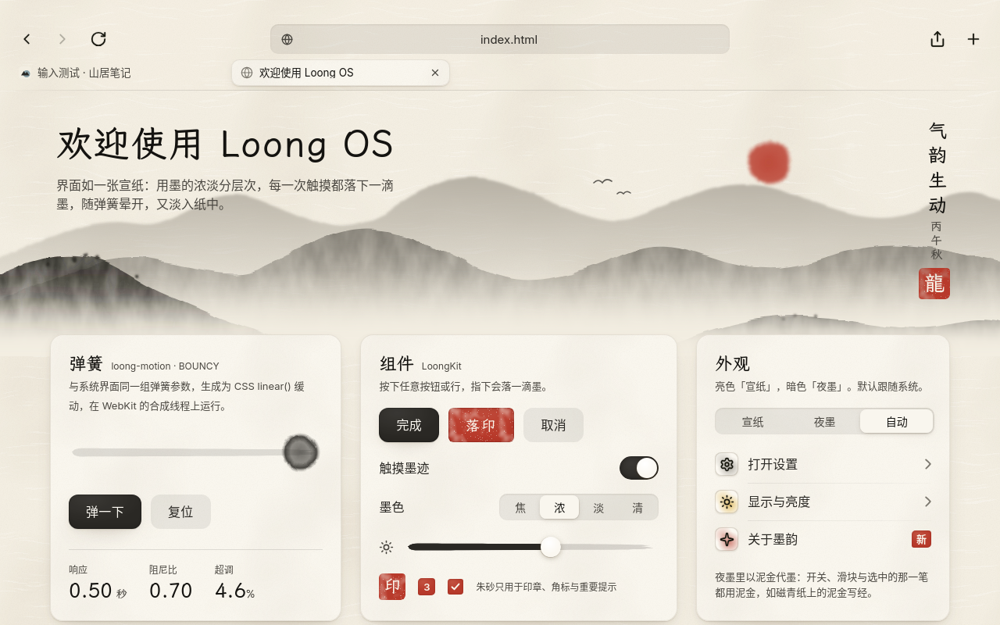
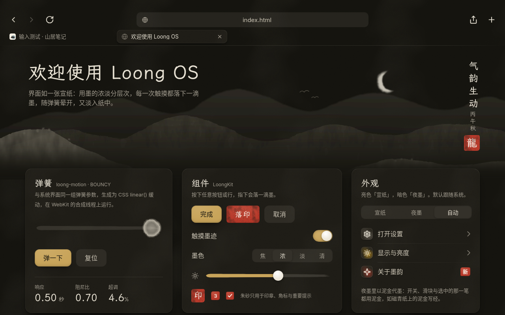
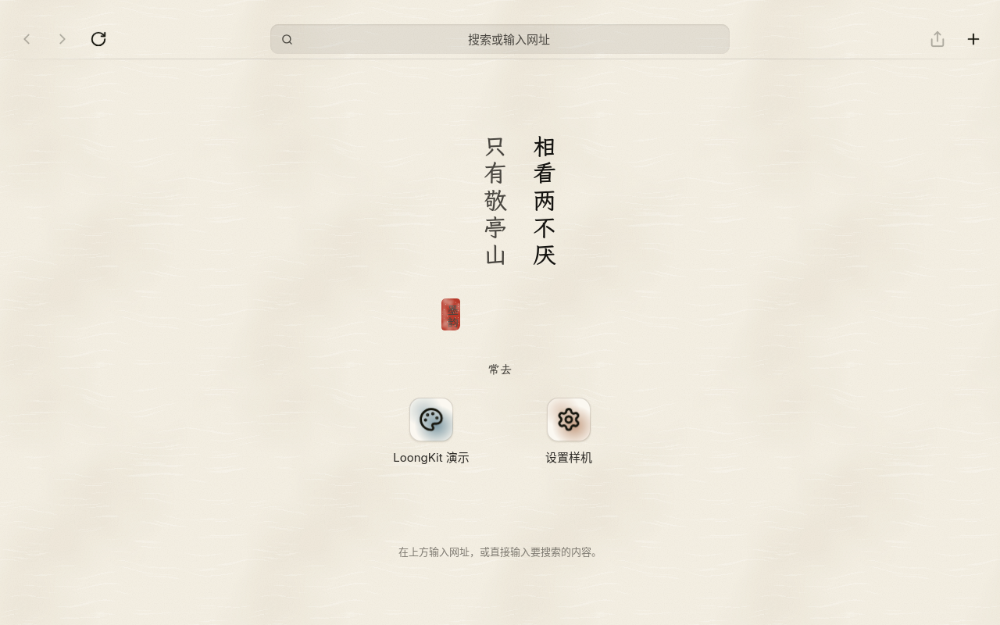
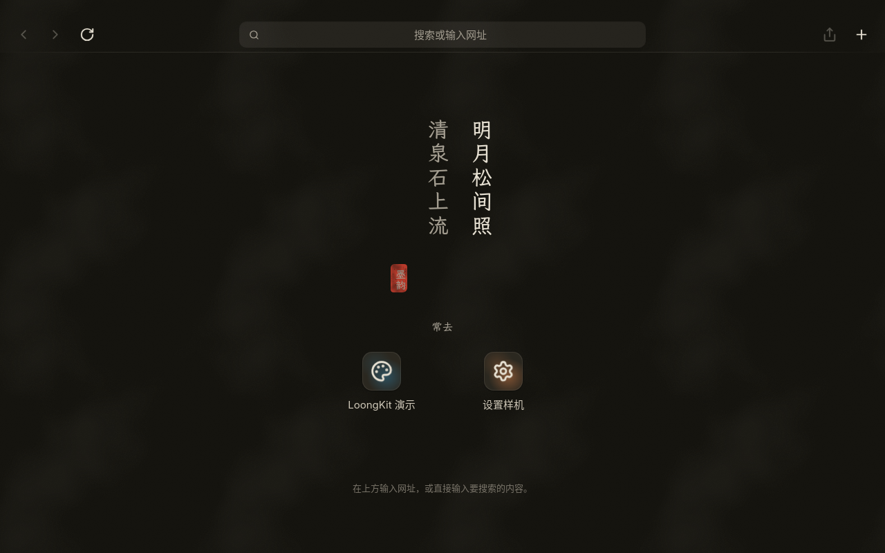
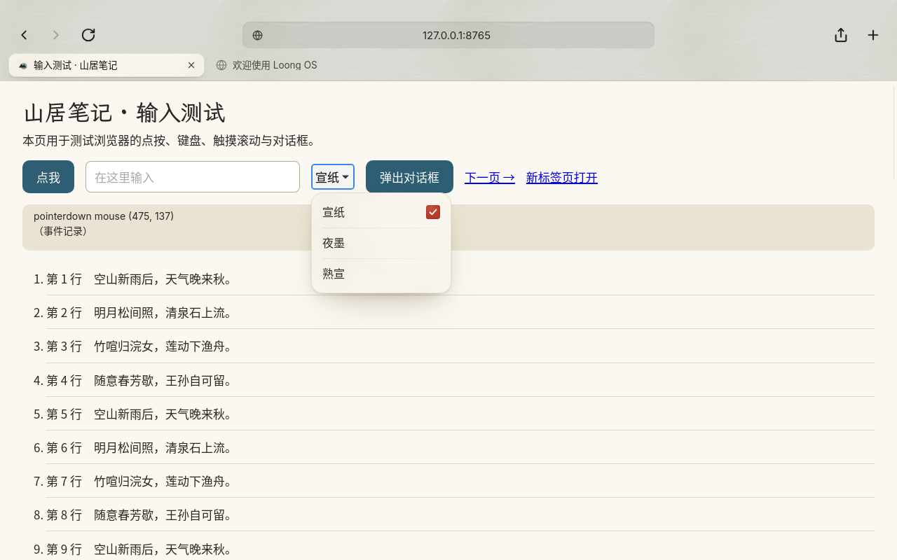
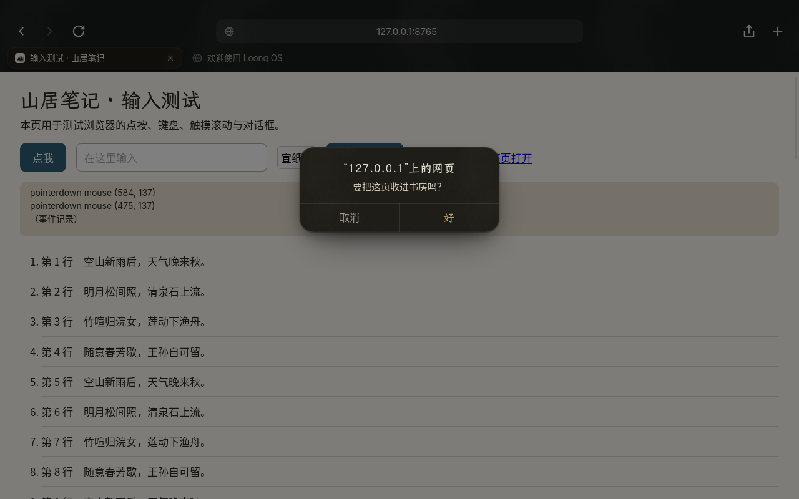
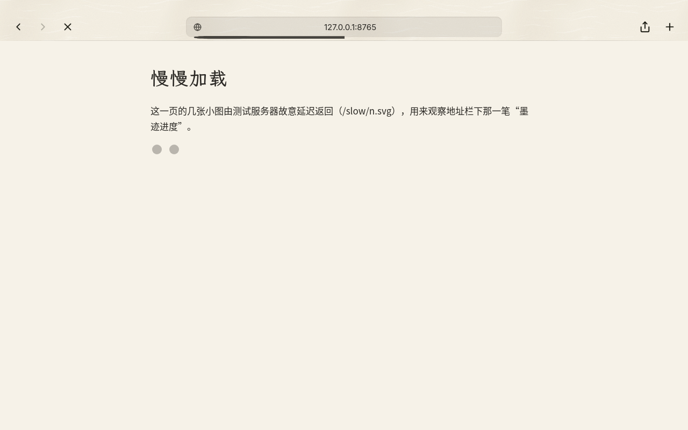
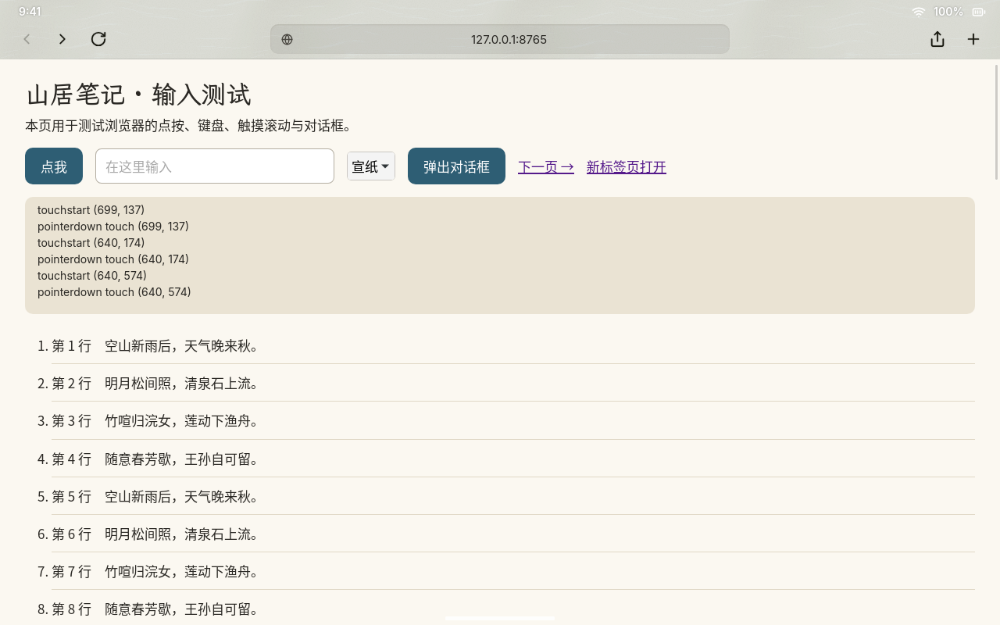

# ADR 0003：Web 内核采用 WPE WebKit 2.54（WPEPlatform API），浏览器使用自写 `loong` WPEPlatform 后端

- **状态**：已接受；`loong` 后端的首选方案已在 M2 实现并验证（见文末“[实现记录（M2）](#实现记录m2loong-后端与浏览器)”）
- **日期**：2026-10
- **相关**：[技术规划 · 关键设计](../技术规划.md#关键设计)、`system/packages/wpewebkit/APKBUILD`、`webrt/platform/`、`webrt/browser/`

## 背景

Loong OS 不建设原生应用生态，所有应用都是 PWA，浏览器要基于 WebKit 开源内核。Web 内核需要满足：

1. **面向嵌入式、资源占用低**，不依赖任何桌面 UI 工具包。
2. **原生支持 Wayland**，能作为 loong-shell 的普通 Wayland 客户端运行。
3. **输入法**：支持 `text-input-v3`，能和合成器内置的 Rime 屏幕键盘配合。
4. **媒体**：通过 GStreamer 播放音视频，nabu 上走 V4L2 Venus 硬解。
5. **多进程与沙箱**：每个 PWA 一个进程，数据目录相互独立；Web 内容进程要有沙箱。
6. **浏览器要能组合“界面（chrome）+ 网页内容”**：地址栏和标签栏与网页内容需要同屏显示。

另外，Alpine 不提供 WPE WebKit，需要自行打包。

## 决策

- 采用 **WPE WebKit 2.54.2**，使用从 2.54 起稳定并成为默认的 **WPEPlatform API**。开启 Wayland 与 Headless 平台后端，关闭 DRM 后端和旧版 libwpe API（`ENABLE_WPE_LEGACY_API=OFF`）。
- **自行打包 APK**（`system/packages/wpewebkit/APKBUILD`），musl 配置参考 Chimera Linux：
  - 编译：clang + lld，`-U_FORTIFY_SOURCE`，不开 LTO，有 ccache 时自动启用。M6 起体积优先：全局 `-Os`，JavaScriptCore / WTF / bmalloc / Skia 用 `-O2`；不生成 `.eh_frame`；lld `--icf=safe`（详见文末“[M6 瘦身记录](#m6-瘦身记录webkit-体积)”）。
  - 关闭：QT_API、DOCUMENTATION、INTROSPECTION、JOURNALD_LOG、WEBDRIVER、SPELLCHECK、GAMEPAD、SPEECH_SYNTHESIS、API/LAYOUT_TESTS；`USE_ATK/FLITE/LIBBACKTRACE/LIBHYPHEN/SYSPROF_CAPTURE=OFF`。M6 起还关闭 MEDIA_STREAM、MEDIA_RECORDER、WEB_RTC、WEB_CODECS、PDFJS、XSLT、GPU_PROCESS、MHTML、MEMORY_SAMPLER、WEBXR、ENCRYPTED_MEDIA、JAVASCRIPT_SHELL 与 `USE_AVIF/JPEGXL`；REMOTE_INSPECTOR、SAMPLING_PROFILER、RESOURCE_USAGE 只在开发构建（APKBUILD 的 `_devtools=ON`）里打开。
  - 保留：BUBBLEWRAP_SANDBOX（运行时依赖 bubblewrap、xdg-dbus-proxy）、GBM、LIBDRM；VIDEO、MEDIA_SOURCE、WEB_AUDIO、GStreamer GL、WEBGL、WEBASSEMBLY 与 FTL JIT、NOTIFICATIONS 等（逐项理由见 M6 瘦身记录）。
  - MiniBrowser 单独打成 `wpewebkit-minibrowser` 子包，仅用于开发测试。
- **运行时组件**放在 `webrt/`（C，meson），直接基于 WPEPlatform 编写：
  - `loong-webapp`：每个 PWA 一个进程，使用独立的 WebKit 数据目录；超出 manifest scope 的导航交给浏览器。
  - `loong-browser`：系统浏览器，负责“添加到主屏幕”（解析 W3C manifest，写入 `~/.local/share/loong/webapps/<id>/`）。
  - 输入法使用 WPE 已有的 `WPEInputMethodContextWaylandV3`（text-input-v3）。
- **自写 `loong` WPEPlatform 后端**（`webrt/platform/`）。调研发现，**WPE 的 Wayland 后端会把一个 toplevel 下的所有 view 画到同一个 `wl_surface` 上**：没有子表面，max-views 默认为 1，浏览器界面和网页内容无法作为两个 view 同屏显示。因此：
  - **首选方案**：`loong` 后端为**每个 view 创建一个 `wl_subsurface`**，并承载 loong 私有协议，传递 app_id、theme-color、状态栏样式，以及启动闪屏交接（合成器绘制的闪屏 → 首帧内容）。webapp 也使用这个后端，以获得私有协议能力。
  - **备选方案**：由 shell 绘制浏览器工具栏，通过私有协议与浏览器进程通信。
  - 这是 **M2 的第一项技术验证**。

## 备选方案及不选原因

| 方案 | 不选原因 |
|---|---|
| **WebKitGTK** | Alpine 有现成的包，但它绑定 GTK 工具包。我们的 UI 不用 GTK，引入 GTK 只会增加体积和内存，而且它面向桌面应用嵌入场景。WPE 是 WebKit 官方面向嵌入式的移植，没有 UI 工具包依赖 |
| **WPE 旧 API：libwpe + WPEBackend-fdo + Cog** | 这是 2.54 之前的方案，多出 libwpe 和后端插件两层间接。2.54 起 WPEPlatform 已稳定并成为默认，自带 Wayland 后端和 text-input-v3 输入法支持。Cog 是通用的单窗口启动器，我们需要自己的运行时（PWA 生命周期、私有协议、数据目录隔离），用不上它 |
| **直接使用 WPE 自带的 Wayland 平台后端** | 一个 toplevel 只有一个 `wl_surface`，无法让界面和内容两个 view 同屏，满足不了浏览器的需求；它也不支持 loong 私有协议（theme-color、状态栏样式、闪屏交接） |
| **Chromium / Blink（CEF、Electron 类方案）** | 不符合“基于 WebKit 开源内核”的产品要求；体积、内存和编译成本也更高 |

## 影响 / 后果

**正面**

- 没有 UI 工具包依赖，WebKit 是 Wayland 客户端，shell 对它和对其他客户端一视同仁。
- 每个 PWA 一个进程、各自独立的数据目录，配合 shell 的 cgroup freezer 冻结和 PSI 回收，资源可控。
- text-input-v3、GStreamer 媒体、bubblewrap 沙箱都是上游现成能力。

**负面与风险**

- **编译成本高**：4 核约需 3–6 小时。GitHub 托管 runner 单个任务最长 6 小时（`wpewebkit.yml` 超时设为 355 分钟）；ARM runner 只对公开仓库免费，私有仓库的 runner 只有 2 核。应对办法：使用 ccache；必要时在开发机或自托管 runner 上构建，再把 APK 发布到 Release。aarch64 不必有 ARM 机器：在 x86_64 上交叉编译（`tools/cross-build-pkg.sh`，4 核 `-j2` 约 3.5 小时），见文末“[aarch64：交叉编译](#aarch64交叉编译)”。
- **打包与升级由我们维护**：每次升级 WPE 都要重新验证 musl 兼容性和编译选项。
- **自写 WPEPlatform 后端是 M2 的关键风险**：如果首选方案受阻，就退回到由 shell 绘制浏览器工具栏。
- **体积与内存**：WebKit 是系统中最大的组件。M6 已按体积重新编译并关掉 v1 用不到的功能（见文末“M6 瘦身记录”）；ICU 数据（`icu-data-loong`，中英文 7 MiB）与字体子集也已完成，见[体积预算](../体积预算.md)；还计划设置 WebKit 内存上限。
- **许可证**：WPE WebKit 采用 LGPL-2.0-or-later AND BSD-2-Clause。我们的组件以动态链接方式使用它，保持 MIT/Apache；如果修改 WebKit 本身，需要按 LGPL 提供修改后的源码。
- **架构**：loongarch64 上的 WebKit 没有 JIT，性能需要单独评估。

## 实现记录（M2）：`loong` 后端与浏览器

首选方案走通了：浏览器界面与网页内容作为两个 WebView、两个子表面同屏显示，备选方案（shell 画工具栏）不再需要。

| 宣纸（亮色） | 夜墨（暗色） |
|---|---|
|  |  |
|  |  |
|  |  |
|  |  |

### 后端怎么工作（`webrt/platform/`，静态库，C/GObject）

| 类型 | 对应 | 要点 |
|---|---|---|
| `LoongDisplay` : `WPEDisplay` | 一个 `wl_display` 连接 | 自己把 Wayland 事件接进 GLib 主循环；必需 `wl_compositor`、`wl_subcompositor`、`xdg_wm_base`、`wl_shm`，可选 `wp_viewporter`、`wp_fractional_scale_v1`、`wp_single_pixel_buffer_v1`、`zwp_linux_dmabuf_v1`（v3/v4）、`zwp_text_input_v3`。第一个创建的 WPEDisplay 就是 WebKit 的主显示 |
| `LoongToplevel` : `WPEToplevel` | 一个 `xdg_toplevel` 窗口 | 根表面只画一层不透明底色（有单像素缓冲 + viewport 时不占内存，否则是整窗大小的 wl_shm 缓冲）；`max-views` 可为 0（不限）；configure 时发 `size-changed` 信号让应用重新布局，布局完再提交根表面 |
| `LoongView` : `WPEView` | 根表面的一个 `wl_subsurface`（desync） | 应用用 `loong_view_set_geometry()` / `loong_view_set_layer()` 决定位置、大小、层次；不设时铺满窗口（与 WPE 自带平台一致，loong-webapp 以后可以直接换用）。隐藏（`wpe_view_set_visible(FALSE)`）= 卸下缓冲，WebKit 随之停画 |
| `LoongScreen` : `WPEScreen` | 一个 `wl_output` | 位置、尺寸、整数缩放、刷新率 |
| `LoongIMContext` : `WPEInputMethodContext` | `zwp_text_input_v3` | 语义同 WPE 自带实现；光标矩形换算到 text-input 进入的那个表面（根表面或子表面） |

**出帧**（WebKit → 合成器）：

- **共享内存**（现在的 CPU 渲染走这条路）：`WPEBufferSHM` 只给出一段内存、没有 fd，不能直接交给合成器。每个 view 自带一组 `wl_shm` 缓冲（交换链，最多 4 个），把 WebKit 的像素拷进去——**只拷这块缓冲落后的区域**（每块缓冲累计本帧以来的损伤包围盒），拷完立刻把 WPEBuffer 还给 WebKit。
- **DMA-BUF**：合成器提供 `zwp_linux_dmabuf_v1` 时用 `create_immed` 零拷贝，`wl_buffer.release` → `wpe_view_buffer_released`；格式与主设备来自 v4 的默认 feedback（或 v3 的 modifier 事件），`get_drm_device()` 由此告诉 WebKit 用哪块 GPU。没有 dmabuf 时不报格式，WebKit 自动走共享内存。不用显式同步（WebKit 自己等渲染 fence）。
- 每次提交都申请 `wl_surface.frame`，回调到达时 `wpe_view_buffer_rendered()`，WebKit 才画下一帧（合成器不发回调时自然停画）。隐藏的 view 改用约 60Hz 的定时器回应；重新显示时直接挂回隐藏前（或隐藏期间）的最新画面，不必等 WebKit 重画。
- **缩放**：分数缩放（`wp_fractional_scale_v1`，用 viewport 目标尺寸 = 缓冲 / 缩放）> `wl_surface.preferred_buffer_scale` > 所在输出的最大 `wl_output.scale`；整数路径用 `wl_surface.set_buffer_scale`。缩放通过 `wpe_toplevel_scale_changed()` 传给所有 view。

**输入**：

- 事件落在某个 view 的子表面上（合成器做了子表面命中测试，如 sway/weston）→ 就是这个 view，坐标是表面坐标。
- 事件落在根表面上（合成器不认子表面，如目前的 loong-shell）→ 后端按 view 的层次与位置自己命中，坐标换算到 view。
- 指针按下后隐式抓取到松开；每个触点在按下时定下目标 view。键盘焦点跟随最后一次按下（点按 / 触摸）的 view，应用可以用 `loong_view_focus()` 指定（例如地址栏回车后把焦点交给网页）。

### 浏览器的拼法（`webrt/browser/`）

- **界面**：`ui/index.html`（LoongKit「墨韵」），最上层（layer 1），平时只占状态栏 24pt + 工具栏 52pt（多于一个标签页时再加 40pt 标签栏），高度由页面自己报告。分享菜单、网页对话框（alert / confirm / prompt / 离开确认）、`<select>` 菜单、提示需要盖住网页时，界面把自己拉到整个窗口（背景透明，网页仍在下面），关掉后缩回。
- **网页**：每个标签页一个 WebView（layer 0），位于界面下方；只有当前标签页的子表面挂在窗口上。网页全屏（视频）时界面隐藏、内容铺满窗口。
- **通信**：界面 → 本进程：`webkit.messageHandlers.loong.postMessage({cmd, …})`（只注册在界面的 UserContentManager 上，网页拿不到）；本进程 → 界面：`loongChrome.update(状态)`（标题、地址、进度、能否后退 / 前进、TLS、theme-color、图标）。图标与 manifest 在网页的隔离 JS world 里读取。
- 地址栏：有协议的原样打开，像主机名的补 `https://`（本机与 IP 补 `http://`），其余交给搜索引擎（`--search-url` 或 `~/.config/loong/browser.ini` 的 `[browser] search-url=`，`%s` 处替换关键词）。
- “添加到主屏幕”：读取并规范化 W3C manifest（相对地址按 manifest 地址解析，start_url 必须同源，scope 默认取 start_url 所在目录；没有 manifest 时用标题、图标和 theme-color 合成），写入 `$XDG_DATA_HOME/loong/webapps/<id>/manifest.json`。`<id>` 由 manifest 的 id（或 start_url）的主机与路径生成，只含 `[a-z0-9-]`，与 loong-webapp 的规则一致。shell 的 inotify 发现与图标生成留给 PWA 注册表。
- 单实例：`$XDG_RUNTIME_DIR/loong-browser.sock`；loong-webapp 把超出 scope 的链接交给 `loong-browser <网址>` 时在已运行的浏览器里开新标签页。

### 验证

- **sway**（wlroots headless + pixman，支持子表面、viewporter、分数缩放、input-method-v2）：`webrt/browser/tests/sway-run.sh` 加常驻虚拟指针 / 键盘 / 输入法 `loong-vinput`。界面与网页同屏；点按、键盘输入网址、前进后退、新标签页（`+` 与 `target=_blank`）、切换标签页、`<select>`、confirm、滚轮、全屏、合成器关闭窗口、单实例；缩放 1 / 1.5 / 2（viewport 与 buffer_scale 两条路径）；输入法预编辑与提交（网页输入框与地址栏）。
- **loong-shell**（headless，`webrt/browser/tests/shell-run.sh`）：从 Dock 图标启动；两个子表面都画出来了，状态栏叠在界面的 24pt 留白上；触摸点按、**触摸滚动网页**、点链接、点工具栏的后退——触摸都发到根表面，由后端命中到正确的 view。

### 限制与待办

- **共享内存要拷贝**：滚动时几乎整帧都脏，每帧拷 1280×800×4 ≈ 4MB（nabu 上 2 倍缩放是 16MB）。合成器支持 linux-dmabuf 且 WebKit 用 GPU 渲染后才能零拷贝。
- 合成器没有 viewporter 时，根表面的底色是整窗大小的缓冲（nabu 上约 16MB）。
- **DMA-BUF 路径已实现、未实测**：开发环境没有 GPU（`LIBGL_ALWAYS_SOFTWARE` 下 WebKit 不会产出 DMA-BUF），测试用的 sway（pixman）也不提供 linux-dmabuf；要在 nabu 上或带 GPU 的合成器里验证。
- 界面的子表面看不到网页的像素，`backdrop-filter` 模糊不到网页，对话框用不透明的素笺代替「绢」。
- 没有：光标主题（平板不需要）、与其他应用共享的剪贴板（只有进程内的 WPE 剪贴板）、指针锁定、拖放、xdg-activation、presentation-time；启动闪屏交接还没有。Loong 私有协议 `loong_app_v1`（状态栏样式、主题色）已加入：浏览器按界面外观指定状态栏样式，网页全屏时改报网页的 theme-color；loong-webapp 在 WPE 自带的 Wayland 平台上也能用它（公开接口取 `wl_display` 与 `wl_surface`，单独的事件队列），见 [loong_app_v1](../api/loong-app-protocol.md)。
- 浏览器功能上：下载、权限授权、历史 / 书签 / 会话恢复都还没有；后台标签页不丢弃（每个标签页一个 Web 进程）；通知没有转发。
- loong-shell 侧还缺的能力（子表面已能显示）：见 README 的“浏览器”一节。

## M6 瘦身记录：WebKit 体积

r0（M0 打的包）的 `libWPEWebKit-2.0.so` 去符号后 123MB，是只读根里最大的单个文件。r1 按体积重新编译、关掉 v1 用不到的功能，**库 123.3MB → 85.2MB，安装大小 119.0MiB → 81.2MiB，镜像的 erofs（lz4hc,12）里 66.2MiB → 44.5MiB；另外少装 7 个依赖包（15.7MiB，压缩后 8.7MiB）。真机配置（mesa-loong）的整个只读根 124.8MiB → 101.0MiB**（`tools/image-size.sh`，同[体积预算](../体积预算.md)）。JS 性能与 r0 持平，DOM/布局类测试慢 3–7%，加载页面后所有 WebKit 进程的 RSS 少约 12%、PSS 少 8–9%。

### 编译参数

| 改动 | 理由 / 实测 |
|---|---|
| 去掉 CMake Release 默认的 `-O3` | `CMAKE_BUILD_TYPE=Release` 会把 `-O3 -DNDEBUG` 追加在 CFLAGS 之后，**r0 名义上 `-O2`，实际是 `-O3`**。现在 `CMAKE_{C,CXX}_FLAGS_RELEASE=-DNDEBUG`，优化级别只由 CFLAGS 与目标选项决定 |
| 全局 `-Os`，热点目标 `-O2` | `loong-opt-targets.cmake` 经 `CMAKE_PROJECT_INCLUDE` 加载，等所有目标定义完再给 `LOONG_O2_TARGETS` 里的目标追加 `-O2`（不改 WebKit 源码）。`-O2` 的有：JavaScriptCore（含子目标 JavaScriptCoreJIT）、WTF、bmalloc、Skia，以及 WebCore 的 WebCoreStyle、WebCoreDOMAndRendering、WebCoreJSBindings 子目标；其余（WebCore 的 platform/Modules/loader、WebKit 的 IPC 与 UI 进程、ANGLE、PAL）用 `-Os`。只给 JSC/WTF/bmalloc/Skia `-O2` 时库是 78.6MB，但 DOM、innerHTML+布局测试比 r0 慢 16–18%；加上三个 WebCore 子目标后库 85.2MB（+6.6MB），只慢 3–7%。系统界面和所有应用都是网页，选后者 |
| `-fno-asynchronous-unwind-tables -fno-unwind-tables` | r0 里 `.eh_frame` + `.eh_frame_hdr` 共 12.5MiB。WebKit 全部 `-fno-exceptions`，库里没有任何 `_Unwind_*` 调用（不做 DWARF 栈回溯，`USE_LIBBACKTRACE=OFF`），没有 C++ 异常要穿过 WebKit 的栈帧。WebKit 会把 `-fasynchronous-unwind-tables` 前置到 CXXFLAGS，我们的标志在后面生效。代价：gdb/perf 在 WebKit 帧里的回溯不如以前可靠（aarch64 上 LLInt 自带的 `.cfi` 指令不受影响） |
| lld `--icf=safe`、`-O2` | 同一棵构建树重新链接比较：不合并 84.3MB，`--icf=safe` 78.6MB，`--icf=all` 77.8MB。`all` 只再省 0.8MB，但 JSC 会拿函数指针当身份标识选快路径（方法表函数与 `JSObject` 默认实现比较、宿主函数与 `callHostFunctionAsConstructor` 比较），不同函数合并成同一地址可能走错路径，所以用 `safe`。`-ffunction-sections -fdata-sections --gc-sections` WebKit 自己已经加了 |
| 不开 LTO | ThinLTO 链接 WebKit 要 10GB 以上内存、时间翻倍，开发机（4 核、约 15GB、多人共用）上不现实；以后在 CI 或自托管 runner 上再评估 |

库的组成（`size -A`，MiB）：

| 段 | r0 | r1 |
|---|---|---|
| `.text` | 88.9 | 69.1 |
| `.eh_frame` + `.eh_frame_hdr` | 12.5 | 0 |
| `.rodata` | 8.4 | 8.0 |
| PDF.js 资源（`.gresource.PdfJS…`） | 3.5 | 0 |
| `.data.rel.ro` | 3.2 | 3.0 |

### 功能开关

v1 的要求：PWA、系统浏览器、GStreamer 音视频、WebGL 与 GPU 合成、JS bridge（脚本消息处理器）、text-input-v3 输入法、暗色模式。逐项对照后：

| 开关 | 取舍 | 理由 |
|---|---|---|
| MEDIA_STREAM、MEDIA_RECORDER、WEB_RTC | 关 | 摄像头不纳入 v1（技术规划），浏览器与 loong-webapp 也一律拒绝权限请求。WEB_RTC 在 WPE 上本来就默认关 |
| WEB_CODECS | 关 | 底层编解码 API；`<video>`/`<audio>`/MSE 播放不依赖它 |
| PDFJS | 关 | 内置 PDF 阅读器，3.5MiB 的 JS 资源。PDF 现在按“不能显示的内容”处理：浏览器提示“暂不支持下载文件”（v1 本来就没有下载） |
| XSLT | 关 | 网页几乎不用，主流浏览器也在移除；去掉 libxslt |
| `USE_AVIF`、`USE_JPEGXL` | 关 | 网站会经 `<picture>` / Accept 回退到 WebP/JPEG。去掉 libavif（连带 aom-libs 8MiB、libdav1d、libyuv）与 libjxl（连带 libhwy） |
| GPU_PROCESS | 关 | WPE 上 WebGL、媒体、DOM 绘制默认都不走 GPU 进程（`UseGPUProcessFor*` 默认关），WebGL 在 Web 进程里经 ANGLE 渲染、GPU 合成也不经过它；关掉后不编译 GPU 进程及其 IPC，也不再有 `WPEGPUProcess`。上游在 `USE_GBM=OFF` 时也会自动关掉它 |
| MHTML、MEMORY_SAMPLER、WEBXR、ENCRYPTED_MEDIA、JAVASCRIPT_SHELL | 关 | 用不到；WEBXR / ENCRYPTED_MEDIA 本来就默认关（实验功能 / 需要 Thunder）；`jsc` 命令行本来就不安装 |
| REMOTE_INSPECTOR、SAMPLING_PROFILER、RESOURCE_USAGE | 跟随 `_devtools`（默认关） | 只服务于调试；RESOURCE_USAGE 还会让 GC 多做内存统计。开发构建把 APKBUILD 的 `_devtools` 改成 `ON`：打开远程 Web Inspector（`WEBKIT_INSPECTOR_HTTP_SERVER=127.0.0.1:9222` 等），并安装 `inspector.gresource`（1.3MiB，发布构建不装） |
| VIDEO、MEDIA_SOURCE | 留 | 音视频播放；MSE 给流媒体网站 |
| `USE_GSTREAMER_GL` | 留 | 关掉后视频改走 WebKit 的后备 sink，它只收系统内存里的帧：nabu 上 V4L2 硬解出来的 DMA-BUF 要逐帧拷贝、再由 CPU 上传，失去 GstGL 的零拷贝（DMA-BUF → EGLImage）。而且省不下东西：`libgstgl` 属于 gst-plugins-base，WebKit 无论如何要用同一个包里的 app/video/audio/pbutils 库，它和它对 `libGL.so.1` 的依赖（mesa-loong 的 glx-stub）都还在 |
| WEB_AUDIO | 留 | 游戏、音乐类应用，以及很多网页的提示音 |
| WEBGL、WEBASSEMBLY、FTL JIT | 留 | v1 要求 WebGL；Wasm 与 FTL 关系到应用性能 |
| NOTIFICATIONS、MEDIA_SESSION、CONTENT_EXTENSIONS | 留 | PWA 通知；以后做系统媒体控制、浏览器广告拦截 |
| `USE_LCMS` | 留 | 带 ICC 配置的照片颜色正确（lcms2 只有 332KiB） |
| WOFF2 | 留 | Alpine 的 FreeType 自带 WOFF2 解码，`USE_WOFF2` 自动关、不依赖 libwoff2 |
| DARK_MODE_CSS、TOUCH_EVENTS、BUBBLEWRAP_SANDBOX | 留 | 暗色模式、触摸、沙箱 |

### 实测

**体积**（x86_64）：

| | r0 | r1 |
|---|---|---|
| `libWPEWebKit-2.0.so.1.11.5`（去符号） | 123.3MB | 85.2MB |
| `wpewebkit` 安装大小 | 119.0MiB | 81.2MiB |
| `wpewebkit` APK 文件 | 47.0MB | 31.0MB |
| 只读根里的 `wpewebkit`（erofs lz4hc,12） | 66.2MiB | 44.5MiB |
| 只因 WebKit 才装的依赖 | aom-libs、libavif、libdav1d、libhwy、libjxl、libxslt、libyuv：15.7MiB（erofs 8.7MiB） | 无 |

| 真机配置（`MESA_FLAVOR=loong`、`WITH_WPE=1`）的整个只读根（`tools/image-size.sh`） | 124.8MiB，267.5MiB 文件，176 个包 | **101.0MiB**，215.4MiB 文件，169 个包 |

按包单独压缩估算，`wpewebkit` 50.3 → 34.0MiB；整个只读根少 23.8MiB（另有 7 个依赖包）。

**性能**（chroot 里无屏幕 WPE，CPU 渲染；r0 与 r1 交替运行 6 轮取中位数，机器上同时有别的构建，单项波动约 ±5%）：

| | r0 | r1 | 变化 |
|---|---|---|---|
| JS 引擎类（整数循环、对象分配、字符串、排序、正则、JSON、Map/Set、解析） | — | — | 各项都在 ±3% 内 |
| DOM 创建 + 布局（热） | 206ms | 218ms | +6% |
| innerHTML 表格 + 布局 + getComputedStyle（热） | 660ms | 678ms | +3% |
| Canvas 2D（热） | 353ms | 322ms | −9%（噪声范围） |
| 基准合计（热 / 首轮） | 2983 / 3428ms | 2995 / 3569ms | +0.4% / +4% |
| `webrt/demo` 冷启动到 load-finished | 599ms | 521ms | 噪声范围 |
| 浏览器起始页冷启动到 load-finished | 200ms | 197ms | 持平 |
| 加载起始页后所有进程 RSS / PSS | 469 / 316MiB | 409 / 287MiB | −13% / −9% |

基准页、对比脚本与功能自检页的思路：一个链接 r0 头文件的小程序用 WPE 的 headless 平台加载页面、计时、调用页面里的 `runBench()`，再用 `LD_LIBRARY_PATH` 指向解包出来的 r1 库（子进程继承），两个版本跑同一个可执行文件。

### 功能验证

- **无屏幕 WPE（chroot，`LD_LIBRARY_PATH` 指向 r1）**：`<video>`（Ogg Theora + Vorbis，HTTP Range）播放、帧画进 canvas；WebGL 2.0 清屏读像素；`OfflineAudioContext` 渲染正弦波；WOFF2 字体加载；`prefers-color-scheme: dark` 跟随 WPE 的暗色设置；脚本消息处理器带回复（JS bridge 的机制）；MSE 可用。关掉的接口确实不存在（`navigator.mediaDevices`、`MediaRecorder`、`VideoDecoder`、`XSLTProcessor`），保留的都在（Service Worker、IndexedDB、Cache、Notification、Wasm、OffscreenCanvas、mediaSession、TouchEvent）。
- **无屏幕 loong-shell + r1**（`crates/loong-shell/tests/scripts/keyboard-webkit.json` 等，`LD_LIBRARY_PATH` 指向 r1）：屏幕键盘在 loong-webapp 的页面里打出“你好，世界。”（拼音 + 候选，经 text-input-v3）；浏览器页面输入框打出“山水”、地址栏打 loong；设置（假 sysfs + loong-sysd + JS bridge）拖动亮度滑块写入背光、切换夜墨外观、“关于本机”显示 WPE WebKit 2.54.2。
- **QEMU 整机（r1 打的 qemu-x86_64 镜像，沙箱开启）**：Web 进程都在 bubblewrap 里（各自的 mount 命名空间，映射 r1 的库）；设置、浏览器正常；浏览器打开功能自检页，WebGL 2.0、WOFF2、Web Audio 正常，`<video>` 画面在走（需要下面说的 autodetect 插件）；网页输入框用屏幕键盘打 nihao 出现拼音预编辑，点候选上屏“你好”（TCG 很慢，脚本的点按偶尔丢失，两轮里有一轮完整上屏）。

### 发现的问题（不在本包范围）

- **镜像里播放任何 `<video>`/`<audio>` 都会让 Web 进程崩溃（r0 同样）**：WebKit 的 `createAutoAudioSink()` 直接用 gst-plugins-good 里的 `autoaudiosink`，找不到就对空指针连信号、随后崩溃；镜像只有 gst-plugins-base（随 wpewebkit 的依赖装进来）。镜像需要装 gst-plugins-good（至少 autodetect 插件；WebKit 调播放速率用的 `scaletempo` 也在里面）以及实际的音频输出（PipeWire 的 GStreamer 插件或 ALSA）。H.264/VP9/AV1 等解码器同样不在镜像里（`canPlayType` 只认 Ogg Theora/Vorbis/Opus），nabu 上要配 V4L2 硬解插件。在 chroot 里只让 GStreamer 看到镜像里的那 35 个插件即可复现；用 QEMU 验证时是把 autodetect 插件放在测试盘上、用 `GST_PLUGIN_PATH` 指过去（沙箱会绑定这个目录）。**已解决**：镜像装上自编的最小插件集 `gst-plugins-loong`（autodetect、解封装、VP8/VP9、MP3、V4L2 硬解等），QEMU 中 WebM、Ogg、MSE、`<audio>`、Web Audio 都能播放，见[媒体格式](../媒体格式.md)。
- bubblewrap 在开发 chroot 里起不来（`bwrap: Failed to make / slave`），沙箱只能在 QEMU 或真机上验证。

## aarch64：交叉编译

开发机是 x86_64，nabu 是 aarch64。WebKit 在 aarch64 的 Alpine 构建 chroot 里经 qemu-user 编译（mesa-loong 就是这样打包的）要好几天，所以改为在 x86_64 开发 chroot 里交叉编译：`tools/cross-build-pkg.sh wpewebkit` 用 abuild 自带的交叉模式（`CHOST=aarch64`、`CBUILDROOT=<sysroot>`），clang/lld 原生运行，sysroot 由 `apk --root --arch aarch64` 安装（不运行任何 aarch64 程序），CMake 工具链文件是 `tools/cross/aarch64-alpine.cmake`。WebKit 本身支持交叉编译：构建时运行的都是 Perl/Python/Ruby 脚本和宿主机工具，LLInt 的偏移量由 offlineasm 从交叉编译出的 `LLIntOffsetsExtractor` 二进制里读出，不需要运行它。APKBUILD 只做了两处改动：`makedepends` 分成 `makedepends_build` / `makedepends_host`，交叉编译时显式给出 `bwrap`、`xdg-dbus-proxy` 的路径；体积参数与功能开关不变。

结果（2026-11，4 核开发沙箱，`-j2`，与其他构建共用 CPU）：3 小时 28 分；`wpewebkit-2.54.2-r1` aarch64 APK 30.4 MB，安装后 79.8 MiB（x86_64 31.0 MB / 81.2 MiB），`libWPEWebKit` 83.6 MB（`.text` 71.5 MB）；JIT、DFG、FTL、WebAssembly 都开启（aarch64 的默认）。nabu 带 WebKit 的完整镜像只读根 141.4 MiB（squashfs lz4hc），QEMU aarch64 中设置与浏览器正常。步骤与验证见 [nabu 适配说明 · 交叉编译 WPE WebKit](../devices/xiaomi-nabu.md#交叉编译-wpe-webkitaarch64)。
