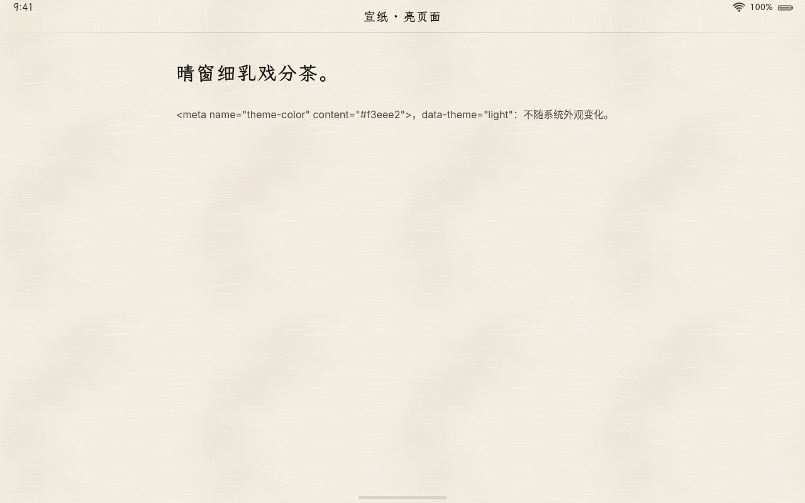
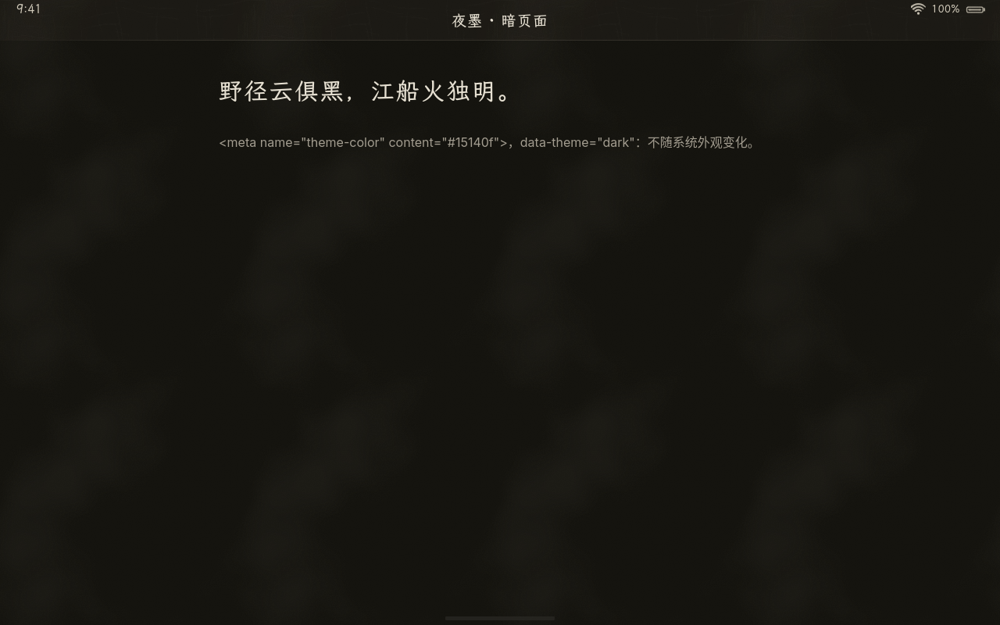
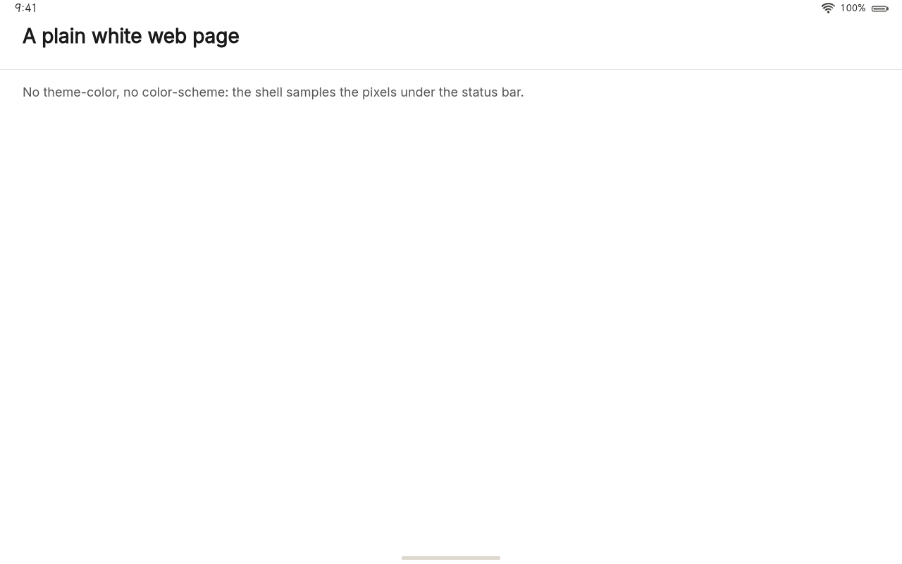
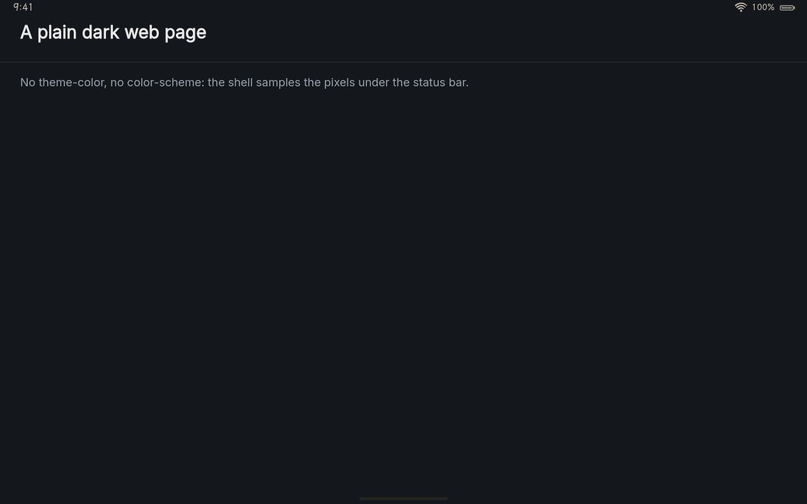
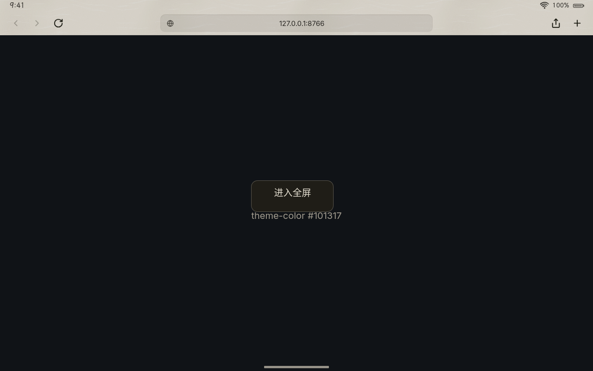
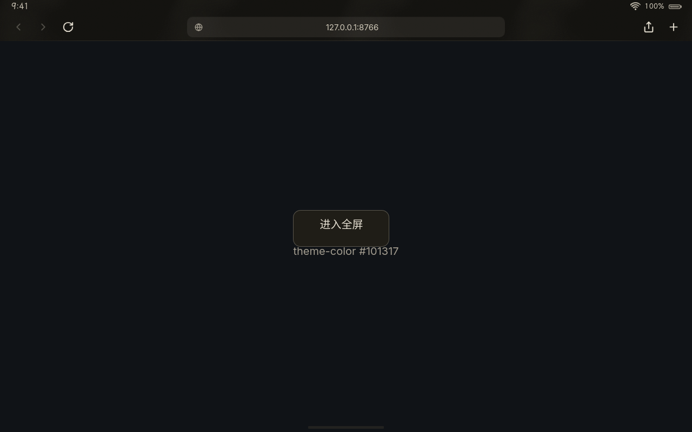
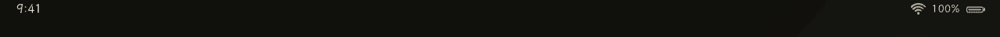
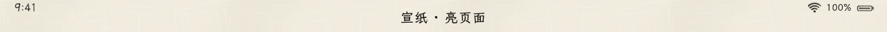
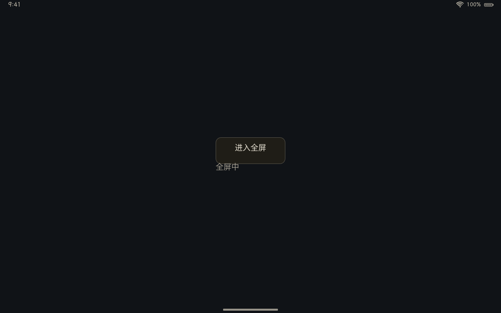
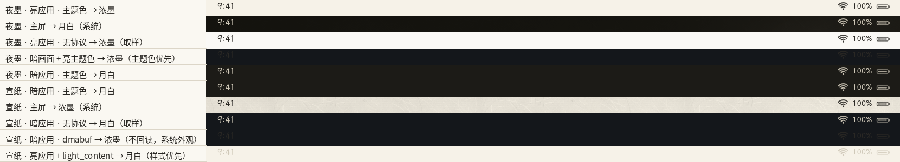

# loong_app_v1：应用与系统界面的私有 Wayland 协议

> 状态：v1（状态栏样式、主题色）已实现：loong-shell 服务端、loong-webapp（WPE 自带 Wayland 平台）与 loong-browser（loong 平台后端）客户端；无屏幕 loong-shell 中用真实客户端端到端验证（[第 5 节](#5-验证)）。启动闪屏交接等后续能力以新版本加入。

| 系统夜墨 · 宣纸网页（主题色 → 浓墨） | 系统宣纸 · 夜墨网页（主题色 → 月白） |
|---|---|
|  |  |
| **系统夜墨 · 没有 theme-color 的白网页**（取样 → 浓墨） | **系统宣纸 · 没有 theme-color 的深色网页**（取样 → 月白） |
|  |  |
| **系统夜墨 · 浏览器界面固定宣纸**（样式 `dark_content`） | **系统宣纸 · 浏览器界面固定夜墨**（样式 `light_content`） |
|  |  |

**交叉淡化**（全分辨率的顶部一条；夜墨：多任务 → 打开亮应用 → 回多任务；宣纸：亮应用 → 多任务 → 打开暗应用）：





## 1. 为什么需要

状态栏（时间、Wi‑Fi、电量）由 loong-shell 画在每个全屏应用顶部的 24pt 上（[设计规范 §8.2](../design/设计规范.md#82-状态栏)）。只跟随系统外观时，应用内容与系统外观不一致就看不清：系统是夜墨、网页是白的，月白的字落在白底上；或者反过来。系统界面看不到应用的“意图”，只能看到像素，而 GPU 缓冲的像素合成器也不该回读。

于是让应用告诉系统：顶部是什么颜色，或者干脆指定用哪种墨。

## 2. 协议

XML：[`protocols/loong-app-v1.xml`](../../protocols/loong-app-v1.xml)（仓库顶层，MIT OR Apache-2.0）。放在顶层而不是某个组件里，因为两边都用它：loong-shell 用 `wayland-scanner`（Rust crate）在编译时生成服务端代码，webrt 用 `wayland-scanner`（C 工具）在 meson 里生成客户端代码。

| 对象 | 请求 | 说明 |
|---|---|---|
| `loong_app_manager_v1`（全局，v1） | `get_app_surface(new_id loong_app_surface_v1, object wl_surface)` | 为应用 toplevel 的**根表面**建立对象；同一表面第二次建立是协议错误 `already_constructed` |
| | `destroy` | 已建立的对象不受影响 |
| `loong_app_surface_v1` | `set_status_bar_style(uint style)` | `auto = 0`（默认）、`dark_content = 1`（浓墨，深色字形，顶部是亮的）、`light_content = 2`（月白，浅色字形，顶部是暗的）；未知值是协议错误 `invalid_style` |
| | `set_theme_color(uint argb)` | 顶部区域（状态栏下方）的颜色 `0xAARRGGBB`，非预乘；alpha 为 0（包括 `0`）表示没有；半透明的颜色合成到系统外观的纸色上再比较 |
| | `destroy` | 样式回到 `auto`、主题色清除 |

约定：

- **立即生效，不随 `wl_surface.commit` 双缓冲。** 换墨本来就有约 0.75 秒的交叉淡化，与某一帧画面精确同步没有意义；而 WebKit 等工具包掌握着表面的提交时机，应用为改个颜色去提交表面既别扭又危险（可能提前提交工具包挂起的状态）。
- 状态挂在 `wl_surface` 上：表面先销毁时对象变成惰性对象（请求被忽略），对象销毁或客户端断开时状态复位。
- v1 只看 toplevel 的根表面；为子表面建立的对象被接受，但不起作用。
- 协议只有请求、没有事件。全局对象只有 loong-shell 提供，客户端必须把它当作可选的（在别的合成器上照常运行）。

## 3. 状态栏用哪种墨

两种墨都取「浓墨」级：浓墨 `#2A2824`（宣纸调色板）与月白 `#CFC8B8`（夜墨调色板）。实现在 `crates/loong-shell/src/shell/status.rs`（决定与淡化）与 `status_sample.rs`（取样）。

### 3.1 什么时候看应用

- **锁屏**（盖住大半屏幕时）、**主屏**、**多任务**：始终跟随系统外观。
- **应用卡片**（前台的、正在打开的、正在飞回主屏的）盖住状态栏区域（屏宽 × 24pt）的一半以上、且内容已经显现（首帧到达、透明度过半）时，用这个应用的墨。打开应用时卡片快铺满屏幕才换；回主屏时卡片一离开顶边就换回来。没有窗口的演示应用（占位画面按系统外观画）跟随系统外观。

### 3.2 决定顺序

1. **显式样式**：`set_status_bar_style` 不是 `auto` 时直接用。
2. **主题色**：`set_theme_color` 给了颜色时，取与它 **WCAG 2.x 对比度**更高的那种墨（`loong_ui::theme::contrast_ratio`；两种墨的分界在相对亮度约 0.16，相等时用浓墨）。
3. **取样**：读状态栏下方应用画的像素（见下）。
4. **系统外观**：宣纸用浓墨，夜墨用月白。

### 3.3 取样

- 取窗口表面树中盖住状态栏区域一半以上的**最上层**表面（普通应用是根表面，浏览器网页全屏时是网页的子表面），只看它落在状态栏区域里的那一块，按 viewport 与缓冲缩放换算到缓冲像素。
- **只读 CPU 能直接读的缓冲**：`wl_shm`（ARGB / XRGB / ABGR / XBGR8888）与单像素缓冲。dmabuf 等 GPU 缓冲**不回读**（要等 GPU、打断流水线），直接退回系统外观。
- **只在需要时重新取样**：提交的损坏区域与这一块相交、或这一块的位置、纸色变了才读；结果缓存在表面上，其余帧只比较提交计数。只在前台应用需要取样时（样式为 `auto` 且没有主题色）才看。
- **降采样**：至多 64 × 4 个点，每个点按对比度“投票”（浓墨更清楚的算亮）；半透明像素合成到卡片的纸色上。投票而不是取平均色：顶部的小块高对比图案（标志、头像）不至于把结论拉偏。
- **回差**：亮点过半用浓墨；但已经是某种墨时，要越过一半再多 10% 才换，内容在临界处时不来回跳。

### 3.4 交叉淡化

两种墨的状态栏位图（时间、`ink::wifi`、百分比、`ink::battery`）都预先画好，与系统外观无关。目标墨变化时，混合值用 `SMOOTH` 弹簧（0.5 s，临界阻尼）从一种墨过渡到另一种：占多数的墨在下层、不透明，另一种墨按份额叠在上面——字形完全重合，任何时刻都是实的，不会在中途变淡；停稳后只剩一种墨。系统外观切换时（例如在主屏上从宣纸换成夜墨）状态栏同样淡过去。

## 4. 应用怎么用

| 应用 | 做法 |
|---|---|
| 顶部跟随系统外观的应用（LoongKit 页面默认如此） | 什么都不用做；最好写 `<meta name="theme-color">`（亮暗各一条，带 `media`），loong-webapp 会转告 |
| 顶部颜色与系统外观无关的应用（强制亮色或暗色、图片、视频、地图） | 设主题色；颜色复杂时直接设样式 |
| 自己画浅色或深色工具栏的应用（浏览器） | 按工具栏的外观设样式 |

### 4.1 loong-webapp（WPE 自带的 Wayland 平台）

`webrt/webapp/loong-app-surface.c`：

- 用 WPEPlatform 的公开接口拿 Wayland 对象：`wpe_display_wayland_get_wl_display(WPE_DISPLAY_WAYLAND(display))` 与 `wpe_toplevel_wayland_get_wl_surface(WPE_TOPLEVEL_WAYLAND(toplevel))`（头文件 `<wpe/wayland/wpe-wayland.h>`，pkg-config `wpe-platform-wayland-2.0`）。其他平台（headless、DRM）不是 `WPEDisplayWayland`，什么也不做。
- WPE 不认识这个协议，它的事件由 WPE 自己的 GSource 分发。这里在同一连接上建一个**单独的事件队列**（`wl_display_create_queue` + 代理包装 `wl_proxy_create_wrapper`），在这个队列上做注册表往返、绑定 `loong_app_manager_v1`，随后销毁注册表。协议没有事件，这个队列之后不需要再分发；请求发出后立即 `wl_display_flush`。
- 页面主题色：`webkit_web_view_get_theme_color` + `notify::theme-color`（随 `prefers-color-scheme` 切换的 `<meta name="theme-color" media=…>` 也会触发）。
- 页面**没有主题色时发 0（未设置）**，而不是替页面报系统纸色：loong-shell 读得到像素（共享内存缓冲）就按像素——白底的普通网页在夜墨系统里也能得到浓墨；读不到（GPU 缓冲）再按系统外观，结果与报纸色相同。

### 4.2 loong-browser（loong 平台后端）

`webrt/platform/` 在注册表里绑定 `loong_app_manager_v1`，每个 `LoongToplevel` 建立时为根表面建立 `loong_app_surface_v1`：

```c
void loong_toplevel_set_status_bar_style(LoongToplevel *toplevel, LoongStatusBarStyle style);
void loong_toplevel_set_theme_color(LoongToplevel *toplevel, guint32 argb);
gboolean loong_display_has_app_protocol(LoongDisplay *display);
```

浏览器（`update_status_bar`）：平时窗口顶部是界面（宣纸 / 夜墨，跟随系统外观或 `--theme`），亮界面设 `dark_content`、暗界面设 `light_content`，主题色报界面的纸色；**网页全屏**时界面隐藏、顶部是网页，样式改回 `auto`、主题色用网页的 theme-color（没有时为 0，由合成器取样或按系统外观）。



### 4.3 其他客户端

用任何 Wayland 客户端库按 XML 生成代码即可；Rust 客户端的例子见 `crates/loong-shell/tests/statusbar.rs`（`wayland_scanner::generate_client_code!`）。不用这个协议的应用照样有自适应状态栏（取样），只是限于共享内存缓冲。

## 5. 验证

- **单元测试**（`cargo test -p loong-shell`）：决定顺序、对比度选择、半透明主题色、卡片覆盖率、交叉淡化（`shell/status.rs`）；取样的字节序、透明像素、X 格式、降采样、越界（`status_sample.rs`）；系统外观下的主屏、演示应用、多任务与切换外观时的淡化（`shell/tests.rs`）。
- **集成测试**（`crates/loong-shell/tests/statusbar.rs`，真实 Wayland 客户端、无屏幕 loong-shell，夜墨与宣纸各跑一次）：主题色、取样、主题色优先于取样、样式优先于主题色、dmabuf 不取样、多任务与回主屏跟随系统外观、经多任务切换。各步的状态栏：

  

- **真实 WebKit 客户端**（`webrt/tests/statusbar-headless.sh dark|light`）：loong-webapp 打开固定宣纸 / 夜墨的 LoongKit 页面（`webrt/tests/statusbar/light.html`、`dark.html`）、没有 theme-color 的普通网页（`plain-*.html`，取样），loong-browser 以与系统相反的外观打开深色网页再进入网页全屏（`fullscreen.html`），最后经多任务在亮、暗应用之间切换并录下顶部一条。loong-shell 日志里记下每次换墨的依据，例如 `状态栏：浓墨（应用主题色 #f3eee2）`、`状态栏：浓墨（取样）`、`状态栏：浓墨（应用指定的样式）`。

## 6. 已知限制

- **dmabuf 不取样**：真机上 WebKit 用 GPU 渲染、以 dmabuf 提交，取样不起作用；这时只有协议（loong-webapp 转告页面主题色，浏览器指定样式）。没有主题色、又不跟随系统外观的网页，在真机上状态栏仍按系统外观。
- **第三方 Wayland 应用**不认识这个协议，只能靠取样（共享内存缓冲）；GPU 渲染的第三方应用跟随系统外观。
- 取样只看盖住状态栏区域的最上层表面，不合成整个表面树（半透明的子表面按卡片纸色合成，不看它下面的表面）；缓冲变换（旋转）时不取样。
- 一种墨对应整条状态栏：顶部左右颜色不同（左边深色侧栏、右边浅色正文）时按多数决定，时间与右侧图标不会各用各的墨。
- Home 指示条仍按系统外观的墨色（设计规范 §8.3 的自适应留待后续，可复用同一套取样）。
