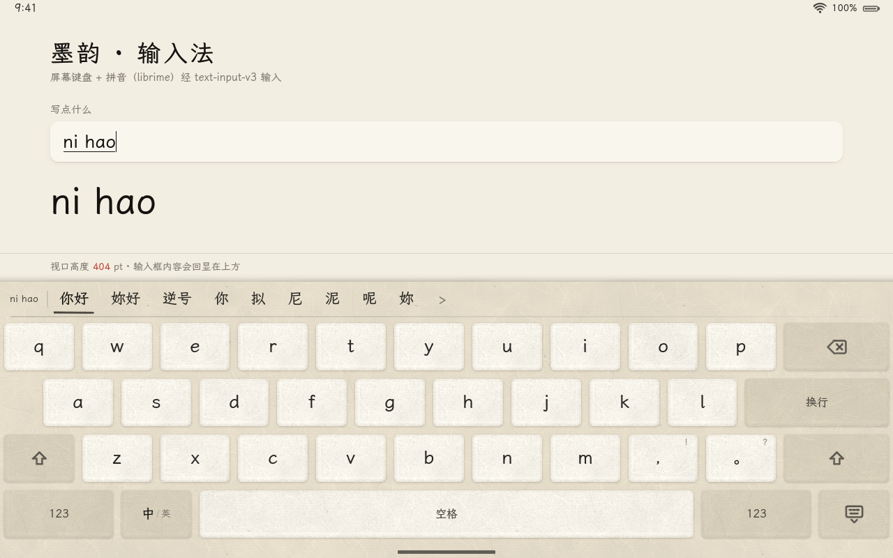
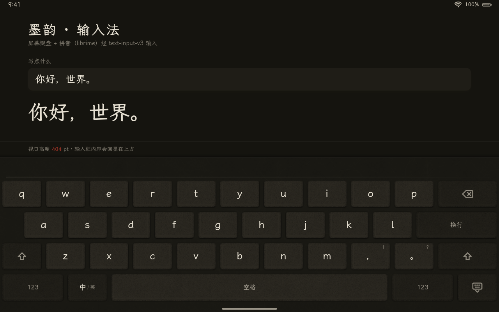
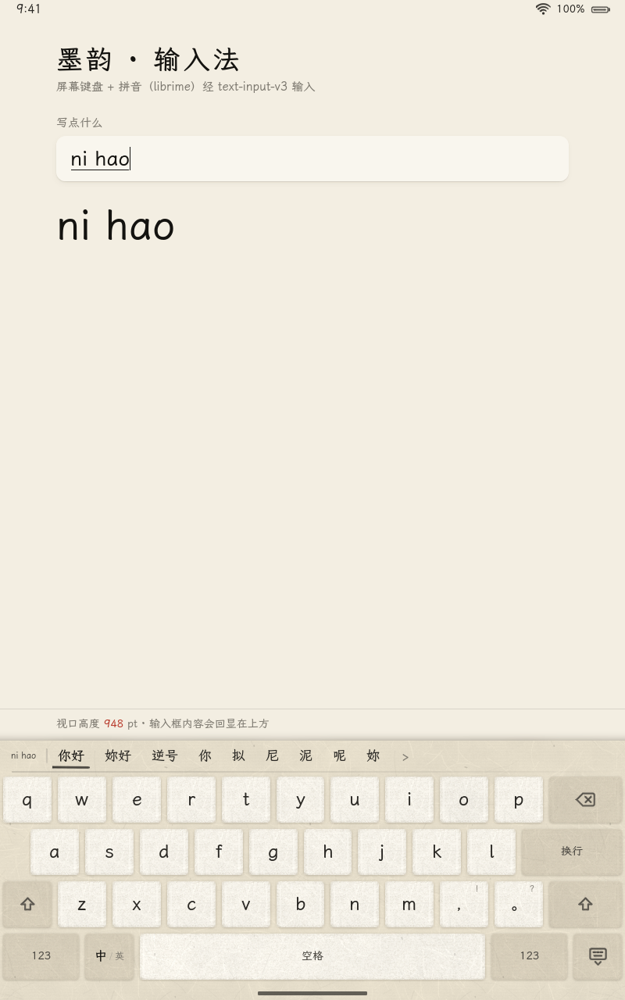
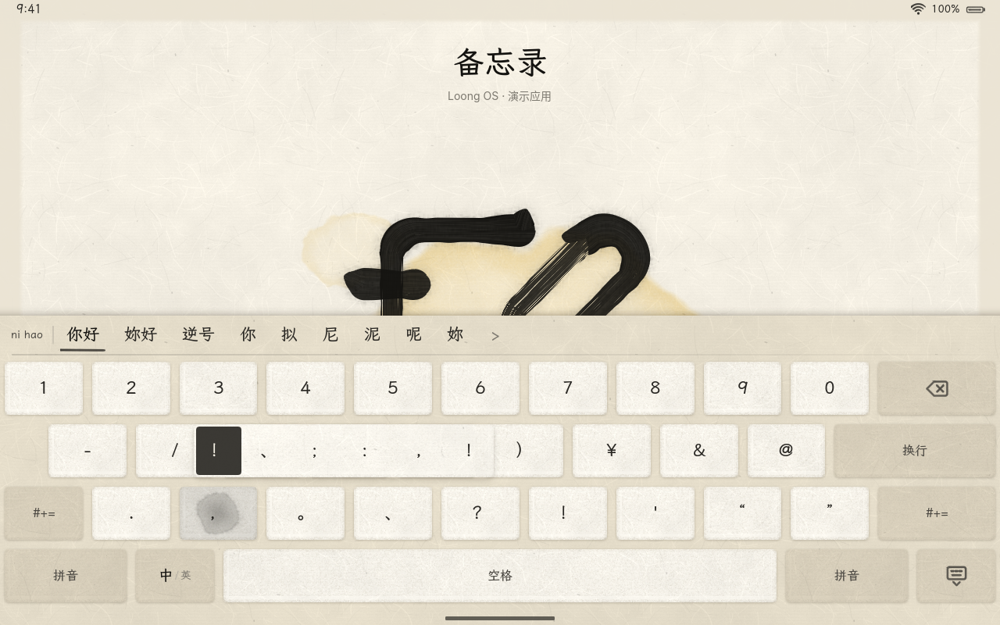
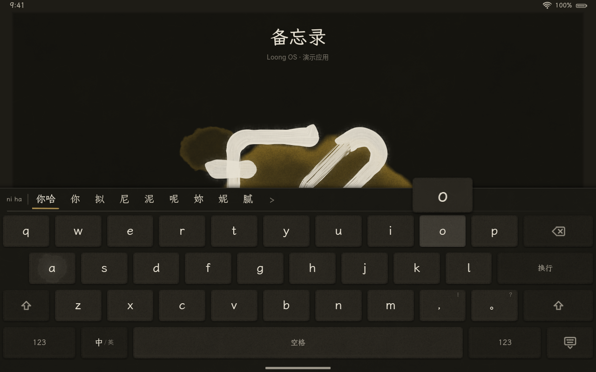
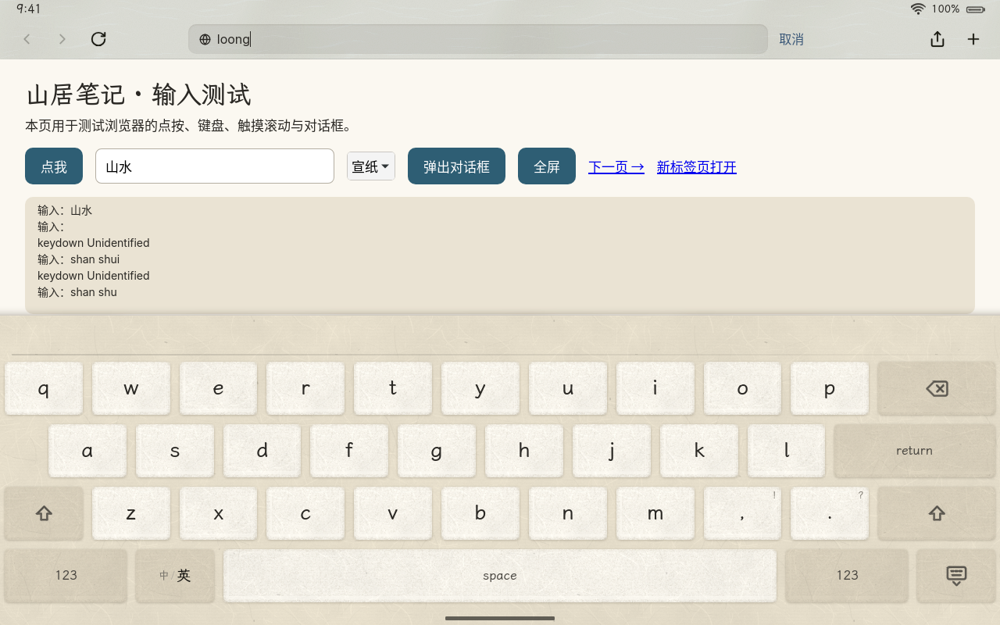

# loong-ime：中文拼音输入法与屏幕键盘

> 状态：引擎、键盘模型、数据方案已完成并有测试；屏幕键盘已接入 loong-shell（「墨韵」绘制、text-input-v3、窗口避让、镜像中的 Rime 数据），在无屏幕 loong-shell + WPE WebKit 中端到端验证（输入“你好，世界。”），见[第 8 节](#8-loong-shell-中的实现)。

| 宣纸 · 组字中（拼音在输入框里带下划线，候选栏左侧是拼音） | 夜墨 · 上屏后 |
|---|---|
|  |  |
| **竖屏**（窗口高度 1280 − 332 = 948pt） | **数字层 + 长按“，”的备选条**（选中格为浓墨底、纸色字） |
|  |  |
| **按下字符键**：键帽着墨、浮起放大小笺、指下点墨（夜墨） | **浏览器地址栏**（网址用途：默认英文、半角标点） |
|  |  |

`crates/loong-ime` 提供 v1 必须的**中文拼音输入法**，分为三层：

| 层 | 类型 | 作用 |
|---|---|---|
| 拼音引擎 | `rime::Rime`、`rime::Session`、`ImeEngine` | librime 1.17 的最小安全封装（手写 FFI，pkg-config 链接）；按键、预编辑、候选分页、上屏、中/英切换 |
| 屏幕键盘模型 | `keyboard::KeyboardLayout`、`keyboard::Keyboard` | iPad 式布局（按宽高推算）、命中测试、触摸状态机（Shift、换层、长按备选、退格连删、快速连打）、按键高亮与升起动画。**只有状态，不画任何东西** |
| 组合 | `InputMethod` | 把键盘动作（`KeyAction`）交给引擎，输出给合成器的事件（`ImeEvent`）：上屏、转发按键、组字变化、收起 |

## 1. 架构

### 1.1 进程与线程

输入法**运行在合成器 loong-shell 进程内**，不是独立的输入法进程：

- 屏幕键盘本来就要由合成器绘制（它是系统界面的一部分，和 Dock、控制中心一样用 `loong-ui` 栅格化成图层纹理），键盘和引擎放在同一进程，按键到候选只是一次函数调用，没有 IPC 往返；
- 应用只和合成器说 `zwp_text_input_v3`，不需要额外的 `zwp_input_method_v2` 客户端进程，少一个常驻进程；
- librime 是**进程全局**的单例（glog 只能初始化一次、会话接口不是线程安全的）。`Rime::start` 每个进程只真正启动一次，之后以 `&'static Rime` 共享；所有 librime 调用经过一把互斥锁串行化。合成器只在主线程（calloop）用输入法，锁没有竞争；
- `Rime::start` 会同步等待部署（maintenance）。首次部署在系统镜像里约 0.1 秒（之后的启动约 7ms），开发环境里要现场编译词典约 4 秒，所以合成器应在**后台线程**启动它，完成后把 `ImeEngine` 交回主线程（`InputMethod::set_engine`）。在此之前键盘照常工作，只能输入英文。

```
 libinput 触摸 ─► loong-shell 手势路由 ─┬─► 系统手势（底边上滑等，优先）
                                        ├─► 键盘图层 ─► InputMethod::touch_* ─► Keyboard ─► KeyAction
                                        │                                                      │
                                        │                       ImeEngine（librime 会话）◄─────┘
                                        │                                │
                                        │            ImeEvent：Commit / Forward / CompositionChanged / Hide
                                        │                                │
                                        └─► 应用窗口          text-input-v3：commit_string / preedit_string / done
                                                              wl_keyboard：合成的 BackSpace / Return
                                                                         │
                                                       WPE WebKit（WPEInputMethodContextWaylandV3）─► DOM
```

### 1.2 键盘的绘制（由 loong-shell 负责）

沿用 Core Animation 的思路（设计规范 §6.2、§7.8）：

- **键帽纹理只在 `Keyboard::revision()` 变化时重画**：换层、Shift、中/英切换、备选条开合会让它加一。键帽内容来自 `Keyboard::label(id)`（文字、带角标的文字、符号、“中/英”）；
- **按下高亮每帧由弹簧给出**：`Keyboard::highlight(id, now)`（0–1），合成器用它混合按下态底色，不重画纹理。按下时立即为 1（按键反馈不能有延迟），抬起后用 `Spring::INTERACTIVE` 渐隐（约 0.25 秒停稳）；
- **升起/收起**：`Keyboard::presentation(now)`（0–1，`Spring::SMOOTH`），键盘图层下移 `(1 − p) × 键盘高度`。可被打断（再次 `show` 时从当前位置和速度继续）；
- `Keyboard::is_animating(now)` 为假、也没有触摸时不重绘；长按与连删的定时用 `Keyboard::next_deadline()` 注册 calloop 定时器；
- 材质用 `thick`（设计规范 §6.1）；键的圆角 `Metrics::corner_radius`（连续圆角）；字母键帽字号 `Metrics::letter_font_size`，功能键文字 `Metrics::label_font_size`，候选 `Metrics::candidate_font_size`；
- 键帽符号（`KeySymbol`）由合成器映射到 Lucide 图标（例如 Shift → `arrow-big-up`，大写锁定 → `arrow-big-up-dash`，退格 → `delete`）；
- 长按备选条 `Keyboard::popup()` 可能超出键盘上边，应画在键盘之上的独立图层；
- 候选栏（`KeyboardLayout::candidate_bar`）的内容排版依赖文字宽度，由合成器负责：候选横向排列、可惯性滚动（`loong-motion` 的 `Decay::NORMAL`），点按调用 `InputMethod::select_candidate(本页下标)`，翻页用 `InputMethod::change_page`。

### 1.3 协议：`zwp_text_input_v3` 与 `zwp_input_method_v2`

`zwp_input_method_v2` 是“输入法客户端 ↔ 合成器”的协议，`zwp_text_input_v3` 是“应用 ↔ 合成器”的协议，合成器在中间转发，两边的消息一一对应：

| 应用 → 合成器（text-input-v3 请求） | 合成器 → 输入法（input-method-v2 事件） | 本 crate 中对应 |
|---|---|---|
| `enable` + `commit` | `activate` + `done` | `InputMethod::activate(purpose)` |
| `disable` + `commit`、焦点离开 | `deactivate` + `done` | `InputMethod::deactivate()` |
| `set_content_type(hint, purpose)` | `content_type` | `ContentPurpose::from_text_input_v3` |
| `set_surrounding_text` | `surrounding_text` | v1 不用（见第 9 节） |
| `set_cursor_rectangle` | （弹出窗口定位） | v1 不用（候选栏固定在键盘顶部） |

| 输入法 → 合成器（input-method-v2 请求） | 合成器 → 应用（text-input-v3 事件） | 本 crate 中对应 |
|---|---|---|
| `commit_string` | `commit_string` | `ImeEvent::Commit` |
| `set_preedit_string` | `preedit_string(text, cursor_begin, cursor_end)` | `InputMethod::preedit()`（光标以字节计） |
| `delete_surrounding_text` | `delete_surrounding_text` | v1 不用（退格走 `ImeEvent::Forward`） |
| `commit(serial)` | `done(serial)` | 每批事件处理完发一次 `done` |

**v1 的做法：合成器自己当输入法。** loong-shell 固定的 Smithay 版本（`f581531`）提供了 `TextInputHandle::set_compositor_input_method(true)`：打开后，即使没有 `zwp_input_method_v2` 客户端，焦点应用的 text-input 也会收到 `enter`，`enable`/`commit` 照常处理，合成器可以直接向它 `commit_string`。激活与关闭通过 `TextInputActivation::activated(content_type)` / `deactivated()` 回调通知合成器。这正是上表左右两列中间的那一层，只是“输入法”在进程内。

以后要支持外部输入法（例如外接实体键盘的用户想用 fcitx5），再注册 Smithay 的 `InputMethodManagerState`，由真正的 `zwp_input_method_v2` 客户端接管；消息语义不变。

### 1.4 WPE WebKit 一侧的行为

WPE 2.54 的 `WPEInputMethodContextWaylandV3`（`Source/WebKit/WPEPlatform/wpe/wayland/`）：

- 可编辑元素获得焦点并收到 `enter` 后发 `enable`，随后发送 `set_surrounding_text`（超过 4000 字节时截取光标附近）、`set_content_type`、`set_cursor_rectangle` 和 `commit`。为了兼容 Mutter 的屏幕键盘，它会**连发两次 `enable`**，除非页面用 `inputmode="none"`（`WPE_INPUT_HINT_INHIBIT_OSK`）；合成器收到第二次时不应重复播放升起动画（`Keyboard::show` 对已升起的键盘没有影响）；
- 密码框的 `content_hint` 带 `HIDDEN_TEXT | SENSITIVE_DATA`，`purpose` 为 `PASSWORD`；`InputMethod` 在密码框和 PIN 框里**强制英文、不能切到中文**，保证 Rime 的用户词库不会记下密码；
- `done(serial)` 时按 `delete_surrounding_text` → `commit_string` → `preedit_string` 的顺序应用，并且**只有 serial 与它发出的 `commit` 次数一致时才生效**（Smithay 的 `TextInputHandle::done(false)` 会带上正确的 serial）；
- 预编辑的光标位置以字节计，`Preedit::cursor` 正是字节偏移。

一次输入的完整消息序列（点按 n、i、h、a、o，再点候选“你好”）：

```
WPE  → enable / set_content_type(NORMAL) / commit            （输入框获得焦点）
壳   : InputMethod::activate → 键盘升起（SMOOTH）
点 n : ImeEvent::CompositionChanged → preedit_string("n", 1, 1) + done
...
点 o : preedit_string("ni hao", 6, 6) + done；候选栏：你好 妳好 逆号 …
点候选“你好”: ImeEvent::Commit("你好"), CompositionChanged
       → commit_string("你好") + preedit_string(null) + done
WPE  → set_surrounding_text(…你好…) / commit
```

### 1.5 键盘与应用窗口的关系

iPad 的键盘覆盖在应用之上，由应用自己避让。WPE 没有“键盘高度”通知，所以 loong-shell 采用**调整窗口高度**而不是平移窗口：键盘升起到 98%（`SMOOTH` 约 0.46 秒）时给前台应用发一次 `xdg_toplevel.configure`，高度减去键盘高度（横屏 800 − 396 = 404pt，竖屏 1280 − 332 = 948pt）；**收起一开始**就恢复全屏高度，再播放收起动画。WebKit 只重排一次：`position: fixed; bottom: 0` 的元素落到键盘上方，`innerHeight` 变小，光标所在的输入框留在可见区域。不逐帧改窗口尺寸（会让 WebKit 每帧重排）。

没有选平移窗口：平移会把应用顶部（含状态栏下的内容）推出屏幕，而且要知道光标位置（`set_cursor_rectangle` 只在 text-input 激活后才有）才能决定平移多少；改高度对所有 PWA 都有效，网页用 CSS 的视口单位就能自己避让。窗口仍保持 `fullscreen` 状态（WPE 按 configure 的尺寸调整，见 `WPEToplevelWayland.cpp` 的 configure 处理），矮了的窗口画在卡片顶部，下面是卡片的纸色底，被键盘盖住。

## 2. 拼音引擎

### 2.1 librime 绑定（`rime` 模块）

- 只链接一个符号 `rime_get_api()`，其余接口都经它返回的函数表调用。函数表与 `RimeContext` 等结构按 `/usr/include/rime_api.h`（librime 1.17）**逐字段手写**，用不到的函数指针用同样大小的占位类型；
- 结构体自带版本（`data_size`），调用前检查库里的函数表是否包含该函数（`RIME_STRUCT_HAS_MEMBER` 的等价实现），旧版库缺少的可选接口自动退回旧接口；
- 单元测试 `layout_matches_c_header` 用系统 C 编译器编译头文件，逐个比对结构体大小和 30 个字段偏移；
- `unsafe` 只出现在 `rime/mod.rs`（每处都有 `SAFETY` 说明）和 `rime/ffi.rs` 的 `extern` 声明里；返回给调用方的都是拷贝出来的 Rust 值。

主要接口：

| 接口 | 说明 |
|---|---|
| `Rime::start(&ImeConfig) -> &'static Rime` | 启动并部署（每进程一次；配置不同时报 `AlreadyRunning`） |
| `Rime::redeploy()` | 完整检查后重新部署。**必须先销毁所有会话**，否则返回 `SessionsAlive`（见第 7 节） |
| `Rime::create_session()` | 新建会话 |
| `Session::process_key(keysym, mask)` | X11 keysym + 修饰键掩码，返回是否被处理 |
| `Session::context()` / `status()` / `take_commit()` | 预编辑、本页候选、开关状态、待上屏文字 |
| `Session::select_candidate_on_current_page(i)` / `change_page(backward)` / `candidates(start, max)` | 选词、翻页、完整候选列表 |
| `Session::set_option(name, bool)` | 例如 `ascii_mode` |

### 2.2 `ImeEngine`

| 操作 | 方法 | 行为 |
|---|---|---|
| 字母、空格、退格、回车、数字、翻页、Esc | `process_key(ImeKey)` | 组字中：字母组字、空格选高亮候选、数字 1–9 选词、退格删字母、回车**原样上屏字母**、Esc 清空。没在组字：可打印字符和空格直接上屏，退格/回车等返回 `KeyOutcome::Forward` |
| 标点、数字、符号 | `insert_text(&str)` | 组字中先把组字内容按当前候选上屏，再输入这段文字（`nihao` + `，` → `你好，`）。例外：中文组字中的 `'` 是音节分隔符（`xi'an` → 西安） |
| 点候选 | `select_candidate(i)` / `select_candidate_global(i)` | 本页 / 完整列表中的下标 |
| 翻页 | `next_page()` / `prev_page()` | |
| 中/英 | `set_ascii_mode(bool)` / `toggle_ascii_mode()` | 组字中切到英文时，已输入的字母原样上屏 |
| 实体键盘 | `process_keysym(keysym, modifiers)` | 返回 `false` 时宿主把原按键转发给应用 |
| 状态 | `state()`、`revision()`、`take_commit()` | `ImeState`：预编辑、原始输入、本页候选、页码、高亮、上屏预览、是否英文 |

默认输出**简体中文**，每页 9 个候选。用户词库（`<用户目录>/loong_pinyin.userdb/`，leveldb）会学习：选过的词下次排在前面。

`InputMethod` 经 `Engine` trait 驱动引擎（`ImeEngine` 实现它）：宿主的单元测试可以用 `InputMethod::with_engine` / `set_boxed_engine` 换上一个假的引擎（例如 loong-shell 的查表拼音），不必启动 librime。

### 2.3 配置与数据目录

| 项 | 默认值 |
|---|---|
| 共享数据目录（只读） | `/usr/share/rime-data` |
| 用户数据目录（可写） | `$XDG_DATA_HOME/loong/rime`，未设置时 `~/.local/share/loong/rime` |
| 方案 | `loong_pinyin`（也可用 Rime 自带的 `luna_pinyin_simp`） |
| 每页候选数 | 9 |
| 日志 | librime 只写 stderr，级别 ERROR |

启动时 loong-ime 往用户目录写入它管理的文件（内容不变时不重写，避免每次启动都触发重新部署）：

- `default.custom.yaml`：方案列表只留所选方案、设置每页候选数、**清空 `key_binder/bindings`**（`default.yaml` 默认让 `,` `.` `-` `=` 兼作翻页键，屏幕键盘上 “nihao，” 会变成翻页）；
- 共享目录里没有预编译的 `loong_pinyin` 时（开发环境只装了 Alpine 的 `rime-plum-data`），写入本 crate 自带的 `loong_pinyin.schema.yaml` 和 `loong_pinyin.dict.yaml`，首次部署时现场编译；共享目录里有正式版本时，删除以前写入的副本；
- 选用 `luna_pinyin*` 方案时写入补丁，去掉对笔画（stroke）数据的依赖。

## 3. 屏幕键盘模型

### 3.1 布局（regular 尺寸类）

参考 iPad 非 Pro 键盘。所有尺寸由键盘宽高推算（`LayoutParams::for_screen(屏宽, 屏高)` 给出推荐高度），不写死机型：

| | 1280×800 横屏 | 800×1280 竖屏 |
|---|---|---|
| 键盘高度（候选栏 + 键区 + 底部 20pt 安全区） | 396pt（屏高的 50%） | 332pt（26%） |
| 字母键 u × 键高 | ≈ 100 × 68pt | ≈ 62 × 59pt |
| 键间距 / 行距 / 左右边距 | 12 / 12 / 6pt | 8 / 8 / 4pt |
| 候选栏高度 | 50pt | 40pt |
| 键圆角 / 字母字号 | 8pt / 23pt | 6pt / 20pt |

```
第 1 行： q  w  e  r  t  y  u  i  o  p  [ ⌫ 1.5u ]
第 2 行：  ½ a  s  d  f  g  h  j  k  l  [ 换行 ≈2u ]
第 3 行： [⇧] z  x  c  v  b  n  m  ，  。 [ ⇧ 1.5u ]
第 4 行： [123 1.5u][中/英][        空格        ][123 1.5u][⌨︎ 收起]
```

- **三层共用一个网格**（字母 / “123” 数字与常用标点 / “#+=” 更多符号），换层只换键帽，键的位置不变；第 3 行两端在数字层和符号层变成换层键。中文模式用全角标点（`，。：；（）¥“”、？！……——《》【】` 等），英文模式用半角；
- 触摸区域（`Key::hit`）把键区无缝铺满：键间空隙按中线分给两侧的键，每行首尾的键延伸到屏幕边缘，第 2 行的缩进归 “A”；键区以外的点在触摸容差（8pt，与设计规范 §9.2 的起手阈值相同）内归最近的键。触控目标都 ≥ 44pt（测试覆盖 8 种平板尺寸）；
- 底部 20pt 安全区不放键，留给 Home 指示条和底边上滑手势；
- **compact（手机，v2）**：`KeyboardLayout::compute` 按 `SizeClass` 分派，目前 compact 沿用 regular 的网格。v2 在这里加一个 `compact()`（10 列等宽字母键、无缩进、更高的键），并用 `SizeClass::shows_key_preview()` 打开按键气泡；键的种类、层、命中规则和 `Keyboard` 状态机都不用改。

### 3.2 触摸行为

| 行为 | 规则 |
|---|---|
| 字符键 | 抬起时输出，以抬起时手指下的键为准（按住滑到相邻键可以纠正）；滑进候选栏或滑出键盘则取消 |
| 快速连打 | 新手指按下时，其他还按着的字符键立即输出，双手交替打字顺序不乱 |
| Shift | 按下即生效：单击 → 下一个字母大写；0.35 秒内双击 → 大写锁定；按住 Shift 打的字母都大写，松开恢复 |
| 换层键 | 按下即切换；同一根手指滑到某个字符上抬起，输出后自动回到原来的层（iPad 的快捷手法） |
| 退格 | 按下立即删除一次，按住 0.5 秒后每 0.1 秒连删；手指滑出退格键停止 |
| 长按备选 | 0.5 秒且移动不超过 8pt，弹出备选条，横向滑动选择，抬起输出。字母（英文模式）有重音字母；标点有中英文变体，例如 “，” → `！ 、 ； ： , !`，“。” → `？ …… . ?`。字母层标点键的角上显示第一个备选 |
| 中/英键 | 切换引擎的 ascii_mode 和键帽；用户在普通输入框里的选择会被记住 |
| 收起键 | 先把组字内容上屏，再收起 |

### 3.3 输入框用途

`InputMethod::activate(ContentPurpose)`：网址、邮箱、密码、PIN、终端等默认英文；数字、电话、PIN、日期时间直接显示数字层；密码与 PIN 不能切到中文。

## 4. 数据与体积

### 4.1 方案选择

| 方案 | 共享目录体积 | 说明 |
|---|---|---|
| Alpine `rime-plum-data` 全部 | 68 MiB（+ `opencc` 包 1.3 MiB） | 8 个方案（朙月、地球、注音、仓颉、笔画……），开发环境用 |
| `luna_pinyin_simp` 的最小文件集 | ≈ 22.4 MiB | 朙月拼音词典收录全部八股文词汇，`luna_pinyin.table.bin` 22.0 MiB |
| **`loong_pinyin`（采用）** | **8.0 MiB（8 388 868 字节）**；erofs lz4hc 压缩后 **5.5 MB** | 朙月拼音字表 + 八股文词汇中词频 ≥ 100、长度 ≤ 7 的词（与地球拼音的取舍相同），`loong_pinyin.table.bin` 7.7 MiB |

`loong_pinyin` 与 `luna_pinyin_simp` 的常用输入结果一致（`nihao`、`zhongguo`、`shurufa`、`pingguo`、`xi'an` 的首选相同，`woxiangqubeijing` → 我想去北京、`jintiantianqizhenhao` → 今天天气真好），只是低频长词变少。方案与词典定义在 `crates/loong-ime/data/`：不带笔画反查和自定义短语，不依赖其他方案的数据。

### 4.2 系统镜像中的文件（`/usr/share/rime-data`）

| 文件 | 字节 |
|---|---|
| `build/loong_pinyin.table.bin` | 8 029 036 |
| `build/loong_pinyin.reverse.bin` | 252 764 |
| `build/loong_pinyin.prism.bin` | 31 712 |
| `build/loong_pinyin.schema.yaml` | 5 823 |
| `default.yaml`、`key_bindings.yaml`、`punctuation.yaml`、`pinyin.yaml`、`loong_pinyin.schema.yaml` | 13 145 |
| `opencc/t2s.json`、`TSPhrases.ocd2`、`TSCharacters.ocd2`（繁转简，Rime 先在这里找） | 56 388 |
| **合计** | **8 388 868** |

打包为 `system/packages/loong-rime-data`（`tools/build-pkg.sh loong-rime-data`，构建时预编译，noarch），`system/mkimage/mkimage.sh` 在本地仓库里有这个包时装进镜像；`librime-nolog` 总是装（loong-shell 链接它）。打包步骤（`tests/image_data.rs` 按这个步骤逐条验证，并确认只用这些文件时引擎正常工作）：

1. 源文件：`rime-plum-data` 的 `default.yaml`、`key_bindings.yaml`、`punctuation.yaml`、`pinyin.yaml`、`luna_pinyin.dict.yaml`、`essay.txt`，加上 `crates/loong-ime/data/loong_pinyin.{schema,dict}.yaml`；
2. `rime_deployer --compile loong_pinyin.schema.yaml <临时用户目录> <源目录> <目标>/usr/share/rime-data/build`（x86_64 约 4 秒）；
3. 删掉 `build/` 里的 `*.txt` 调试导出，复制上表中的 YAML 与 OpenCC 文件。

运行时不需要 `luna_pinyin.dict.yaml`、`essay.txt`（共 10.1 MiB）。librime 会在部署时打印一行 `source file '…/loong_pinyin.dict.yaml' does not exist`，这是预期的（它改用预编译词典）。

### 4.3 运行库

| 包 | 安装体积 |
|---|---|
| `librime-nolog`（镜像用不带 glog 的版本） | 1449 KiB |
| `leveldb` + `snappy`（用户词库） | 274 KiB |
| `libmarisa` | 250 KiB |
| `opencc-libs` | 309 KiB |
| `yaml-cpp` | 281 KiB |
| **合计** | **≈ 2.5 MiB**（另需 `libstdc++`，镜像中已有） |

开发环境用 `librime`（带 glog，`librime-dev` 依赖它），两者提供同一个 `librime.so.1`。

镜像体积的实测（`mkfs.erofs -zlz4hc,12`，与 mkimage 相同）：数据 8 409 348 字节 → **5.3 MiB**，运行库 2.5 MiB → **1.4 MiB**，合计约 **6.6 MiB**（安装后 10.5 MiB）。数据包的 `.apk` 为 3.8 MiB。

### 4.4 用户目录

镜像里 loong-shell 以用户 loong 运行（`HOME=/home/loong`），用户目录是 `~/.local/share/loong/rime`；`/home` 由 initramfs 从 data 分区绑定进来，可写、OTA 不影响。系统镜像（预编译词典）下首次部署后约 40KB：`default.custom.yaml`、`installation.yaml`、`user.yaml`、`build/`（编译后的方案 YAML 与 31KB 的 prism）、`loong_pinyin.userdb/`（随使用增长）。开发环境现场编译时，`build/` 里还有 7.7 MiB 的词典。

### 4.5 许可证

本 crate 的代码与 `data/` 中的方案配置为 MIT OR Apache-2.0。librime 为 BSD-3-Clause；词典数据（朙月拼音 luna_pinyin、八股文 essay）为 **LGPL-3.0**，作为独立的数据包分发，不链接进任何程序；OpenCC 为 Apache-2.0；leveldb、glog 为 BSD-3-Clause；yaml-cpp 为 MIT；marisa-trie 为 BSD-2-Clause/LGPL-2.1 双许可。

## 5. 延迟与内存

在开发机（x86_64，chroot，同时有 WebKit 在编译）上用 `examples/ime_probe.rs` 测得（release 构建）：

| 指标 | `loong_pinyin`（镜像数据） | `luna_pinyin_simp` |
|---|---|---|
| 启动 + 部署（用户目录为空） | 0.03–0.14 秒 | 0.16–0.21 秒 |
| 启动（已部署过，只检查修改时间） | ≈ 7 ms | — |
| 开发环境首次部署（现场编译词典） | 3.5–5 秒 | 0.13 秒（用 rime-plum-data 预编译的词典） |
| 单键延迟（含刷新候选），平均 / 最大 | 0.46 ms / 5.5 ms | 0.75 ms / 9.7 ms |
| 进程 RSS：启动前 → 打完 9 段拼音 | 5.7 → 15.0 MB | 5.7 → 22.9 MB |
| 其中匿名内存增量 | +1.9 MB | +2.6 MB |
| 其中文件映射增量（词典页） | +7.4 MB | +14.6 MB |

- 最大延迟出现在第一个键（第一次读词典页）。之后每键不到 1ms，远低于 120Hz 的帧间隔（8.3ms）；
- 词典是 `mmap` 的只读文件页，计入 RSS，但是干净页，内存紧张时内核可以直接回收，不占匿名内存。对 shell「常驻内存 ≤ 40MB」的目标，输入法真正新增的是约 2MB 匿名内存；
- 优化方向：输入框第一次激活时才启动 librime（`InputMethod` 允许暂时没有引擎）；镜像用 `librime-nolog`；在 nabu 实机上复测。

## 6. 测试

```sh
tools/dev-chroot.sh run sh -c 'cargo test -p loong-ime -j2'
tools/dev-chroot.sh run sh -c 'cargo run --release -p loong-ime --example ime_probe'   # 延迟与内存
```

| 测试 | 内容 |
|---|---|
| `src/rime/ffi.rs` | 用 C 编译器比对结构体大小与字段偏移；`data_size` 规则 |
| `src/config.rs` | 补丁文件内容、不重复写入、镜像数据优先于自带文件、缺数据报错 |
| `tests/keyboard.rs` | 8 种平板尺寸 × 3 层 × 中英：键都在范围内、互不重叠、间距 ≥ 5pt、触控目标 ≥ 44pt、触摸区域铺满键区；26 个字母和 10 个数字各一次；iPad 比例；换层网格不变；命中测试（键中心、横/纵向空隙、缩进、候选栏、容差内外）；状态机（点按与高亮弹簧、滑动纠正、快速连打、Shift 单击/双击/按住、换层与滑回、长按备选、退格连删、标签、升起/收起、旋转） |
| `tests/rime_engine.rs` | **真实 librime**：`nihao` 出现“你好”并上屏；空格/数字选词；用户词库学习；简体输出与整句；退格/回车/Esc；标点上屏；分隔符；中英切换；翻页与完整候选列表；有会话时拒绝重新部署；**屏幕键盘点按驱动引擎的端到端测试**（含密码框） |
| `tests/image_data.rs` | 按打包步骤预编译最小数据集，只用这些文件启动引擎并输入；没有会话时重新部署 |

没装 Rime 数据时，真实引擎测试打印跳过原因后返回；CI（`.github/workflows/rust.yml`，已加 `librime-dev rime-plum-data`）设置 `LOONG_IME_REQUIRE_RIME=1`，跳过即失败。开发 chroot 的 `tools/dev-chroot.sh` 也已加上这两个包。

## 7. 注意事项

- **重新部署前必须销毁所有会话。** librime 部署时会替换词典资源，已有会话继续使用会读到失效的内存映射——测试中复现过段错误（`rime::Table::GetString`）。`Rime::redeploy` 因此在有存活会话时返回 `SessionsAlive`；正确流程是 `InputMethod::set_engine(None)` → `redeploy()` → `ImeEngine::with_rime` → `set_engine(Some(..))`。常见前端（如 fcitx5-rime）重新部署前也是先 `finalize` 整个 librime；
- librime 每个进程只能用一份配置启动；测试里所有引擎测试共用一个用户目录，用户词库也共用（选了非首选候选会改变后续排序）；
- `default.custom.yaml` 等文件由 loong-ime 管理，会被覆盖；用户自定义以后通过设置应用改 `ImeConfig`。

## 8. loong-shell 中的实现

按下面的集成步骤实现，代码位置：

| 文件 | 内容 |
|---|---|
| `crates/loong-shell/src/shell/keyboard.rs` | `ScreenKeyboard`：激活与可见性、键盘与候选栏的触摸、`ImeEvent` → `TextOp`、窗口避让高度、画面（`DrawItem`）。不依赖 Wayland，单元测试用查表的假引擎（`keyboard/tests.rs`） |
| `crates/loong-shell/src/shell/mod.rs` | 触摸路由（键盘优先于应用，底边 20pt 系统手势优先于键盘）、允许显示的条件、画面层次 |
| `crates/loong-shell/src/ime.rs` | text-input-v3（合成器当输入法）、`commit_string` / `preedit_string` / `done`、合成按键、键盘焦点、窗口尺寸、后台启动 librime |
| `crates/loong-shell/src/render/keyboard.rs` | 「墨韵」位图：背板、键帽、字形、放大小笺、备选条、候选 |
| `system/packages/loong-rime-data/` | 预编译的 Rime 数据包（见 4.2 节） |

1. **依赖**：`loong-ime = { path = "../loong-ime" }`；镜像加入 `librime-nolog` 与 `loong-rime-data`（`leveldb`、`libmarisa`、`opencc-libs`、`yaml-cpp` 由 apk 按 so 依赖带进来）。
2. **启动**：真机后端在后台线程 `ImeEngine::new(&ImeConfig::default())`，经 calloop channel 交回主线程（`ScreenKeyboard::set_engine`）；失败时只能输入英文。无屏幕后端同步启动（截图可复现）。环境变量 `LOONG_IME=off` 不启动引擎。键盘背板在开机和切换外观时于后台线程预先画好（1280×800@1x 约 40ms）。
3. **text-input**：`TextInputManagerState` + `set_compositor_input_method(true)`；`TextInputActivation::activated(ct)` → `ScreenKeyboard::activate`（只带“敏感数据”提示的输入框也按密码处理），`deactivated()` → `deactivate`。WPE 的第二次 `enable` 不带内容类型：已激活时保持原来的用途，不重置层与组字。
4. **键盘焦点跟随前台应用，并且在窗口映射（提交第一帧）之后才给**。实测发现：WPE 的 text-input 监听器是在创建输入法上下文时才挂上的（`textInputV3GetGlobalByDisplay`），`new_toplevel` 时就给焦点的话，`zwp_text_input_v3.enter` 在客户端被丢弃（`WAYLAND_DEBUG` 里是 `discarded zwp_text_input_v3#12.enter`），之后它永远不会 `enable`。回主屏、进多任务时焦点离开应用：Smithay 只发 `leave`，应用随后的 `disable` 因为不再是焦点会被丢弃、不回调 `deactivated`，所以由 loong-shell 自己收起键盘；回到应用时重新 `enter`，输入框仍有焦点的话应用会再次 `enable`。
5. **可见性**：输入框激活、前台应用停稳（不在打开、回主屏、多任务途中）、没有系统手势、未锁屏时显示。按收起键后输入框仍激活：在应用上**点按**（移动不超过 8pt）0.2 秒后键盘重新弹出——如果这次点按让输入框失去焦点，应用会先发 `disable`，键盘就不会弹出又收回。
6. **触摸路由**：键盘显示时，键盘矩形内、底边 20pt 以外的触摸都交给键盘（含多指快速连打，与应用上的手指互不影响）；底边 20pt 照常是系统手势，开始时取消键盘上的触摸并收起键盘。候选栏：点按选词，横向拖动惯性滚动（`Decay::NORMAL` 投影，停在范围内），拖过末端 44pt 松手翻到下一页（开头同理翻回上一页），两端的 “‹”“›” 也可以点按翻页。
7. **消息顺序**：一批 `ImeEvent` 合成一组 `commit_string` → `preedit_string`（只发最终状态）→ `done`；遇到要转发的按键时先发 `done`，再发合成的 `wl_keyboard` 按键（“a” 上屏后退格，应用先插入 “a”）。没有组字时的退格、回车（以及 Esc、Tab、方向键）用默认 us 键位的键码（BackSpace 22、Return 36），按下再抬起。
8. **绘制**（`render/keyboard.rs`）：背板（熟宣 / 墨绢，上缘向上投出墨影，暗色加一道月白受光边）与全部键帽小笺（素笺、毛边、墨影；功能键用略深的纸）画成一张纹理，三层键盘共用网格，换层不重画；字形另成一层（文楷字，Shift / 退格 / 收起是 Lucide 符号转成的毛笔笔触），按 `Keyboard::revision` 重画、字形按文字缓存；按下时键帽着墨（浓墨 13%，暗色为月白）并在指下点墨（`InkLayer::Overlay`）；字符键按下时上方浮起放大小笺；长按备选条选中格为浓墨（暗色泥金）底、纸色字；候选栏左侧是拼音（重墨），候选为文楷（高亮候选焦墨，下方一笔浓墨），翻页箭头淡墨。所有位图只在内容变化时画一次，动画（升起、高亮、滚动）只做 GPU 合成。
9. **窗口避让**：见 1.5 节。
10. **定时**：`Shell::update` 在 `Keyboard::next_deadline` 到期时调用 `tick`（长按、退格连删）；有触摸或动画时 `Shell::is_idle` 为假，后端继续出帧。

### 8.1 验证

```sh
# 单元测试（假引擎）：显示/收起、布局尺寸、候选栏命中与翻页、上屏流程、触摸路由与系统手势优先
tools/dev-chroot.sh run cargo test -p loong-shell keyboard -j2
# 只有合成器（模拟输入框获得焦点）：键盘升起、打字、Shift、数字层、长按备选（亮色 / 暗色 / 竖屏）
build/target-alpine/release/loong-shell --headless --size 1280x800 \
  --script crates/loong-shell/tests/scripts/keyboard.json --out out/kb
# 真实客户端：loong-webapp 打开 tests/pages/ime-input.html（输入框自动获得焦点），打 nihao → 点候选 →
# “，” → shijie + 空格 → “。”，得到“你好，世界。”（WPE 在 chroot 中需要下面这些环境变量）
WEBKIT_SKIA_ENABLE_CPU_RENDERING=1 LIBGL_ALWAYS_SOFTWARE=1 LANG=C.UTF-8 WEBKIT_DISABLE_SANDBOX_THIS_IS_DANGEROUS=1 \
  build/target-alpine/release/loong-shell --headless --realtime --size 1280x800 \
  --script crates/loong-shell/tests/scripts/keyboard-webkit.json --out out/kb-webkit \
  --app "notes=build/webrt/loong-webapp --id notes --name 备忘录 file://$PWD/crates/loong-shell/tests/pages/ime-input.html"
# 浏览器：页面输入框打 shanshui → 山水，地址栏（网址用途，英文）打 loong
webrt/browser/tests/shell-run.sh crates/loong-shell/tests/scripts/keyboard-browser.json out/kb-browser http://127.0.0.1:8765/index.html
```

无屏幕脚本的键盘事件见 `crates/loong-shell/src/script.rs`：`text_input`（模拟输入框获得焦点）、`type`（按当前布局点按字符所在的键，可设 `interval`、`hold`）、`candidate`、`key`（功能键）。`RUST_LOG=loong_shell=debug` 打印每批发给应用的消息。

### 8.2 已知问题

- **text-input-v3 的 serial 竞争**：应用在收到 `done` 之前又发了 `commit`（例如 WebKit 在光标移动后更新 `set_cursor_rectangle`），它会按协议丢弃这次 `done` 带来的上屏文字。协议本身的局限，所有合成器都一样；正常打字的间隔（> 50ms）远大于往返时间，测试中没有出现。
- 收起键只收起键盘，不让输入框失去焦点（text-input-v3 没有这个请求）；点按应用再弹出。
- 只有平板（regular）布局；旋转屏幕时 `ScreenKeyboard` 还没有接 `set_params`（loong-shell 目前也不支持旋转）。
- 外接实体键盘的按键还没有先交给引擎（第 9 步）；librime 的用户词库在第一次使用时部署，用户目录损坏时只记日志、退回英文。

## 9. 后续工作

- compact（手机）布局与按键气泡（v2，扩展点见 3.1 节）；
- iPad 的下滑输入（flick：下滑字符键得到角标字符）、长按空格变触控板移动光标；
- 利用 `surrounding_text` 做英文句首自动大写、双击空格输入句号，以及用 `delete_surrounding_text` 代替合成退格；
- 展开的候选面板（`ImeEngine::candidates(start, max)` 已提供数据）、英文联想、表情符号层；
- 设置应用：每页候选数、模糊音（`speller/algebra` 补丁）、清空用户词库（需要按第 7 节的流程重新部署）；
- 按需启动/空闲时释放 librime，在 nabu 上复测延迟与内存。
