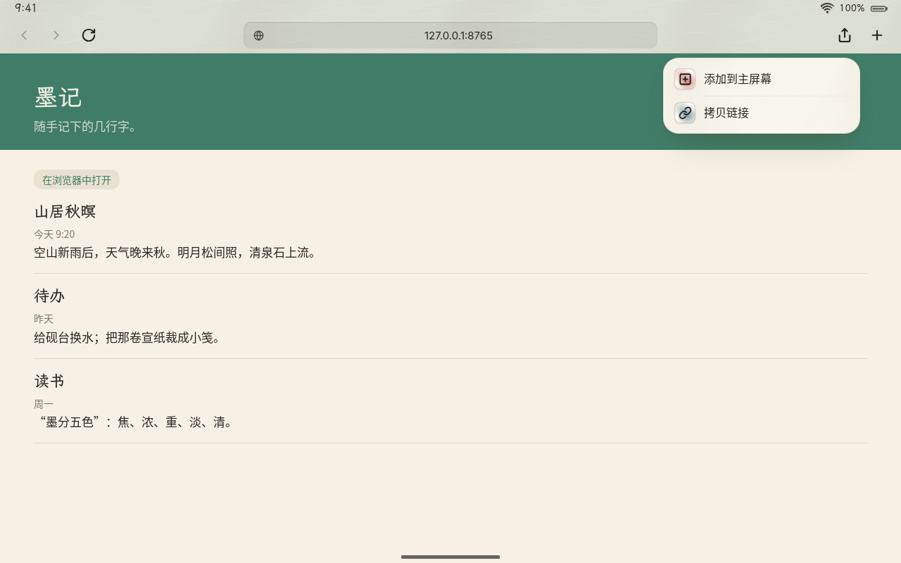
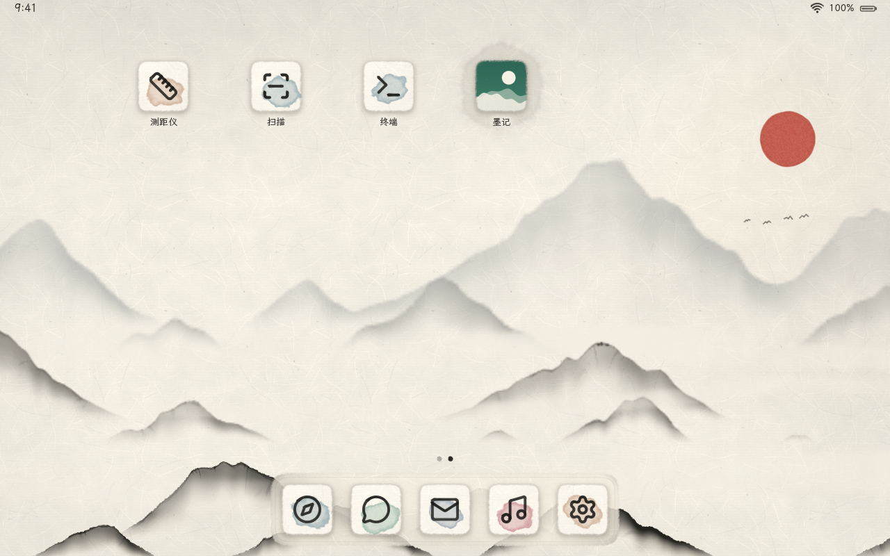
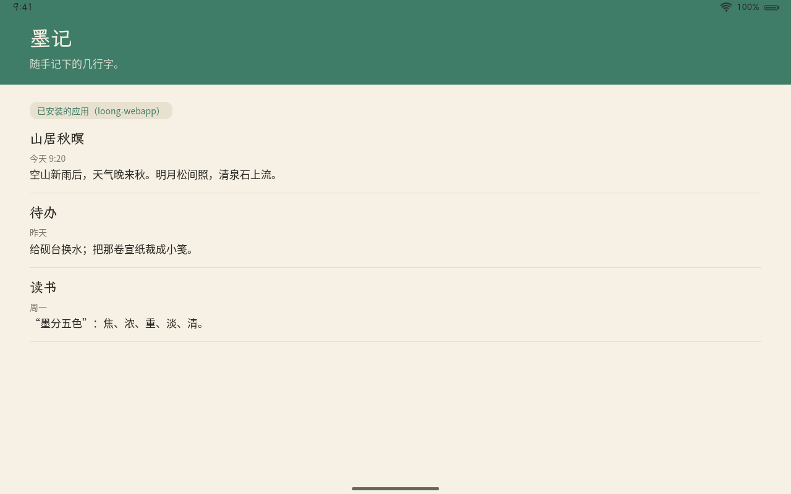
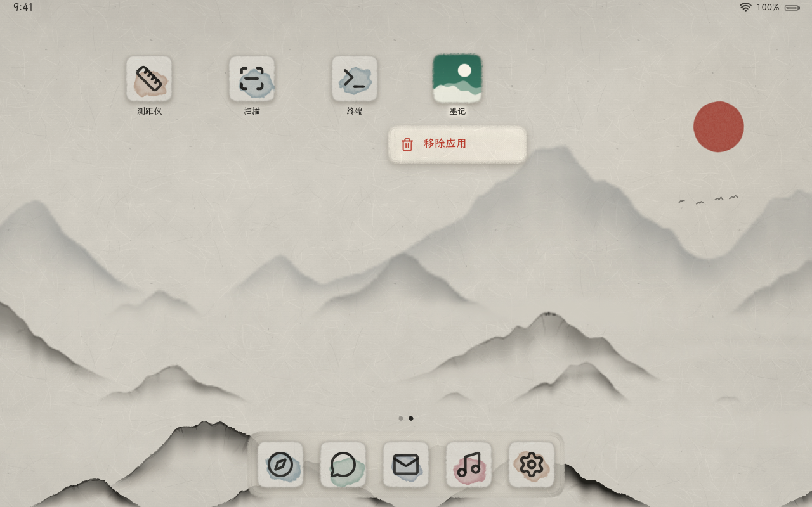
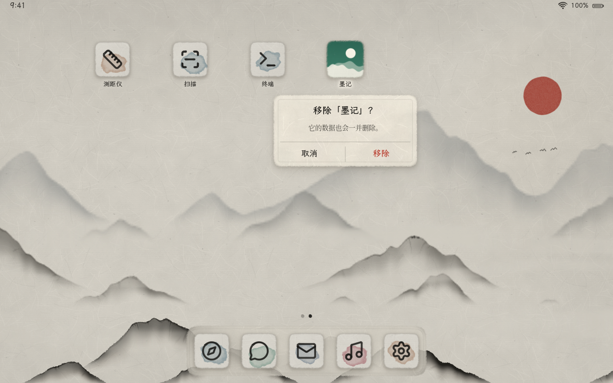
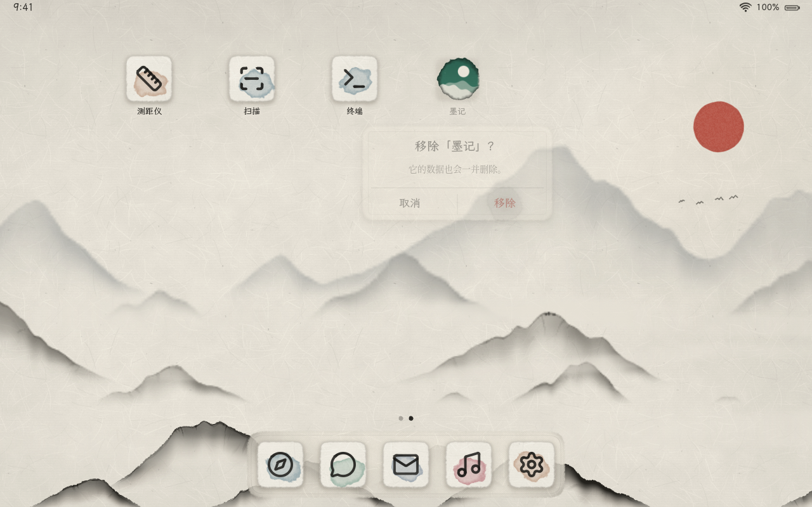
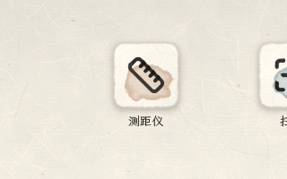
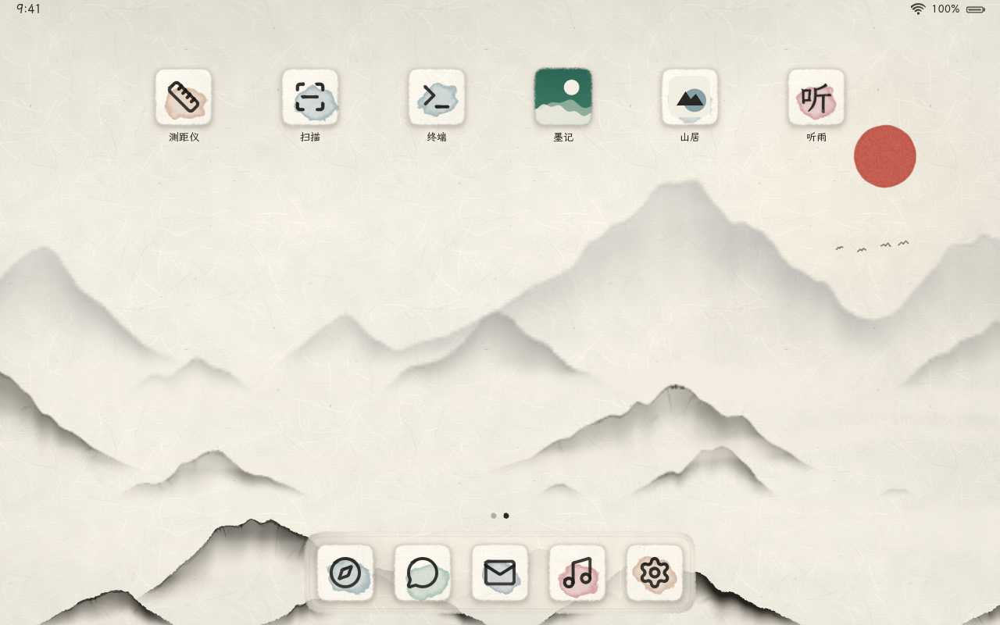
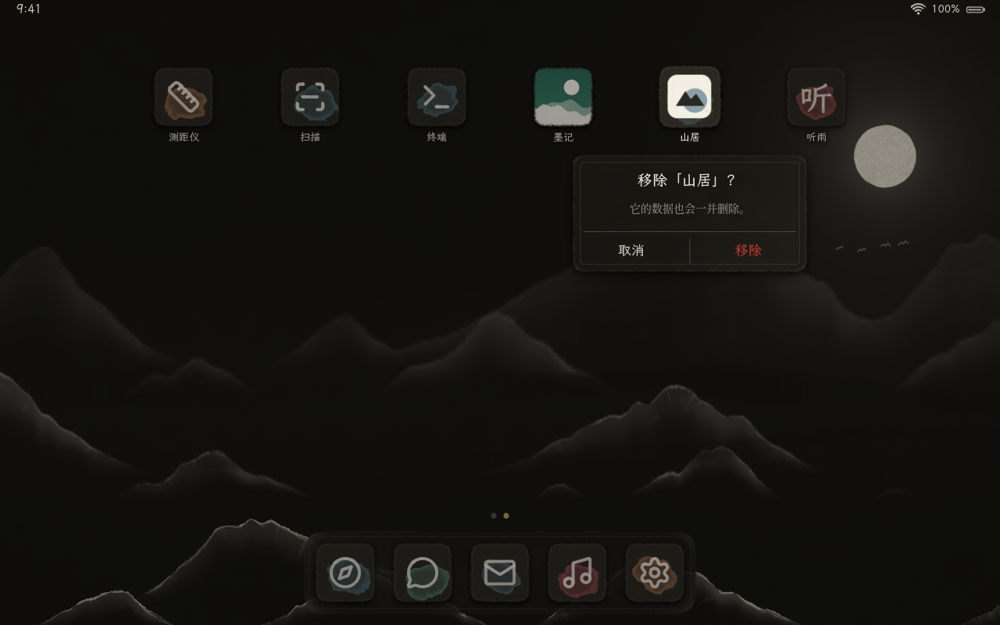

# PWA 注册表：已安装的 Web 应用

> 状态：已实现（M2）。浏览器“添加到主屏幕”写注册表 → loong-shell 用 inotify 发现新应用、在主屏上“落印”入场 → 点按以 loong-webapp 运行 → 长按“移除应用”删除注册表与数据。在无屏幕 loong-shell 中用真实的 loong-browser 与 loong-webapp 端到端验证（[第 8 节](#8-验证)）。

| 浏览器：分享 → 添加到主屏幕 | 回到主屏：展卷到新图标所在的页，图标“落印” | 以 loong-webapp 运行（没有浏览器界面） |
|---|---|---|
|  |  |  |
| **长按：绢面小菜单** | **确认移除** | **收墨：图标像墨收回纸中** |
|  |  |  |

落印的过程（APNG，主屏第二页的一角，15 帧/秒）：



三种小笺（左起：maskable PNG 铺满小笺；`any` 的 SVG 缩到 70% 放在宣纸上；没有图标时用名称首字，颜料取自 `theme_color`），宣纸与夜墨：

| 宣纸 | 夜墨 · 长按确认 |
|---|---|
|  |  |

## 1. 流程

1. 用户在 loong-browser 里点“分享 → 添加到主屏幕”。浏览器在网页的隔离 JS world 中读取 W3C manifest，规范化（绝对地址、颜色、作用域），挑一个图标，经浏览器自己的网络会话下载，然后写入注册表目录（第 3 节）。
2. loong-shell 监视注册表目录（inotify），读到新的 `manifest.json` 后把应用追加到主屏网格的末尾。主屏不在眼前（应用在前台、多任务、锁屏）时先记着；回到主屏、动画停稳后，主屏展卷到新图标所在的页，图标落印（第 6 节）。
3. 点按图标：卡片从图标处弹出，纸色底就是启动闪屏（manifest 的 `background_color` + 小笺图标），loong-shell 运行 `loong-webapp`（第 5 节）；窗口的 app_id 对上之后内容晕染开。
4. 长按图标（0.5 秒、位移 < 8pt）：弹出“移除应用”菜单，确认后 loong-shell 结束应用进程、删除注册表目录与数据目录、写回 home.toml，图标收墨，后面的图标落位。

## 2. 路径

| 路径 | 内容 | 谁写 |
|---|---|---|
| `$XDG_DATA_HOME/loong/webapps/<id>/manifest.json` | 规范化的 manifest（第 3 节） | 浏览器 |
| `$XDG_DATA_HOME/loong/webapps/<id>/icon.png` 或 `icon.svg` | 浏览器下载的图标 | 浏览器 |
| `$XDG_DATA_HOME/loong/webapps/<id>/` 下其余文件 | 这个应用的 WebKit 数据（Cookie、localStorage、IndexedDB、Service Worker） | loong-webapp |
| `$XDG_CACHE_HOME/loong/webapps/<id>/` | 这个应用的 WebKit 缓存 | loong-webapp |
| `$XDG_CONFIG_HOME/loong/home.toml` | 主屏网格的顺序（第 7 节） | loong-shell |

`$XDG_DATA_HOME` 默认 `~/.local/share`，`$XDG_CACHE_HOME` 默认 `~/.cache`，`$XDG_CONFIG_HOME` 默认 `~/.config`；设备上用户是 `loong`。注册表目录不存在时 loong-shell 以 0700 创建。

注册表目录与 loong-webapp 的数据目录是**同一个目录**：系统应用（“设置”等，`--id settings`）也在这里放 WebKit 数据，但没有 `manifest.json`，不算已安装的应用；与内置应用同名的目录一律忽略。

**应用 id**：目录名，只允许 `[a-z0-9-]`、1–64 个字符、不以 `-` 开头（浏览器、loong-webapp、loong-shell 规则相同）。浏览器由 manifest 的 `id`（没有时用 `start_url`）的主机名 + 路径生成，例如 `https://www.example.com/app/` → `example-com-app`，`http://127.0.0.1:8765/pwa/` → `127-0-0-1-8765-pwa`。同一个网站再装一次是同一个 id（覆盖）。

## 3. manifest.json

浏览器写入的是规范化过的 W3C manifest，外加 Loong 自己的 `loong_icon`：

```json
{
  "name": "墨记 · 随手笔记",
  "short_name": "墨记",
  "start_url": "http://127.0.0.1:8765/pwa/?source=pwa",
  "scope": "http://127.0.0.1:8765/pwa/",
  "id": "http://127.0.0.1:8765/pwa/?source=pwa",
  "display": "standalone",
  "theme_color": "#3f7d68",
  "background_color": "#f6f1e4",
  "icons": [
    { "src": "http://127.0.0.1:8765/pwa/icon-192.png", "sizes": "192x192", "type": "image/png", "purpose": "maskable" },
    { "src": "http://127.0.0.1:8765/icon.svg", "sizes": "any", "type": "image/svg+xml", "purpose": "any" }
  ],
  "loong_icon": { "file": "icon.png", "purpose": "maskable", "src": "http://127.0.0.1:8765/pwa/icon-192.png" }
}
```

loong-shell 读取时的校验（不合格的应用只记警告、不影响其他应用）：

| 字段 | 规则 |
|---|---|
| 文件 | ≤ 64 KiB，JSON 对象 |
| `name` / `short_name` | 至少有一个；去掉控制字符，截到 80 个字符。主屏标签用 `short_name`（太长时截断加“…”），多任务与确认对话框用 `name` |
| `start_url` | 必填，`http://` 或 `https://` 绝对地址，不含空白，≤ 2048 字节 |
| `scope` | 必须是 `start_url` 的前缀；缺省或不合规时取 `start_url` 所在目录 |
| `display` | `fullscreen` / `standalone` / `minimal-ui` / `browser`，其余按 `standalone`；v1 一律全屏运行 |
| `theme_color` / `background_color` | CSS 颜色：`#rgb`、`#rrggbb`（及带透明度的写法）、`rgb()`、常见颜色名；透明度忽略。浏览器写入时已经规范化成 `#rrggbb` |
| `loong_icon.file` | 只认 `icon.png` 与 `icon.svg`（不跟随别的路径）；文件 ≤ 1 MiB，内容须是 PNG（签名）或 SVG。`purpose` 含 `maskable` 时铺满小笺 |

**写入顺序**：浏览器先写图标（临时文件下载完、校验后改名为 `icon.png`/`icon.svg`），最后用 `g_file_set_contents`（写临时文件再 rename）写 `manifest.json`。loong-shell 读到 manifest 时图标已经就位；手写注册表时也请按这个顺序。重新安装（manifest 或图标变了）时主屏上的图标、名称原地更新。

## 4. 图标

**浏览器挑图标**（`webrt/browser/loong-browser.c` 的安装脚本）：只要 loong-shell 能解码的 PNG 与 SVG（按 `type`，没有 `type` 时按扩展名；没有扩展名的当 PNG 下载、按内容校验）。打分：够大（≥ 192px 或矢量）最要紧，其次 `maskable`（铺满小笺），再次 PNG，同等条件下取最接近 256px 的。下载走浏览器自己的网络会话（代理、Cookie 与网页一致，不受 CORS 限制），上限 1 MiB、15 秒；`data:` 图标直接解码。取不到可用的图标时照样安装，manifest 里没有 `loong_icon`。

**loong-shell 画小笺**（`loong_ui::ink::web_app_icon`，「墨韵」宣纸小笺，见[设计规范 §10.1](../design/设计规范.md#101-应用图标宣纸小笺)）：

- `maskable`：图标铺满小笺，连续圆角遮罩 + 毛边，表面压一层极淡的纸纹（像印在宣纸上）；
- `any`：宣纸底 + 一团淡彩，图标缩到 70% 居中放在纸上，纸纹淡淡透上来；
- 没有图标（或解不出）：名称首字（拉丁字母大写），霞鹜文楷，按毛笔的方式处理——笔画边缘积墨、沿纤维晕开、偶有飞白；
- 淡彩颜料由 `theme_color`（太灰时用 `background_color`，再没有就按 id 轮换）按色相选一种中国传统颜料：胭脂、藤黄、赭石、石绿、石青、花青（朱砂留给品牌与提示）。
- 解码：PNG 头里声明的边长 ≤ 2048、像素 ≤ 4M 才解码；缩小按面积平均（不起锯齿），SVG 由 resvg 直接画到目标大小（不加载外部资源与字体）。墨影与内置图标相同，但不预先画进整页山水（已安装的应用随时可能增删、移动），单独画。

## 5. 启动

点按图标时 loong-shell 运行（经 `/bin/sh -c`，参数单引号转义）：

```sh
loong-webapp --id <id> --name <name> --scope <scope> [--theme-color '#rrggbb'] [--background-color '#rrggbb'] <start_url>
```

- `loong-webapp` 可用环境变量 `LOONG_WEBAPP` 换成别的命令（开发时可以带环境变量，例如 `env WEBKIT_DISABLE_SANDBOX_THIS_IS_DANGEROUS=1 /path/to/loong-webapp`）。
- `--scope`：超出作用域、由用户发起的跳转交给系统浏览器。
- `--background-color`：WebKit 首帧前的底色，与 loong-shell 画的启动闪屏（应用卡片的纸色底）同色；暗色外观下只用深色的背景色（相对亮度 < 0.2），浅色的仍用夜墨，免得夜里闪一下白。两边规则相同。
- `--theme-color`：页面还没有报告主题色（`<meta name="theme-color">`）时，经 `loong_app_v1` 告诉 loong-shell 状态栏用哪种墨（[loong_app_v1](loong-app-protocol.md)）。
- **app_id**：loong-webapp 的 Wayland app_id 是 `loong.webapp.<id>`，`-` 写作 `_`；以数字开头的 id 前面再加 `_`（WebKit 用 GApplication id 作 app_id，而 GApplication id 的每一节不能以数字开头），例如 `127-0-0-1-8765-pwa` → `loong.webapp._127_0_0_1_8765_pwa`。id 不以 `-` 开头，所以还原没有歧义。loong-shell 据此把窗口对应到主屏图标（`shell/apps.rs` 的 `webapp_app_id`）。

## 6. 主屏上的动效

| 动效 | 何时 | 表现 | 弹簧 | 减弱动态效果 |
|---|---|---|---|---|
| **落印** | 新应用入场（主屏摆在眼前、动画停稳后） | 先展卷到新图标所在的页；图标从 1.6 倍、半透明压到纸上，带一点回弹（压进纸里再弹回），墨影随贴近纸面显出；盖下的一刻纸上晕开一滴墨 | 缩放 `BOUNCY`，显现 `SNAPPY`；展卷 `SMOOTH` | 只淡入（`SMOOTH`），不落墨；展卷照常 |
| **收墨** | 确认移除 | 晕染遮罩从四周收向图标中心（前沿积墨），图标略缩，最后一点墨淡入纸中；名称、墨影随之淡去 | `SMOOTH` | 只淡出 |
| **落位** | 收墨结束、排列变化 | 后面的图标从旧位置移到新位置（跨页的从屏幕外滑进来） | `BOUNCY` | 直接就位 |
| **菜单** | 长按 0.5 秒 | 主屏罩一层薄墨，被按住的图标浮起 1.06 倍；绢面小菜单从 1.08 倍缩到 1、淡入；收起时只淡出 | `SNAPPY`；收起 `SMOOTH` | 不缩放，只淡入淡出 |

等待落印的图标在格子里不显示、点不中；收墨中的图标点不中。页数随应用数量增减（横屏每页 6×4）：多出一页时重画山水长卷（层宽与页数有关），少了一页而正停在那一页时滚回最后一页。

## 7. 主屏排列：home.toml

```toml
# 主屏网格中应用的顺序（loong-shell 写入；新安装的应用追加到末尾）
order = [
  "photos",
  "notes",
  "127-0-0-1-8765-pwa",
]
```

- 只记网格；Dock 固定为系统应用（浏览器、设置等）。内置的演示应用也在网格里，排在前面。
- 开机时：文件里的顺序在前；文件里没有的应用排在后面（内置应用按内置顺序，已安装的按 manifest 的修改时间、再按 id）；文件里有、但已经不存在的 id 忽略。开机时的排列不写回。
- 安装、移除后 loong-shell 写回（临时文件 + rename，0600）。还没有拖动排序；手动改了文件，重启 loong-shell 生效。

## 8. 验证

- 单元测试（`cargo test -p loong-shell -p loong-ui`）：manifest 解析与校验（坏 JSON、缺名称、非 http(s) 的 `start_url`、不合法的 id、路径穿越的 `loong_icon`、颜色写法）、扫描与增删改比较、卸载、inotify 事件过滤（WebKit 数据不触发扫描）与原子写入、home.toml 读写、启动命令的转义、app_id 往返；主屏：开机追加不播放动画、等主屏可见再展卷与落印（帧中能看到放大的图标与墨滴）、减弱动态效果、长按菜单（内置应用没有、面板外点击收起、取消、确认移除、收墨时图标只画一次）、落位、页数增减、`background_color` 闪屏；小笺：三种画法、图标解码与上限、面积平均缩小、颜料按色相。
- 端到端（`tools/dev-chroot.sh run sh webrt/tests/pwa-headless.sh`）：无屏幕 loong-shell（真实时间）+ 本地 HTTP 服务上的测试 PWA「墨记」（`webrt/browser/tests/pages/pwa/`，maskable PNG 图标）+ 真实的 loong-browser 与 loong-webapp，按 `webrt/tests/pwa/install.json` 回放触摸：点 Dock 的浏览器 → 分享 → 添加到主屏幕 → 回主屏（展卷、落印，录 APNG）→ 点图标（loong-webapp 打开，没有浏览器界面，页面显示“已安装的应用”）→ 回主屏 → 长按 → 移除应用 → 移除（收墨）。脚本最后检查：浏览器写了 manifest 与图标、loong-shell 发现了新应用、启动命令带作用域与颜色、窗口 app_id 对上了应用、卸载后注册表目录与缓存目录都没了、home.toml 里也没有它。本页的截图来自这里。
- 三种小笺（`tools/dev-chroot.sh run sh webrt/tests/pwa/icons.sh`）：按本页格式直接写注册表，截主屏与长按菜单，宣纸与夜墨各一套。

## 9. 尚未实现

- 拖动排序、文件夹、把已安装的应用放进 Dock。
- `display: browser` / `minimal-ui` 的区别（v1 一律全屏运行）；`shortcuts`、`share_target`、`protocol_handlers`、`file_handlers`。
- manifest 更新检查（网站改了 manifest 或图标，要重新“添加到主屏幕”）。
- ICO、WebP 等格式的图标（浏览器只挑 PNG 与 SVG；都没有时主屏用首字）。
- 移除时要等应用进程退出再删一次数据（最多约 5 秒，2 秒后 SIGKILL）；正在启动、还没有窗口的实例结束不了，它退出后可能又写下一点 WebKit 数据（下次卸载时清掉）。
- 主屏第一页、第二页的前几格仍是内置的演示应用（截图与动效测试用），新安装的应用排在它们后面。
- Web Notifications 转发（M2 的另一项）。
