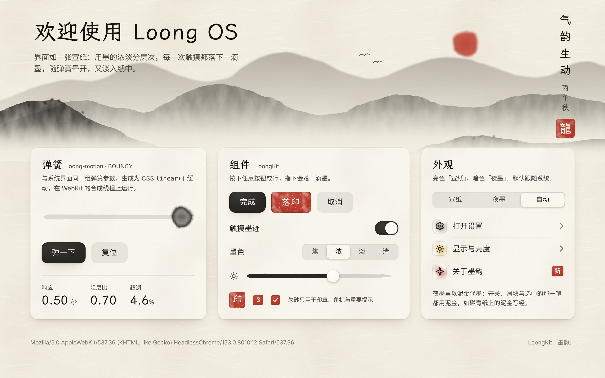
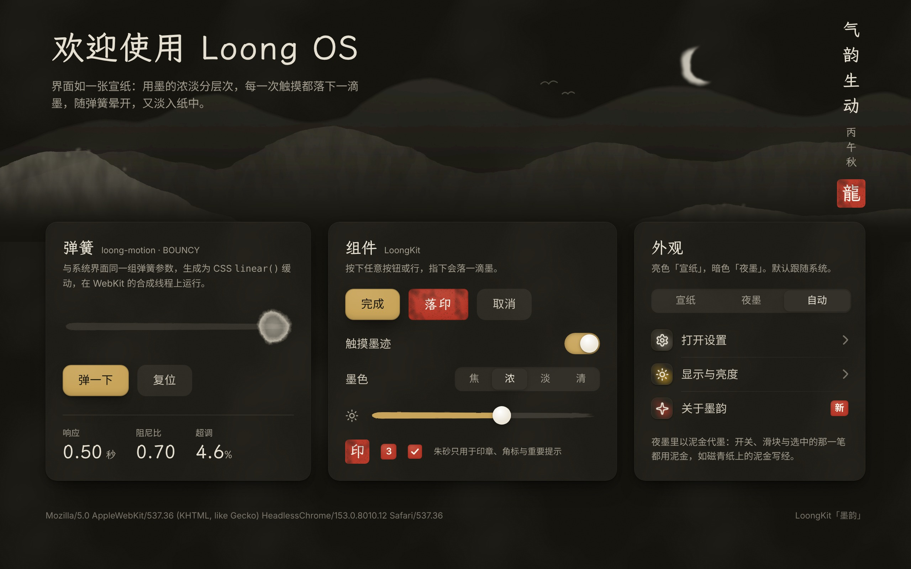
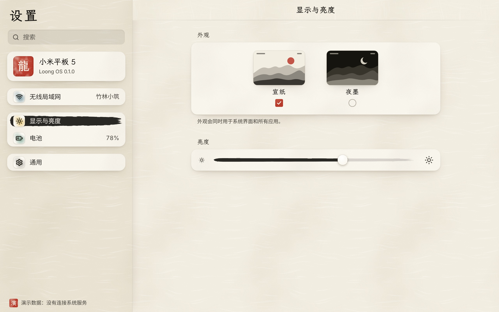
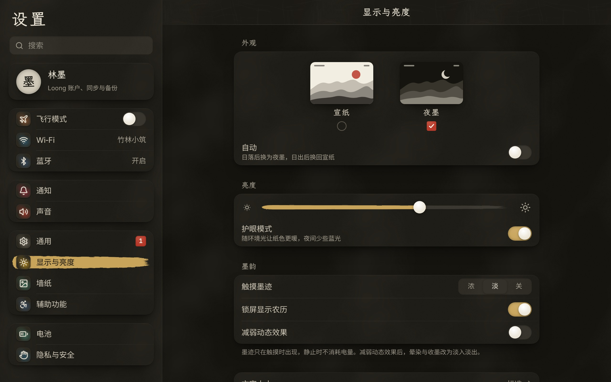

# Loong 设计规范（Loong HIG）·「墨韵」

> 适用范围：v1 平板（regular 尺寸类）。shell 侧由 `crates/loong-ui`（绘制、令牌、连续圆角、`ink` 水墨绘画工具）和 `crates/loong-motion`（物理动画）实现；Web 侧由 LoongKit（`webrt/loongkit/`）实现，系统 Web 应用与第三方 PWA 都可以使用。
> 设计语言的取舍见 [ADR 0005](../adr/0005-设计语言-墨韵.md)。色值以 `crates/loong-ui/src/theme.rs` 为准，本文同步；本文中的其余数值是**初始值**，需要在实机（小米平板 5）上调校。
> 效果参考：`webrt/demo/index.html`、`webrt/apps/settings/`（设置，加 `?mock=1` 用演示数据），截图见 [`docs/images/web/`](../images/web/)（由 `tools/web-shot.mjs` 生成）。

| 宣纸（亮色，默认） | 夜墨（暗色） |
|---|---|
|  |  |
|  |  |

## 1. 设计原则

**「墨韵」：用起来像一幅水墨画在眼前动起来，像在纸上作画。** 界面是一张纸，信息是墨，触摸是落笔，动画是墨在纸上的晕染与收敛。

### 1.1 五条水墨原则

| 原则 | 含义 | 落点 |
|---|---|---|
| **留白** | 纸为底，界面元素少而疏；不用描边和色块堆砌层次 | 页面就是宣纸；卡片是提亮的素笺加一层墨影，不画边框；分隔线是一笔渐淡的淡墨 |
| **墨分五色** | 用墨的浓淡（焦 / 浓 / 重 / 淡 / 清）表达层级，而不是用很多颜色；每个元素最多一种颜料点缀；**朱砂只用于品牌与重要提示** | 标题焦墨、正文浓墨、说明重墨、占位淡墨、装饰清墨；朱砂只出现在印章、角标、警示 |
| **笔意** | 每一次触摸都“落墨”：触摸反馈就是墨点、笔迹 | 按下即「点墨」；选中项是一笔浓墨横画；滑块是一笔淡墨，拖动时着墨 |
| **气韵生动** | 一切运动由弹簧物理驱动，以晕染、收墨、展卷表现；可随时被手势打断并继承速度 | 第 7 章：每种水墨动效都对应一个 `loong-motion` 弹簧预设 |
| **虚实** | 焦点是实（浓墨、清晰），背景是虚（淡墨、烟云、模糊） | 当前项实、其余虚；面板后方是绢与烟；远山淡、近石浓 |

### 1.2 沿用的三条 Loong 原则

| 原则 | 含义 |
|---|---|
| **物理一致** | 所有动画都来自同一个物理模型：只用弹簧、惯性、橡皮筋；**所有动画都可被手势打断，并继承速度** |
| **克制省电** | 静止时不消耗资源：无变化不重绘；纸纹、山水、图标、模糊只算一次并缓存；水墨特效**只在交互期间计算**，不做常驻装饰动画 |
| **中文优先** | 先满足中文排版，再兼顾西文：字号与行高按中文校准；全角标点；题款可竖排 |

### 1.3 素材与许可

- 参考 Apple HIG 的**原则**，不复制 Apple 的素材和外观：不使用 SF Pro、苹方、SF Symbols、Apple 壁纸、图标和音效。
- 壁纸、纸纹、笔触、印章、图标底板全部**程序生成**（`loong-ui::ink`、`tools/loongkit-textures.py`），不增加资源体积。

  | 素材 | 用途 | 许可 |
  |---|---|---|
  | **霞鹜文楷屏幕版**（LXGW WenKai Screen） | 展示字体：标题、时间、印章、题款 | SIL OFL 1.1 |
  | **Inter** | 西文与数字 | SIL OFL 1.1 |
  | **Noto Sans CJK SC** | 中文正文 | SIL OFL 1.1 |
  | **Lucide** | 符号（再转成毛笔笔触） | ISC |
  | 程序生成的山水、纸纹、印章、图标 | — | 项目自有 |

## 2. 单位、缩放与网格

### 2.1 逻辑点（pt）

- 所有设计数值都以**逻辑点 pt** 为单位，满足 `px = pt × scale`。在 Web 端，1 CSS px = 1 pt（WebKit 的 device scale factor 等于系统 scale）。
- `scale` 由 `device.toml` 中的分辨率和物理尺寸算出，shell 不写死任何机型：

  ```
  ppi       = √(宽px² + 高px²) / 对角线英寸
  scale_raw = ppi / 132                      // regular（平板）基准密度
  scale     = |scale_raw − round(scale_raw)| ≤ 0.15 ? round(scale_raw)
                                                    : round(scale_raw × 4) / 4   // 0.25 步进
  ```

  | 设备 | 物理参数 | ppi | scale | 逻辑画布（横屏） |
  |---|---|---|---|---|
  | 小米平板 5（nabu） | 2560×1600，11″ | ≈ 274 | 2 | 1280×800 pt |
  | QEMU 开发机 | 1280×800（虚拟屏） | — | 1（固定） | 1280×800 pt |

- **尺寸类**：逻辑短边 ≥ 600pt 为 **regular**（平板）；< 600pt 为 **compact**（手机，v2）。compact 的基准密度预留为 163。

### 2.2 网格与间距

- 平板使用 **8pt 基础网格**；图标、文字之间的细调可以用 4pt 半格。
- 间距令牌（单位 pt）：

  | 令牌 | 2 | 4 | 8 | 12 | 16 | 20 | 24 | 32 | 40 | 48 | 64 |
  |---|---|---|---|---|---|---|---|---|---|---|---|
  | 常见用途 | 细线微调 | 图文间距 | 组件内边距 | 列表图标与文字 | 卡片内边距 | — | 页面边距 | 分组间距 | — | 单行列表行高 | 双行列表行高 |

- **留白优先**：拿不准时取大一级的间距。一屏之内的卡片不超过三列。
- **触控目标**不小于 44×44pt，相邻目标之间至少间隔 8pt。
- **像素对齐**：分隔线固定为 1 物理像素（不是 1pt）。元素静止时边缘对齐物理像素；动画过程中**不做**对齐，以免抖动。动画停稳时 `loong-motion` 返回精确的目标值，最后一帧自然落在对齐位置。

## 3. 颜色：纸、墨、颜料

界面只引用**令牌**，不直接写色值。色值的唯一来源是 `crates/loong-ui/src/theme.rs`（`Theme::palette()` 与 `pigment`）；LoongKit 的 CSS 变量与之一一对应。

### 3.1 纸与墨（`Palette`）

| 令牌 | 「宣纸」亮色（默认） | 「夜墨」暗色 | 用途 |
|---|---|---|---|
| `paper` 纸 | 宣纸 `#F3EEE2` | 夜墨 `#15140F` | 页面、壁纸天色 |
| `paper_raised` 抬起的纸 | 熟宣 `#EAE3D3` | 墨绢 `#1F1D17` | 侧栏、凹槽、多任务卡片的纸 |
| `ink[0]` 焦墨 | `#141310` | `#E6E0D2` | 标题、最重要的文字与笔触 |
| `ink[1]` 浓墨 | `#2A2824` | `#CFC8B8` | 正文、主按钮、选中的一笔 |
| `ink[2]` 重墨 | `#4A4741` | `#A39D90` | 次要文字、说明、数值 |
| `ink[3]` 淡墨 | `#7D7970` | `#7A756A` | 占位、不可用、远山（**不用于正文**） |
| `ink[4]` 清墨 | `#B4AEA2` | `#5A564C` | 装饰、分隔、最远的层次 |
| `accent` | 朱砂 `#B83A2B` | 朱砂 `#B83A2B` | 印章、角标、警示 |

暗色不是把亮色反相：纸变成夜墨，墨变成“月白”系（越重要越亮）。

### 3.2 传统颜料（`pigment`）

| 颜料 | 色值 | 用途 |
|---|---|---|
| **朱砂** | `#B83A2B` | 品牌与重要提示：印章、角标、警示、品牌主操作（一屏最多一个） |
| 胭脂 | `#9D2B3C` | 图标色晕（音乐、通知） |
| 藤黄 | `#D8A21E` | 图标色晕、充电闪电、太阳（**只用于图形**，对纸 2.0:1） |
| 赭石 | `#A0623A` | 图标色晕、警告（暖） |
| 石青 | `#2E5E74` | 图标色晕（相册、网络）、存储分段 |
| 石绿 | `#3F7D68` | 图标色晕（地图、电池）、充电中的电量 |
| 花青 | `#3B5878` | 链接（亮色）、图标色晕 |
| 泥金 | `#C8A45A` | 暗色的“着色”：开关、滑块、选中的一笔（磁青纸泥金写经的意思） |

规则：**每个元素最多一种颜料**；颜料以“色晕”（没骨淡彩，边缘晕开）出现，不做大面积纯色块；朱砂不做装饰。

### 3.3 语义令牌

在纸与墨之上再定义一层语义，组件只用这一层。Web 端的名字见 §11；派生色（标 * 的）不在 `theme.rs` 中，用于满足对比度或材质需要，shell 侧需要时按同值补入。

| 令牌 | 亮色 | 暗色 | 用途 |
|---|---|---|---|
| `title` | 焦墨 | 焦墨（月白） | 标题 |
| `label` | 浓墨 | 浓墨 | 正文 |
| `secondaryLabel` | 重墨 | 重墨 | 次要文字、分组标题、脚注 |
| `tertiaryLabel` | 淡墨 | 淡墨 | 占位、不可用（≥ 3:1，只用于大字或非关键信息） |
| `quaternaryLabel` | 清墨 | 清墨 | 装饰，不承载信息 |
| `sheet`* 素笺 | `#F9F6EE` | `#1F1D17` | 卡片、分组列表（亮色是宣纸提亮，暗色等于墨绢） |
| `separator` | 浓墨 13% | 月白 12% | 分隔线（一笔向右渐淡） |
| `fill` / `secondaryFill` / `tertiaryFill` | 浓墨 11% / 8% / 6% | 月白 13% / 9% / 6% | 控件底（开关关闭态、分段控件槽、搜索框） |
| `accent` | 朱砂 | 朱砂 | 印章、角标、朱砂按钮 |
| `onAccent`* | `#FAF6EC` | `#FAF6EC` | 朱砂上的字（5.3:1） |
| `accentText`* | 朱砂 `#B83A2B` | `#E06A55` | 朱砂色文字（警示）；只放在纸与素笺上 |
| `link`* | 花青 `#3B5878` | `#93AFCB` | 链接、信息按钮 |
| `success`* | `#346E5A`（石绿加深） | `#7BB59B` | 成功、已连接（文字） |
| `warning` | 赭石 | 泥金 | 警告 |
| `danger` | 朱砂 | `#E06A55` | 破坏性操作 |
| `control` | 浓墨 | **泥金** | 开关开启、滑块已着墨段、选中的一笔、主按钮 |
| `onControl`* | `#FBF8F1` | `#15140F` | `control` 上的字 |
| `knob`* | `#FBF8F1` | `#ECE6D9` | 开关、滑块的纸团 |
| `scrim` | `rgb(30 24 14 / .22)` | `rgb(0 0 0 / .5)` | sheet、弹窗后方的遮罩 |

### 3.4 对比度（WCAG 2.x，已校验）

| 前景 / 背景 | 宣纸 `#F3EEE2` | 素笺 `#F9F6EE` | 熟宣 `#EAE3D3` | 夜墨 `#15140F` | 墨绢 `#1F1D17` |
|---|---|---|---|---|---|
| 焦墨（标题） | 16.1 | 17.2 | 14.5 | 14.0 | 12.8 |
| 浓墨（正文） | **12.7** | **13.6** | **11.5** | **11.1** | **10.1** |
| 重墨（次要） | 8.0 | 8.6 | 7.2 | 6.8 | 6.2 |
| 淡墨（占位） | 3.8 | 4.0 | 3.4 | 4.0 | 3.7 |
| `accentText` | 4.9 | 5.3 | 4.5 ✗ | 5.6 | 5.1 |
| `link` | 6.4 | 6.8 | 5.8 | 8.1 | 7.4 |
| `success` | 5.2 | 5.5 | 4.7 | 7.8 | 7.2 |

- `onControl` 在 `control` 上：亮 13.9，暗 7.8；`onAccent` 在朱砂上 5.3。侧栏选中行（`onControl` 85% 不透明）：亮 10.4，暗 6.1。
- 非文字图形：开关开启态对卡片 13.6（亮）/ 7.2（暗）；朱砂印章对宣纸 4.9、对夜墨 3.2（≥ 3:1）。
- ✗：朱砂文字放在熟宣上只有 4.47，因此朱砂文字只放在宣纸与素笺上。

### 3.5 使用规则

- 正文 ≥ 4.5:1，大字（≥ 20pt）与非文字图形 ≥ 3:1；淡墨、清墨不承载必须读到的信息。
- **不只靠颜色传达状态**：状态同时配合符号或文字（低电量既变朱砂，也显示百分比；已连接用印章 ✓ 加“已连接”）。
- 外观（宣纸 / 夜墨）跟随系统设置，默认宣纸；系统界面和 LoongKit 组件都通过令牌自动切换。
- PWA 的 `theme_color` 决定状态栏前景：相对亮度 > 0.5 用浓墨，否则用月白。它不改变系统的墨与颜料。

## 4. 字体

### 4.1 字体族与回退

| 角色 | 字体 | 回退 | 用在哪里 |
|---|---|---|---|
| **展示**（Display） | 霞鹜文楷屏幕版 `LXGW WenKai Screen`（只有 Regular 一个字重） | 正文字体 | 大标题、各级标题、分组标题、导航栏标题、锁屏时间与日期、电量等大号数字、印章与题款、朱砂按钮 |
| **正文**（Body） | Inter → Noto Sans CJK SC | system-ui | 正文、列表、按钮、说明、表格数字 |

- `loong-ui` 中对应 `font::DISPLAY_FAMILY` / `font::FAMILY`（`text.rs` 的 `FontRole::Display` / `Body`）；LoongKit 中对应 `--loong-font-display-family` / `--loong-font-family`。
- **文楷不加粗**：只有一个字重，禁止合成粗体（CSS `font-synthesis: none`）。层级靠字号、墨色与留白，不靠字重。
- **中文正文只用 400**：设备上的 Noto Sans CJK SC 只有 Regular 与 Bold，500/600 会落到 Bold，中文显得过重。需要强调时换成文楷或更浓的墨，而不是加粗。西文与数字可用 Inter 500。
- **数字**：时间、电量等“看一眼”的大号数字用文楷；表格、计数器、计时器用 Inter 的等宽数字（`tnum`），数字变化时宽度不跳动。
- **弯引号** `“ ” ‘ ’` 交给 Noto Sans CJK SC 渲染成全角字形；书名、引用的专名用「」。

### 4.2 字号层级（regular）

| 令牌 | 字号 / 行高 | 字体 | 用途 |
|---|---|---|---|
| `largeTitle` | 34 / 44pt | 文楷 | 页面大标题（如“设置”，两字标题字距 0.12em） |
| `title1` | 28 / 36pt | 文楷 | 一级标题、关于本机的系统名 |
| `title2` | 22 / 30pt | 文楷 | 卡片标题 |
| `title3` | 20 / 28pt | 文楷 | 三级标题、锁屏日期 |
| `headline` | 17 / 24pt | 正文 500（中文 400） | 强调文字 |
| `body` | 17 / 26pt | 正文 400 | 正文；列表行用 16 / 22pt |
| `callout` | 16 / 24pt | 正文 400 | 说明块 |
| `subhead` | 15 / 22pt | 正文 400 | 副标题 |
| `footnote` | 13 / 20pt | 正文 400 | 注释、列表脚注、行内副标题 |
| `caption` | 12 / 18pt | 正文 400 | 主屏图标名称、时间戳、图例 |

- 专用字号：分组标题 文楷 15 / 20pt、字距 0.04em、重墨；导航栏标题 文楷 19 / 26pt、字距 0.06em；状态栏时间 文楷 14pt；锁屏时间 文楷 80pt。
- 行高已为中文留出空间（约 1.3–1.55 倍）。长段落建议 1.6–1.75 倍行高。中文最小字号 12pt。

### 4.3 中文排版要点

- **避头尾**：行首不出现 `，。、；：！？）」` 等标点（CSS `line-break: strict`）。不使用连字符断词（WPE 的构建也关闭了 libhyphen）。
- **不留孤字**：两行以内的说明文字用 `text-wrap: balance`，避免第二行只剩一两个字。
- **中西文混排**：中文与英文、数字之间加半角空格；中文语境下使用全角标点。
- **字距**：正文字距为 0；文楷标题可放宽到 0.04–0.12em（字越少放得越宽）。
- **题款**：装饰性的题字可以竖排（`writing-mode: vertical-rl`），落款下方配一方朱砂印。只用于插画与卷首，不用于可操作的界面。
- **截断**：单行文字超出时在末尾显示 `…`。主屏图标名称只显示一行。

## 5. 形状

### 5.1 连续圆角

系统中的圆角都是**连续圆角**：从直边到圆角的曲率连续变化，没有普通圆弧圆角在切点处的“折痕”。实现见 `loong-ui` 的 `shape::continuous_rect`：

- 每个角用**超椭圆** `|x|ⁿ + |y|ⁿ = 1` 代替圆弧，其中 **n = 4**。曲线两端曲率为 0，与直边平滑相接。
- 令牌中的半径 r 是**名义半径**。为了让视觉大小接近同半径的圆弧圆角，角曲线实际覆盖 **1.28 × r** 的范围，并限制在边长的一半以内。
- 合成器的窗口圆角着色器使用同一组参数，保证图标、卡片、窗口观感一致。应用图标边长为 S 时，`r = 0.225 × S`。
- `capsule`（胶囊）和 `badge` 直接使用圆弧。

### 5.2 圆角令牌

| 令牌 | 半径 | 用途 |
|---|---|---|
| `icon` | 0.225 × 边长（72pt 图标约 16.2pt） | 应用图标、启动闪屏图标；列表中的 30pt 小笺为 8pt |
| `badge` | 4pt（四角略有出入） | 角标、小印 |
| `field` | 10pt | 搜索框、分段控件 |
| `button` | 12pt | 标准按钮；朱砂按钮 6pt（像一方印） |
| `card` | 16pt | 卡片、分组列表、控制中心模块 |
| `panel` | 22pt | 通知、多任务卡片、弹窗 |
| `sheet` | 30pt | sheet、Dock |
| `capsule` | 高度 / 2 | 开关、Home 指示条 |
| `screen` | 取自 `device.toml`（未配置时平板默认 18pt，无圆角屏幕为 0） | 全屏应用窗口 |

### 5.3 规则

- **同心**：嵌套元素的内圆角 = 外圆角 − 内边距。例如 Dock：64pt 图标的圆角约 14.4pt，加上 16pt 内边距约等于 30pt，正好是 `sheet`。
- **动画中圆角也要连续**：打开应用时，窗口圆角从 `icon` 过渡到 `screen`；回主屏时反向；进入多任务时从 `screen` 过渡到 `panel`。圆角半径与几何属性由同一个弹簧驱动。
- **毛边**：纸面元素（图标底板、多任务册页、Dock 的绢带）的边缘加轻微“毛边”——用噪声扰动边缘的 alpha（`loong-ui::ink::paper` 的毛边遮罩），幅度不超过 1pt，不改变命中区域。Web 端不做逐元素毛边（太贵），改为：印章四角半径略有出入，选中项用笔触 mask。
- **笔触代替矩形**：需要“强调一块区域”时，优先用一笔横画（选中行、滑块、存储条）而不是填充矩形；分隔线是一笔从左向右渐淡的淡墨。

## 6. 材质与层次

### 6.1 材质

| 材质 | 构成 | 用途 | Web 令牌 |
|---|---|---|---|
| **宣纸** | 不透明：纸色 + 云絮（低频明暗，约 ±3%）+ 弯曲的纤维 + 细颗粒；暗色只有云絮与颗粒 | 页面、壁纸天色 | `--loong-color-paper` + `--loong-paper-texture` |
| **素笺** | 不透明：宣纸提亮，云絮与颗粒，无纤维（更干净） | 卡片、分组列表、分段控件选中块 | `--loong-color-sheet` + `--loong-sheet-texture` |
| **熟宣** | 不透明：`paper_raised` + 宣纸纹理 | 侧栏、凹槽 | `--loong-color-paper-raised` |
| **绢** | 半透明：下层内容 → 模糊 → 暖色纸色叠加 → 经纬两向的细丝 → 柔和毛边 | 导航栏、Dock、控制中心、通知、键盘 | `--loong-material-silk` + `--loong-silk-texture` |
| **烟** | 纸色的竖向渐变雾带 | 山水各层之间、卷首下缘、多任务背景 | — |

绢分三档（shell 侧 `ink::silk_panel`，Web 端一般只用“绢”）：

| 档 | 模糊 σ | 纸色叠加（亮 / 暗） | 用途 |
|---|---|---|---|
| 薄绢 | 16pt | `#F3EEE2` 50% / `#1F1D17` 55% | 音量、亮度 HUD |
| 绢 | 24pt | `#F3EEE2` 72% / `#1F1D17` 74% | Dock、导航栏、控制中心、通知 |
| 厚绢 | 40pt | `#F3EEE2` 86% / `#1F1D17` 88% | 屏幕键盘、权限弹窗、锁屏通知 |

材质上的文字使用墨色令牌，自然透出底色。

### 6.2 墨影（阴影）

墨影是纸张浮起时投下的暖色影子：亮色用暖褐 `rgb(74 56 30)`，暗色用黑；由三层组成（贴边的细影 + 两层错开的柔影，x 方向略有偏移，显得“略不规则”）。

| 令牌 | 亮色 | 暗色 | 用途 |
|---|---|---|---|
| `shadowLow` | `0 .5 1 /12%`，`-1 3 8 -3 /12%`，`2 12 28 -14 /26%` | 黑：`0 .5 1 /40%`，`-1 4 10 -3 /36%`，`2 14 30 -12 /50%` | 卡片、按钮、小笺 |
| `shadowMid` | `0 1 2 /12%`，`-2 8 22 -8 /20%`，`3 26 52 -24 /32%` | 黑：`0 1 2 /40%`，`-2 10 26 -8 /46%`，`3 28 56 -22 /60%` | 菜单、通知横幅、弹窗 |
| `shadowHigh` | `0 2 4 /12%`，`-3 16 40 -14 /26%`，`4 44 80 -30 /36%` | 黑：`0 2 4 /40%`，`-3 18 44 -14 /50%`，`4 48 84 -28 /66%` | 多任务册页、sheet、开合途中的应用窗口 |

（格式：x y 模糊 扩展 / 不透明度，单位 pt。）暗色另加一道 0.5pt 的月白内描边作为受光边。合成器把墨影预先渲染成九宫格纹理（`ink::ink_shadow`），之后只做拉伸，不逐帧计算模糊。

### 6.3 性能策略

- **纸纹、山水、图标、印章只画一次并缓存**：shell 在开机或切换外观时由 `loong-ui::ink` 在 CPU 上生成，按（主题、尺寸、版本）缓存到 `/var/cache/loong/assets/`；Web 端的纹理是内联 SVG，浏览器栅格化一次后复用。
- **主屏与锁屏上的绢直接采样预先模糊好的壁纸**，每帧几乎没有额外开销；只有应用之上的绢才实时模糊，并且只在下层内容有新帧时重新计算。
- 实现：先降采样到 1/4，再用多次盒式模糊或 Kawase 模糊近似高斯（GLES2 可实现）。
- **降级**：开启“降低透明度”后，或在 GPU 较弱的机型上，绢改为不透明的纸色（亮 `#F3EEE2`、暗 `#1F1D17`）。

## 7. 动效

气韵生动：动画由弹簧物理驱动，以晕染、收墨、展卷表现出来。

### 7.1 原则

1. **只用物理模型**：弹簧、惯性衰减、橡皮筋。不使用“固定时长 + 贝塞尔曲线”。时长不是设计参数，而是物理过程的结果。
2. **所有动画都可被手势打断，并继承速度**。手指按到正在运动的元素上时，元素立即停在当前位置，被手指“抓住”。松手后，用速度跟踪器测得的速度作为新动画的初速度，位置和速度都连续，不会跳变（`retarget` / `set_spring` / `jump_to`）。
3. **跟手 1:1**：拖动过程中，元素严格跟随手指；超出边界的部分使用橡皮筋阻尼。
4. **用意图决定结果，而不是松手位置**：松手时先把速度投影成预计落点，再决定去向（§7.5）。
5. **与刷新率无关**：动画由显示器的帧时间戳驱动，使用解析解求值，所以 60Hz 和 120Hz 下的轨迹完全一致，掉帧也不会累计误差。
6. **运动要“像墨”**：位移和缩放之外，用晕开（半径）、浓淡（透明度）、干湿（笔迹粗细与飞白）来表达；这些量同样由弹簧驱动（§7.6）。

### 7.2 弹簧预设

参数含义与 SwiftUI 一致：`response` 是无阻尼时的振荡周期（秒），`dampingFraction` 是阻尼比 ζ。换算关系为 ω₀ = 2π / response，k = ω₀²，c = 4π·ζ / response；欠阻尼时的超调量 = e^(−ζπ/√(1−ζ²))。

| 预设 | response | damping | 停稳时长* | 超调 | 用途 |
|---|---|---|---|---|---|
| `INTERACTIVE` | 0.15s | 0.86 | ≈ 246ms | 0.5% | 拖动中的跟随：面板、卡片、图标随手指移动（每个触摸事件都 retarget 到手指位置） |
| `SNAPPY` | 0.30s | 0.85 | ≈ 462ms | 0.6% | 按钮按下 / 抬起、开关滑块、分段控件、点墨晕开、主屏翻页与切换应用后的吸附、弹窗出现 |
| `SMOOTH` | 0.50s | 1.0 | ≈ 746ms | 0 | 大面积转场：控制中心、通知中心、sheet、进出多任务、未完成手势的回位、交叉淡化；墨淡去、笔迹消散、晕染开启（页内） |
| `BOUNCY` | 0.50s | 0.7 | ≈ 846ms | 4.6% | 需要“活力”的小元素：落印、新应用图标入场、徽标出现、图标落位 |
| `APP_OPEN` | 0.42s | 0.9 | ≈ 560ms | 0.15% | 图标放大成应用窗口（含启动闪屏）与晕染开启 |
| `APP_CLOSE` | 0.38s | 0.82 | ≈ 570ms | 1.1% | 回主屏：窗口缩回图标、收墨，保留一点回弹 |

\* 指从静止的 0 运动到 1、静止阈值为 0.001/0.01 时的时长，由 `css::spring_easing` 算出。带初速度时实际时长会不同。体感上，大部分位移在前 40% 的时间内完成。

**静止阈值**：位置类属性（pt）用 `with_rest_thresholds(0.1, 1.0)`；缩放、透明度、墨点半径比例等用默认的 0.001 / 0.01。

### 7.3 惯性衰减

速度按指数衰减：v(t) = v₀ · rate^(t·1000)。最终滑行距离为 `project(v) = −v / (1000 · ln rate)`。

| 档位 | rate | 投影距离 | 以 1000pt/s 松手 | 从 1000pt/s 降到 1pt/s 的时间 | 用途 |
|---|---|---|---|---|---|
| `Decay::NORMAL` | 0.998 /ms | ≈ 0.50 × v | 滑行约 500pt | ≈ 3.45s | 系统界面中的列表滚动 |
| `Decay::FAST` | 0.99 /ms | ≈ 0.10 × v | 滑行约 100pt | ≈ 0.69s | 分页、多任务卡片、所有手势落点判定 |

网页内的滚动由 WebKit 自己处理，不受上表约束。

### 7.4 橡皮筋

```
f(x) = (1 − 1 / (x · c / d + 1)) · d        c = 0.55
```

- 其中 x 是手指的越界量，d 是该方向上的可视尺寸。函数起始斜率为 0.55（越界越多阻力越大），但越界量永远达不到 d。
- 越界状态下手指再次按下时，用 `rubber_band_inverse` 还原出手指坐标，避免跳变。
- 越界松手后，以松手速度为初速度，用 `SMOOTH` 弹回边界。
- 适用场景：主屏首页和末页的边缘、列表顶部和底部、面板拉过完全展开的位置、多任务卡片向下拖、sheet 向上拖。

### 7.5 速度跟踪与松手决策

- **速度估计**：对最近 100ms 的触点做最小二乘直线拟合，可以抑制抖动。如果松手前停顿超过 40ms，速度视为 0，即“按住再松开”不会触发惯性。
- **二选一手势**（回主屏或留在应用、打开或收起面板、关闭或保留卡片）：用 `should_complete(p, ṗ, Decay::FAST)` 判定，规则是 `p + project(ṗ) > 0.5`。其中 p 是手势进度（0–1），ṗ 是进度速度。这样慢拖过半能完成，轻甩一下也能完成。
- **分页**：`page_for_release` 用 `FAST` 投影后取整，**一次手势最多翻一页**。
- **自由吸附**（例如多任务卡片列表）：`nearest_snap_point` 先投影，再吸附到最近的卡片位置。
- 同一个速度还用来决定**笔迹的干湿**（§7.6）。

### 7.6 水墨动效

| 动效 | 触发 | 表现 | 弹簧 | 实现 |
|---|---|---|---|---|
| **点墨** | 手指按下图标、主屏空白、按钮、列表行 | 指下落一滴墨：半径从 8% 晕开到约一个元素高（小控件晕满为止），中心略淡、边缘积墨、外缘被纸纤维扯出毛边；抬起后再洇开 12% 并淡入纸中。纸面上是淡墨，浓墨按钮上是一滴清水（“水破墨”） | 半径 `SNAPPY`；抬起后半径与透明度 `SMOOTH` | shell：`render/ink_fx.frag` + `shell/ink.rs` 的墨点列表（每滴各有半径、透明度弹簧）；Web：`loongkit.js` 插入 `.loong-inkdrop` |
| **晕染开启** | 打开应用 | 卡片沿用放大弹簧；内容像墨在湿宣纸上从图标处洇开：fbm 噪声阈值遮罩，前沿一圈积墨 | 几何与遮罩半径同用 `APP_OPEN` | shell：`render/shader.frag` 的 `Reveal`（中心、半径、柔度、种子）；Web 页内切换：`.loong-bloom`（`SMOOTH`：透明度 + 8pt 模糊 + 0.985 缩放） |
| **收墨** | 回主屏 | 晕染开启的逆过程：内容收回图标，遮罩随窗口缩小 | `APP_CLOSE`（继承手指速度） | 同上，半径反向 |
| **笔迹** | 系统手势（回主屏、翻页、多任务） | 指后一道渐隐的笔迹：慢则湿而粗、边缘洇开；快则干而细、出现飞白；约 0.5s 消失 | 每个笔迹印的透明度 `SMOOTH`；粗细与干湿由 `VelocityTracker` 的速度映射 | shell：笔迹印环形缓冲（`ink_fx.frag`） |
| **展卷** | 主屏翻页 | 「山水长卷」分层视差：远山 0.15、中景 0.35、近景 0.6、烟云 0.8；烟云随滑动速度飘移 | 跟手 1:1；松手 `SNAPPY`（继承速度） | shell：`TexKey::WallpaperLayer(i)` |
| **墨散** | 上滑解锁 | 锁屏随手指上移，同时像墨入清水般向上散开（遮罩阈值随进度升高） | 跟手；完成与回位 `SMOOTH` | shell：`Reveal` 反向 |
| **落印** | 确认类操作（选定外观、保存、通知已处理） | 印章从 1.6 倍、−8° 落到纸上，带一点回弹，像按下去的弹性 | `BOUNCY` | Web：`.is-stamped` / `LoongKit.stamp(el)`；shell：后续用于通知与设置 |

LoongKit 组件里的小动效同样“像墨”：

| 组件 | 动效 | 弹簧 |
|---|---|---|
| 列表选中 | 一笔浓墨从左向右写出来（clip 由左至右展开） | `SMOOTH` |
| 开关 | 纸团滑过去（`SNAPPY`）；墨从纸团处在砚池里晕开（圆形 clip 半径） | `SNAPPY` + `SMOOTH` |
| 分段控件 | 素笺选中块滑到新位置 | `SNAPPY` |
| 按钮 | 按下缩到 0.96，同时点墨 | `SNAPPY` |
| 外观切换 | 新旧两张纸交叉晕染（View Transitions） | `SMOOTH` |

约束：

- **只在交互期间计算特效**：墨点、笔迹、遮罩在停稳后全部移除，静止时 GPU 不做任何动画（`is_idle()` 要把墨点与笔迹计入）。
- 墨点只画自己的小矩形；晕染遮罩只作用于卡片；fbm 最多 3 个八度。
- Web 端只动 `transform` 与 `opacity`（合成线程）；笔触与墨点外形是一次栅格化的静态 mask。

### 7.7 关键转场

| 转场 | 动画 |
|---|---|
| **按钮** | 按下时缩放到 0.96 并点墨，抬起时恢复，均使用 `SNAPPY`。按下后手指移出按钮区域则取消点击 |
| **打开应用** | 图标所在的矩形放大为全屏窗口（`APP_OPEN`），圆角从 `icon` 过渡到 `screen`，内容晕染开启。窗口中先显示合成器绘制的**启动闪屏**（manifest 的 `background_color` + 宣纸小笺图标），覆盖 WebKit 的冷启动时间。首帧就绪后闪屏淡出、内容淡入（`SMOOTH`）。主屏整体淡出并放大到 1.08 倍，形成“进入”的纵深感 |
| **回主屏** | 松手后，窗口以手指速度为初速度飞向图标位置（`APP_CLOSE`），圆角从 `screen` 过渡到 `icon`，内容收墨。图标不在当前页时飞向 Dock 中的同一图标；Dock 中也没有时，缩小并淡出到屏幕中心。主屏从 1.08 倍恢复到 1 并淡入（`SMOOTH`） |
| **面板与 sheet** | 拖动时使用 `INTERACTIVE` 跟手，松手后通过 `set_spring` 切换到 `SMOOTH`，速度保持连续 |
| **弹窗** | 出现时从 1.08 倍缩放到 1，同时透明度从 0 到 1（`SNAPPY`）；消失时只淡出 |
| **通知横幅** | 从顶部滑入（`SMOOTH`），停留 5s 后滑出；也可以上滑收起 |
| **新应用入场** | PWA 安装后，图标在主屏上从 0 放大到 1（`BOUNCY`） |

### 7.8 减弱动态效果

开启“减弱动态效果”后（Web 端对应 `prefers-reduced-motion: reduce`）：

- 位移、缩放、晕染、收墨、墨散一律改为**交叉淡入淡出**（透明度使用 `SMOOTH`，Web 端 200ms）。打开应用变成闪屏直接淡入；回主屏变成应用淡出、主屏淡入。
- **点墨与笔迹关闭**；按钮按下改为墨色略加深，不缩放。
- `BOUNCY` 改为 `SMOOTH`，取消回弹（落印只淡入）；取消主屏的纵深缩放与山水视差。
- **保留**跟手拖动和橡皮筋：直接操控是交互本身，不属于装饰性动效。但松手后的“飞行”改为淡出。

### 7.9 帧调度与功耗

- 动画在预计的上屏时间点求值，并由显示器的帧时间戳驱动。nabu 在交互时以 120Hz 刷新。
- 当没有动画、没有输入、也没有客户端提交新帧时，合成器**不重绘**。
- 不做常驻的装饰动画（呼吸灯、动态壁纸、飘动的烟云）。烟云只在翻页时随速度飘移。
- “低电量模式”关闭点墨与笔迹。

## 8. 平板布局（regular）

以 11 英寸级别的屏幕为基准，逻辑画布为 **1280×800pt（横屏）/ 800×1280pt（竖屏）**。

### 8.1 安全区与系统层

- 应用窗口占满全屏，状态栏和 Home 指示条**叠加在应用之上**。
- 应用的安全区如下（会与 `device.toml` 中的屏幕安全区合并）：

  | 方向 | 内缩 |
  |---|---|
  | 上 | 24pt（状态栏） |
  | 下 | 20pt（Home 指示条与底边手势区） |
  | 左 / 右 | 0（屏幕圆角或挖孔由 `device.toml` 补充） |

### 8.2 状态栏

| 属性 | 值 |
|---|---|
| 高度 | **24pt** |
| 左右内边距 | 24pt。屏幕圆角较大时，按 `device.toml` 的安全区加大 |
| 左侧内容 | 时间 + 日期，例如“14:30　10月30日 周五” |
| 右侧内容 | 毛笔画的 Wi‑Fi（三道弧）、电量百分比、毛笔画的电池（按电量填墨，充电时加藤黄闪电） |
| 文字 | 时间用文楷 14pt；其余正文 13pt，`tnum` |
| 符号 | 16pt，`ink::wifi` / `ink::battery` 生成 |
| 背景 | 透明 |
| 前景色 | 浓墨或月白，由应用的 theme-color 决定（规则见 §3.5）；主屏上随壁纸外观决定 |

### 8.3 Home 指示条

- 胶囊形，**200×5pt**，距屏幕底边 8pt，位于 20pt 的底边手势区内。
- 颜色根据下方内容的亮度，在浓墨 `#2A2824` 和月白 `#E6E0D2` 之间切换，切换过程使用 `SMOOTH`。
- 应用和锁屏中显示，主屏中隐藏。

### 8.4 主屏

| 方向 | 图标网格 | 水平边距 | 列距（约） | 行距（约） |
|---|---|---|---|---|
| 横屏 1280×800 | **6 列 × 5 行** | 96pt | 181pt | 121pt |
| 竖屏 800×1280 | **5 列 × 6 行** | 56pt | 138pt | 181pt |

- **每页 30 个格子**，横竖屏数量相同，所以旋转屏幕时应用所在的页不变，顺序也不变。
- **壁纸「山水长卷」**：程序生成、分层：天色淡墨渐变 + 远中近三层山（fbm 山脊线，近浓远淡，边缘干笔质感）+ 两条烟云 + 亮色朱砂日 / 暗色月。各层是独立纹理，翻页时按视差移动（§7.6 展卷）。
- **图标**：72pt「宣纸小笺」（§10），圆角 `icon`。图标下方 8pt 处显示名称：`caption` 12pt，单行，最大宽度为列距减 8pt。名称颜色随外观：亮色浓墨、暗色月白，衬一圈 4pt 的纸色柔光（而不是黑色投影），保证落在山水任何位置都可读。
- **网格区域**：上起状态栏下方 24pt；下止于页面指示点上方 16pt。底部保留区共 148pt，从下往上依次为：Dock 底距 12pt、Dock 96pt、间距 16pt、指示点 8pt、间距 16pt。
- **页面指示点**：直径 8pt 的墨点，间距 8pt。当前页浓墨，其余页清墨。只有一页时隐藏。
- **其他屏幕尺寸**按同样的规则推算：最小列距 128pt，最小行距 112pt，横竖屏的每页格子数保持一致。

### 8.5 Dock

| 属性 | 值 |
|---|---|
| 图标 | 64pt |
| 内边距 | 16pt |
| 高度 | 96pt |
| 图标间距 | 16pt |
| 底距 | 12pt |
| 宽度 | 随图标数量变化，水平居中 |
| 圆角 | `sheet` 30pt |
| 材质 | **绢**（一条半透明的绢带，柔和毛边） |
| 容量 | 最多 8 个固定应用 |

### 8.6 多任务

- **背景**：主屏山水叠加烟云与模糊（采样缓存的模糊壁纸）。
- **卡片**：一页页**册页**——应用快照按 0.45 倍缩放（横屏 576×360pt），衬在熟宣上，圆角 `panel`，墨影 `shadowHigh`，卡片间距 32pt。卡片上方 8pt 处显示应用图标（24pt）和名称（文楷 15pt）。卡片和标签作为整体垂直居中。
- **排序**：按最近使用排列，最近的应用在最右侧，向右滑动查看更早的应用。这与底边横滑切换应用的方向一致。
- **滚动**：横向滚动 1:1 跟手，两端越界按橡皮筋处理（d = 屏幕宽度）；松手后用 `Decay::FAST` 投影，再吸附到卡片（`nearest_snap_point`）。吸附位置让相邻两张卡片并排完整显示（较新的在右侧），两侧露出更早或更新卡片的边缘；只有一个应用时卡片居中。
- **关闭后补位**：被关闭卡片右侧的卡片左移一格，滚动位置超出新范围时滚回范围内，两者使用同一个 `SMOOTH` 弹簧，所以不需要移动的卡片保持不动。
- 已被回收的应用显示快照；点按后冷启动，并播放启动闪屏。

### 8.7 控制中心、通知、弹窗、锁屏

| 组件 | 布局 |
|---|---|
| **控制中心** | 位于右上，距顶 32pt、距右 16pt，宽 400pt。模块网格为 4 列，单元 80pt，间距 16pt，模块圆角 `card`、素笺底。背景是覆盖全屏的绢。v1（M4）的模块有 Wi‑Fi、亮度（笔触滑块）、音量、电量 |
| **通知中心** | 覆盖全屏的绢，通知按应用分组。通知卡片宽 480pt，圆角 `panel`，内边距 16pt；应用图标 24pt，标题用文楷 17pt，正文用 `subhead` |
| **通知横幅** | 顶部居中，位于状态栏下方 8pt，宽 480pt，绢，墨影 `shadowMid` |
| **sheet** | 居中显示，宽 600pt，最大高度为屏幕的 80%，圆角 `sheet`（四角），素笺底，后方加 `scrim` 遮罩 |
| **弹窗 / 权限弹窗** | 宽 320pt，圆角 `panel`，厚绢。按钮高 44pt，按钮之间用 `separator` 分隔；主操作用浓墨（或泥金），破坏性操作用朱砂字 |
| **锁屏** | 时间为文楷 80pt；下方是 `title3` 文楷日期，显示**农历 + 星期**（如“十月初九 · 星期五”）；角落一方朱砂小印；再往下是通知列表（厚绢）。从底边上滑解锁（墨散） |

### 8.8 compact（手机，v2 预留）

- 同一套令牌，按尺寸类取不同的值。v1 的组件**不写死**平板数值，统一通过令牌和布局参数读取。
- compact 的布局：单列主屏、底部 Dock、刘海或挖孔安全区（由 `device.toml` 提供）、全屏来电界面。手势和动画引擎与平板相同。

### 8.9 屏幕键盘

布局与触摸行为见 [loong-ime](../api/loong-ime.md#3-屏幕键盘模型)（iPad 式，横屏 396pt、竖屏 332pt，含候选栏与底部 20pt 手势区）。外观：

| 部分 | 亮色「宣纸」 | 暗色「夜墨」 |
|---|---|---|
| 背板 | 熟宣 `#E4DCC9` + 纸纹；上缘向上投出淡墨影 | 墨绢 `#191813` + 绢纹；上缘一道月白受光边 |
| 字符键 | 素笺 `#F9F6EE` 小笺，毛边 + `shadowLow` 墨影，圆角随键高（5–8pt） | `#2B2821` 小笺 |
| 功能键（Shift、退格、换行、换层、收起） | 略深的纸 `#D9D0BC` | `#211F19` |
| 键帽文字 | 文楷：字母浓墨（拉丁字母放大 18%，与汉字等观），功能键文字重墨；Shift、退格、收起为毛笔笔触符号 | 字母月白（焦墨），功能键重墨 |
| 中/英键 | 当前模式焦墨、稍大，另一个清墨、稍小 | 同左 |
| 候选栏 | 左侧拼音（重墨，与候选之间一道清墨），候选为文楷，高亮候选焦墨并在下方添一笔浓墨；翻页箭头淡墨 | 选中的一笔为泥金 |
| 按下 | 键帽着墨（浓墨 13%，弹簧淡去）+ 指下点墨；字符键上方浮起放大小笺（宽 1.3 倍） | 着墨为月白 |
| 长按备选 | 素笺条，选中格浓墨底、纸色字（水破墨） | 选中格泥金底 |

- 升起 / 收起用 `SMOOTH`，可打断；升起到位后应用窗口让出键盘高度，收起一开始就恢复。
- 键盘只在前台应用停稳、没有系统手势时出现；底边 20pt 永远是系统手势区，上滑回主屏时键盘随之收起。
- 背板与键帽只在外观或尺寸变化时画一次，换层、Shift 只重画字形层；动画中只做 GPU 合成。

## 9. 手势

### 9.1 系统手势（iPadOS 式）

D = 0.25 × 当前方向下屏幕的逻辑高度（横屏 200pt），用作底边手势的参考距离；H 为屏幕逻辑高度。所有系统手势在拖动时都留下「笔迹」（§7.6）。

| 手势 | 起点 | 拖动过程 | 松手判定 | 完成 | 未完成 |
|---|---|---|---|---|---|
| **回主屏** | 应用内，底边 20pt 区域上滑 | 窗口底边跟随手指，手指在窗口上的相对位置不变；缩放 s = 1 − 0.58 × (1 − (1 − p)²)，p = min(dy / 0.55H, 1)，最小 0.42；圆角过渡到 `panel`；主屏缩放 1.1 → 1、遮罩 0.45 → 0.12 | `should_complete(dy/D, ṗ, FAST)`；松手时把手指速度换算成窗口各分量的速度交给弹簧 | `APP_CLOSE` 飞回图标（收墨） | `SNAPPY` 回到全屏 |
| **进入多任务** | 同上，上移距离 ≥ 0.5·D 后停顿 | 速度 < **100pt/s** 并持续 **100ms**，即进入多任务：窗口停在手指下，其他应用的册页从左侧滑入，背景淡入烟云与模糊（`SMOOTH`）。手指静止时没有触摸事件，停顿检测每帧进行 | 此后松手（无论速度），停留在多任务界面：窗口带着手指速度缩成册页（`SMOOTH`） | — | — |
| **离开多任务** | 多任务中点按卡片、点按空白处，或底边上滑 | — | 底边上滑与回主屏相同：`should_complete(dy/D, …)` | 点按卡片：卡片从当前位置（继承速度）放大成应用（`APP_OPEN`），背景保持到应用铺满；点按空白处 / 底边上滑：回主屏，卡片原地淡出并略微缩小（`SMOOTH`） | 留在多任务 |
| **切换应用** | 底边区域横滑（与水平方向夹角 < 30°） | 当前应用随手指横移，相邻应用从另一侧露出 | `FAST` 投影后吸附，一次最多切换一个应用 | `SNAPPY` | `SNAPPY` 回到原应用 |
| **控制中心** | 顶边 24pt 区域的**右侧 1/3** 下滑 | 面板随手指展开，背景的模糊和遮罩随进度增强；超过完全展开的位置后按橡皮筋处理 | `should_complete(dy/面板高度, …)` | `SMOOTH` | `SMOOTH` 收回 |
| **通知中心** | 顶边区域的**左侧及中部**下滑 | 通知列表随手指下拉 | 同上 | `SMOOTH` | `SMOOTH` 收回 |
| **收起面板** | 在面板上上滑，或点按空白处 | 与展开时相反方向跟手 | 同上（方向相反） | `SMOOTH` | `SMOOTH` |
| **主屏翻页** | 主屏任意位置横滑 | 1:1 跟手（展卷视差）；首页和末页越界时按橡皮筋处理（d = 屏幕宽度） | `page_for_release`（`FAST`，一次最多一页） | `SNAPPY`（继承速度） | — |
| **关闭应用** | 多任务卡片上滑 | 卡片随手指上移；向下拖时按橡皮筋处理 | `should_complete(dy/卡片高度, …)` | 卡片按松手速度飞出屏幕（`SMOOTH`），应用随之结束；其余卡片 `SMOOTH` 补位 | `SNAPPY` 回位 |
| **解锁** | 锁屏底边上滑 | 锁屏内容随手指上移并墨散 | 与回主屏相同 | `SMOOTH` | `SMOOTH` |

### 9.2 通用阈值

| 参数 | 值 | 说明 |
|---|---|---|
| 起手阈值（touch slop） | 8pt | 位移不超过它时视为点按候选，超过后才识别为拖动 |
| 方向锁定 | 30° | 与某条主轴的夹角小于 30° 时，锁定为该方向 |
| 长按 | 500ms，且位移 < 8pt | — |
| 底边手势区 | 20pt | — |
| 顶边手势区 | 24pt（状态栏高度） | 右侧 1/3 → 控制中心；其余 → 通知中心 |
| 速度估计窗口 | 100ms | 最小二乘拟合（`VelocityTracker`） |
| 松手前停顿 | > 40ms 视为速度 0 | 不触发惯性 |
| 停顿进入多任务 | 速度 < 100pt/s，持续 100ms | 上移距离需 ≥ 0.5·D |
| 二选一判定 | p + project_FAST(ṗ) > 0.5 | `snap::should_complete` |

### 9.3 系统手势与应用的关系

- （当前实现：底边区域的触摸直接由系统接管，尚未转发给应用；下面是目标行为。）
- 从边缘区域开始的触摸**照常发给应用**。一旦被识别为系统手势，合成器就向应用发送 `wl_touch.cancel` 并接管后续事件。如果手指在起手阈值内抬起，就按普通点按处理。
- v1 不提供让应用推迟系统手势的机制，系统手势始终优先。
- 双指及以上的多指手势不在系统层定义，全部留给应用。

## 10. 图标与符号

### 10.1 应用图标「宣纸小笺」

- **构成**（`loong-ui::ink::app_icon`）：连续圆角的宣纸底板（纤维、毛边、墨影）+ 一团淡彩“没骨”色晕（每个应用一种颜料，如天气藤黄、地图石绿、相册石青、音乐胭脂）+ 毛笔笔触符号。
- **笔触符号**：由 Lucide 线条图标**自动转换**——展平成折线，沿线盖“笔肚”印：起笔、行笔、收笔的粗细变化，飞白（沿笔向的各向异性噪声），边缘积墨与轻微晕开。所有系统图标风格自动统一，不逐个手绘。
- **PWA 图标**取自 manifest 的 `icons`：
  - 优先使用 `purpose: "maskable"` 的图标，shell 用 `icon` 连续圆角遮罩，并加宣纸毛边与墨影。内容应位于中心直径 80% 的圆形安全区内（W3C 规定）。
  - 只有 `any` 图标时，把它缩放到 70%，放在宣纸底板上（`background_color` 作为色晕颜色；没有时用淡墨）。
  - 优先选 SVG；位图至少需要 72pt × scale 像素（nabu 上为 144px）。
- **尺寸**：主屏 72pt，Dock 64pt，启动闪屏 96pt，多任务和通知 24pt；设置等列表行首 30pt（圆角 8pt）。

### 10.2 符号

- 使用 Lucide（ISC），自绘符号遵循同一套规则：24pt 网格，描边 2pt，圆头圆角；常用尺寸 16、20、24、28pt；描边随尺寸等比缩放，但不小于 1.5pt。
- 单色，颜色取自焦墨、`secondaryLabel` 或 `link`。系统界面里的符号走笔触化（`ink::brush_symbol`）；Web 端在小笺里加一道轻微的洇墨滤镜（`#loong-brush`），列表行尾等处保持干净的线条。
- 系统附带 Lucide 的 ISC 许可文本。

### 10.3 印章

- 朱砂印泥，阴刻留白的字（1–4 个汉字，文楷）；多字印竖排、从右往左读。四角半径略有出入，印面带零星透白的印泥颗粒（小于 24pt 的小印不加颗粒，保持清晰）。
- 用途：品牌（`龍`、`墨韵`）、锁屏落款、选中标记（印中一个 ✓）、角标。每屏的朱砂元素保持在少数几处。

## 11. Web 端（LoongKit）

LoongKit 为系统 Web 应用（设置等）和第三方 PWA 提供 CSS 设计令牌、组件和一个很小的交互脚本：

```html
<link rel="stylesheet" href="/loongkit/loongkit.css">   <!-- 令牌、组件；@import springs.css -->
<script src="/loongkit/loongkit.js" defer></script>      <!-- 点墨、滑块/分段同步、外观、落印（约 3 KB） -->
```

在 Web 端，**1 CSS px = 1 pt**。目标引擎是 WPE WebKit 2.54（约等于 Safari 18 的特性集）；不依赖任何框架。

### 11.1 命名约定

格式为 `--loong-<类别>-<名称>[-<属性>]`，一律使用 kebab-case；颜料与墨色用拼音。

| 类别 | 格式 | 示例 |
|---|---|---|
| 纸与墨 | `--loong-color-paper[-raised]`、`--loong-color-sheet`、`--loong-color-ink-<焦浓重淡清>` | `--loong-color-ink-nong`、`--loong-color-ink-dan` |
| 颜料 | `--loong-color-<拼音>` | `--loong-color-zhusha`、`--loong-color-shiqing`、`--loong-color-nijin` |
| 语义色 | `--loong-color-<语义名>` | `--loong-color-label`、`--loong-color-secondary-label`、`--loong-color-control` |
| 墨晕（带透明度） | `rgb(var(--loong-ink-rgb) / a)` | `rgb(var(--loong-ink-rgb) / 0.13)` |
| 字体 | `--loong-font-family`、`--loong-font-display-family`、`--loong-font-<层级>`（简写） | `--loong-font-title2`、`--loong-font-body` |
| 间距 | `--loong-space-<pt>` | `--loong-space-16` |
| 圆角 | `--loong-radius-<语义名>` | `--loong-radius-card` |
| 材质与纹理 | `--loong-material-<名称>`、`--loong-<名称>-texture` | `--loong-material-silk`、`--loong-paper-texture` |
| 形状 mask | `--loong-brush-stroke`、`--loong-ink-drop`、`--loong-seal-texture` | — |
| 阴影（墨影） | `--loong-shadow-<级别>` | `--loong-shadow-mid` |
| 弹簧 | `--loong-spring-<预设>-duration` / `-easing` | `--loong-spring-snappy-easing` |
| 安全区 | `--loong-safe-area-<方向>` | `--loong-safe-area-top`（由运行时注入） |

### 11.2 外观

- 默认跟随系统 `prefers-color-scheme`；`<html data-theme="light|dark">` 强制指定；`LoongKit.setTheme('light' | 'dark' | 'auto')` 在支持 View Transitions 时交叉晕染。
- 暗色令牌写两份：`@media (prefers-color-scheme: dark) { :root:not([data-theme="light"]) {…} }` 与 `:root[data-theme="dark"] {…}`。组件只用令牌，不写暗色分支。

### 11.3 组件

| 组件 | 标记 | 说明 |
|---|---|---|
| 页面 | `<html>` 自动 | 宣纸 + 纹理；`line-break: strict`；`font-synthesis: none` |
| 标题 | `.loong-large-title` `.loong-title1–3` | 文楷 400 |
| 卡片 | `.loong-card` | 素笺 + 墨影 |
| 分组列表 | `.loong-section` > `.loong-section-header` + `.loong-list.loong-card` > `.loong-row` | 行内：`.loong-tile`、`.loong-row-title`（`.loong-row-subtitle`）、`.loong-row-value`、`.loong-chevron`、控件；`a.loong-row` 可点并点墨；`aria-current="page"` 或 `.is-selected` 时写出一笔浓墨（暗色泥金） |
| 宣纸小笺 | `<span class="loong-tile" style="--loong-pigment: var(--loong-color-shiqing)"><svg class="loong-symbol">…</svg></span>` | 30pt；`.loong-tile--large` 56pt |
| 按钮 | `.loong-button`（浓墨）、`--accent`（朱砂印，文楷）、`--plain`（素）、`--small` | 按下 0.96 + 点墨 |
| 开关 | `<label class="loong-switch"><input type="checkbox" role="switch"><span></span></label>` | 砚池里研开一池墨 |
| 滑块 | `<div class="loong-slider"><input type="range"></div>` | 一笔淡墨，已着墨段为浓墨 / 泥金；`--loong-value` 由脚本维护 |
| 分段控件 | `<div class="loong-segmented" role="radiogroup"><label><input type="radio">浓</label>…</div>` | 素笺选中块；`--loong-index` / `--loong-count` 由脚本维护 |
| 搜索框 | `<label class="loong-search"><svg class="loong-symbol">…</svg><input type="search"></label>` | 墨晕凹槽 |
| 导航栏 | `<header class="loong-nav"><h2 class="loong-nav-title">…</h2></header>` | 绢，粘顶；标题文楷 |
| 印章 / 角标 / 选中 | `.loong-seal`（`--vertical`、`--small`）、`.loong-badge`、`.loong-check` | 朱砂 |
| 分隔线 | `<hr class="loong-rule">` | 一笔向右渐淡的淡墨 |
| 晕染开启 | `.loong-bloom` | 页内切换内容时加上 |
| 落印 | `LoongKit.stamp(el)` | 给元素加 `.is-stamped` |

完整示例见 `webrt/apps/settings/`（设置，真实的系统应用；普通浏览器里自动使用演示数据）与 `webrt/demo/index.html`。JS 弹簧：`LoongKit.springValue(初值, 回调, 'smooth')` 返回可中途改目标、继承速度的弹簧值（`to()` / `set()`），`LoongKit.springSolve` 是 `Spring::solve` 的直接移植。

### 11.4 实现要点

- **弹簧缓动在构建时生成**：`cargo run -p loong-motion --example css_tokens > webrt/loongkit/springs.css`，把每个预设转成 `linear()` 折线（最大误差 0.002，20–25 个点），CSS 动画在 WebKit 的合成线程上执行，不占用 JS 主线程。手势驱动的组件（拖动 sheet、轮播等）不能用 CSS transition 继承速度，改用 JS 弹簧（`Spring::solve` 解析解的直接移植，由 `requestAnimationFrame` 的时间戳驱动），打断与继承速度的规则同 §7.1。
- **点墨**（`loongkit.js`）：对 `[data-ink]`、`.loong-button`、`a/button.loong-row`、分段控件，在 `pointerdown` 处插入 `.loong-inkdrop`（宿主 `overflow: hidden; isolation: isolate`，墨点在文字之下）。半径 = min(最远角 × 1.1, clamp(28, 0.95 × max(元素高, 44), 96))；随机旋转与 0.92–1.08 的横向拉伸，让每滴墨不同。按下时用 Web Animations 以 `SNAPPY` 从 0.08 倍长到 1；`pointerup` / `pointercancel` 时以 `SMOOTH` 长到 1.12 倍并淡出，结束后移除。颜色来自宿主的 `--loong-drop-color`（纸面上浓墨 16–20%，浓墨按钮上纸色 32%，朱砂上深红 30%）。减弱动态效果时不落墨。
- **程序纹理**：宣纸、素笺、绢、印泥、笔触、墨点都是内联 SVG（`feTurbulence` / `feDisplacementMap`），由 `tools/loongkit-textures.py` 生成并写回 CSS（`--check` 可在 CI 中校验）。它们只作为背景或 mask 使用，浏览器栅格化一次后缓存；不要对大面积内容使用 CSS `filter: url(#…)`。
- **展示字体**：`@font-face { font-family: "Loong Display"; src: local("LXGW WenKai Screen"), … }`，只引用系统字体，不随应用下载；缺失时回退到正文字体。`--loong-font-display-family` 已包含回退链。
- **WebKit 兼容**：SVG 的 `fill` / `stroke` / `stop-color` 若要用 CSS 变量，写在 `style` 属性里，不要写成表现属性（`fill="var(--x)"`）；`backdrop-filter` 同时写 `-webkit-` 前缀；`mask` 同时写 `-webkit-mask`。
- **减弱动态效果**：`@media (prefers-reduced-motion: reduce)` 下所有过渡与动画缩到 1ms，`.loong-bloom` 改为 200ms 淡入，按钮按下只加深；规则同 §7.8。
- **降低透明度**：`@media (prefers-reduced-transparency: reduce)` 下绢变为不透明纸色。
- **连续圆角**：CSS 的 `border-radius` 画的是普通圆弧圆角。一般场景接受这种近似；需要精确外形的组件（如应用图标）用 SVG 遮罩实现。
- **材质要慎用**：`backdrop-filter` 在 Web 内容里开销较大，只在导航栏、浮层等少数位置使用。
- **PWA manifest 与 shell 的约定**：`theme_color` 决定状态栏前景色（§3.5）；`background_color` 和 `icons` 用于启动闪屏和宣纸小笺；安全区通过 `--loong-safe-area-*` 提供。

### 11.5 截图与视觉回归

`node tools/web-shot.mjs` 用宿主机的 Playwright + Chromium 渲染演示页：亮色 / 暗色，1x（1280×800）与 2x（2560×1600），以及按下时点墨的特写，输出到 `docs/images/web/`。脚本把开发 chroot 的字体目录加入 fontconfig，使用与设备一致的 Noto Sans CJK SC 与霞鹜文楷。Chromium 与 WPE WebKit 的渲染细节略有差异，最终以设备为准。

## 12. 可访问性检查清单

- [ ] 正文对纸 ≥ 4.5:1，大字和图形 ≥ 3:1（§3.4，亮色与暗色都要测）；只使用令牌。
- [ ] 淡墨、清墨不承载必须读到的信息；朱砂文字只放在宣纸与素笺上。
- [ ] 纸纹、山水等装饰的明暗起伏不超过约 ±3%，不能干扰文字。
- [ ] 触控目标 ≥ 44×44pt，相邻目标间隔 ≥ 8pt。
- [ ] 不只用颜色表达状态（印章 ✓ 配文字，低电量配百分比）。
- [ ] 支持“减弱动态效果”（§7.8）和“降低透明度”（§6.3）；两者下界面仍完整可用。
- [ ] 开关、分段控件使用原生 `input`（`role="switch"` / radio），可用键盘与读屏操作；有 `:focus-visible` 焦点环（`link` 色）。
- [ ] 字号只通过令牌引用，为以后的“文字大小”设置预留空间。
- [ ] 所有动画都可被打断；任何动画进行中，点按和手势都能立即响应。
