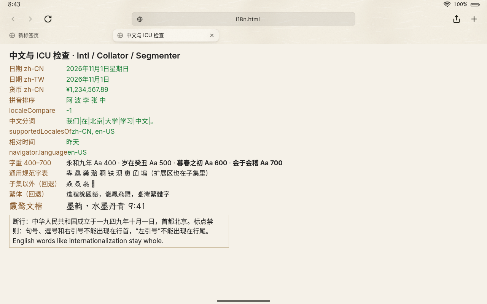

# 体积预算（M6 瘦身）

目标（[技术规划](技术规划.md#v1-资源目标)）：只读根（压缩后）≤ 250 MiB，M6 瘦身后 ≤ 150 MiB。A/B 两个 slot 各放一份，所以每省 1 MiB，设备上就省 2 MiB。

本文记录完整 QEMU 镜像（`WITH_WPE=1 system/mkimage/mkimage.sh qemu-x86_64`，带 WPE WebKit、霞鹜文楷、拼音词库）的体积：各部分占多少、每项改动省了多少、压缩参数怎么选。数字都是 `root.erofs` 的字节数（MiB = 1048576 字节）。

图形栈有两种（`MESA_FLAVOR`，见 `system/profiles/*.conf`）：真机用自编的 `mesa-loong`（不依赖 LLVM，`loong`）；QEMU 机型默认用 Alpine 的 mesa（`distro`，带 llvmpipe，因为 softpipe 在 TCG 下慢 5–8 倍）。**体积按真机的配置算**，即 `MESA_FLAVOR=loong`。

## 怎么量

```sh
tools/dev-chroot.sh run tools/image-size.sh qemu-x86_64                    # 按包、按目录、最大的文件
tools/dev-chroot.sh run tools/image-size.sh qemu-x86_64 --compressed 30    # 再估算最大的 30 个包压缩后各占多少
tools/dev-chroot.sh run tools/image-size.sh qemu-x86_64 --compressed 1 '--opts=-zlz4hc,12' --only font-inter-loong
```

- “原大小”是 rootfs 里实际存在的文件（裁剪后）的字节数，硬链接只算一次；“压缩后”是把这个包的文件单独做成一个只读根的大小（参数与镜像相同，见 `build/image/<机型>/work/rootfs.env`）。单独压缩没有跨包去重，各包加起来比整个镜像略大。
- 开机与启动应用的时间：`tools/qemu-bench.py <镜像>`（见下文“压缩参数”）。

## 现状

| 完整 QEMU 镜像（x86_64，带 WebKit） | 只读根 | 文件内容 | 文件数 | apk 包 |
|---|---|---|---|---|
| 瘦身前（a366771，Alpine mesa + LLVM） | **327.7 MiB** | 554.0 MiB | 5435 | 189 |
| 只换 mesa-loong，不做其他瘦身（mesa-loong 那一路测的） | 217 MiB | | | |
| 本轮，QEMU 默认图形栈（`MESA_FLAVOR=distro`） | **217.0 MiB** | 484.2 MiB | 1876 | 182 |
| **本轮 + mesa-loong（`MESA_FLAVOR=loong`，与真机相同）** | **124.8 MiB** | 267.5 MiB | 1851 | 176 |
| **再换上按体积重编的 WebKit（wpewebkit 2.54.2-r1）** | **101.0 MiB** | 215.4 MiB | 1838 | 169 |
| **再加上音视频插件（`gst-plugins-loong` + libvpx + libmpg123）** | **104.0 MiB** | 221.6 MiB | 1858 | 172 |
| r1 + 音视频插件，QEMU 默认图形栈（`MESA_FLAVOR=distro`；不加插件是 193.2 MiB） | 196.2 MiB | 438.3 MiB | 1884 | 178 |
| r1，不带 WebKit（不设 `WITH_WPE`） | 39.8 MiB | 79.5 MiB | 1177 | 98 |

两路合在一起，真机配置的只读根从 327.7 MiB 降到 124.8 MiB（−62%），已经低于 150 MiB 的目标；其中 WebKit 和它的依赖（含 ICU、GStreamer 等）占了 85 MiB。WebKit 再按体积重编（全局 `-Os`、热点 `-O2`，不生成 `.eh_frame`，关掉 v1 用不到的功能，见 [ADR 0003 · M6 瘦身记录](adr/0003-web-内核-wpe-webkit.md#m6-瘦身记录webkit-体积)）后为 **101.0 MiB**，WebKit 和它的依赖降到 61 MiB。之后补上音视频插件（原来镜像里任何 `<video>`/`<audio>` 都让网页进程崩溃，见下文“音视频”一节）：**104.0 MiB**（+3.0 MiB）。nabu 的数字见下文“nabu”一节。

### 每项改动省了多少

在 Alpine mesa 的配置上（换 mesa-loong 之前做的）逐项计算：内容上的改动按旧的压缩参数（`-zlz4hc,12`，4 KiB 物理簇）逐包估算，最后一行是压缩参数本身的效果：

| 改动 | 之前 | 之后 | 变化 |
|---|---|---|---|
| 中文字体：`font-noto-cjk`（思源黑体 SC/TC/JP/KR，Regular + Bold 两个 TTC，宋体已删）→ `font-noto-sans-sc-loong`（简体子集，可变字重） | 34.8 | 3.6 | **−31.2** |
| 内核模块：linux-virt 的 892 个 → 白名单 172 个（`KERNEL_MODULES`） | 30.3 | 4.1 | **−26.2** |
| 开发工具与清理：foot（连带 ncurses-terminfo）、MiniBrowser、Web Inspector 资源、MIME 源文件与类型说明、GObject 内省数据、pci.ids 等 | — | — | **−8.7** |
| 拉丁字体：`font-inter`（正体 + 斜体两个可变字体）→ `font-inter-loong`（一个） | 1.2 | 0.4 | −0.8 |
| ICU 数据：`icu-data-en`（只有英文）→ `icu-data-loong`（中文 + 英文） | 1.4 | 4.7 | **+3.3** |
| = 内容合计（同样用 4 KiB 簇的 lz4hc） | 327.7 | 264.1 | −63.6 |
| 压缩参数：lz4hc 4 KiB 簇 → lz4hc 64 KiB 簇 + `ztailpacking,fragments,dedupe` | 264.1 | 217.0 | **−47.1** |

ICU 是唯一变大的一项：原来的 `icu-data-en` 没有中文数据（见下文 ICU 一节），补上中文是功能修复。再换上 mesa-loong（`MESA_FLAVOR=loong`）：217.0 → 124.8 MiB（LLVM 77 MiB、Alpine mesa 与 spirv-tools 18 MiB → mesa-loong 3 MiB）。

### 预算表（真机配置：mesa-loong + 本轮瘦身，默认压缩参数）

| 部分 | 原大小 | 压缩后 | 负责 / 下一步 |
|---|---|---|---|
| WPE WebKit（`libWPEWebKit` 等） | 81.2 | 34.0 | 已重编（r1；r0 是 117.7 / 50.3），见 ADR 0003 |
| WebKit 的媒体依赖：gst-plugins-base、gstreamer | 8.9 | 4.2 | aom、libavif、libdav1d、libyuv、libjxl、libhwy、libxslt 已随 WebKit 重编去掉（原来连同这两个共 24.0 / 11.3） |
| 音视频插件：`gst-plugins-loong` 2.65、libvpx 3.19、libmpg123 0.35 | 6.2 | 3.0 | 见下文“音视频”；libvpx 只编解码器可以再省 |
| 图形栈 `mesa-loong`（x86_64：softpipe + virgl；aarch64 另有 freedreno） | 13.3 | 3.1 | 已完成（另一路工作） |
| 字体：霞鹜文楷 6.9、思源黑体子集 4.2、Inter 0.6 | 11.7 | 8.8 | 文楷现在兼做繁体字的回退，暂不裁 |
| ICU：数据 7.1 + 库 4.6 | 11.7 | 6.6 | 已是中英文最小集合 |
| 拼音：词库 8.0 + librime 1.5 | 9.5 | 5.0 | — |
| 内核模块（QEMU） | 4.3 | 4.0 | — |
| Loong OS 组件（loong-shell、loong-sysd、loong-update、Web 运行时） | 13.0 | ≈ 6 | — |
| 其他（openssl、glib、xkeyboard-config、libstdc++、libx11、gnutls 等约 150 个包） | ≈ 62 | ≈ 30 | — |
| **合计** | **221.6** | **104.0** | |

WebKit 及其依赖（重编后 61 MiB，原来 85 MiB，见上表“不带 WebKit”一行的差；加上音视频插件 64 MiB）仍是最大的一块。QEMU 默认的 `distro` 图形栈另外多出 LLVM（压缩后 77 MiB）等，只用于开发。

## 音视频

WebKit 只依赖 gst-plugins-base 的库，镜像里原来只有 -base 的插件；WebKit 建音频输出时要 gst-plugins-good 的 `autoaudiosink`，拿不到就崩溃。Alpine 的 `gst-plugins-good` 把全部插件装在一个包里（连带 X11、PulseAudio、libraw1394、cairo、gdk-pixbuf、lame、shout、wavpack 等），所以自编一个最小子集 `gst-plugins-loong`（插件清单与理由见[媒体格式](媒体格式.md)）。同一棵代码树、只差这个包的两次构建：

| 配置 | 不加 | 加上 | 变化 |
|---|---|---|---|
| 真机配置（`MESA_FLAVOR=loong`） | 101.0 MiB（105 910 272 字节） | 104.0 MiB（109 084 672 字节） | **+3.03 MiB** |
| QEMU 默认（`MESA_FLAVOR=distro`） | 193.2 MiB | 196.2 MiB | +3.04 MiB |

新增的三个包（`tools/image-size.sh --compressed 1 --only gst-plugins-loong,libvpx,mpg123-libs`）：

| 包 | 原大小 | 压缩后 | 内容 |
|---|---|---|---|
| `libvpx` | 3.19 | 1.52 | VP8/VP9 软解（Alpine 的包同时带编码器） |
| `gst-plugins-loong` | 2.65 | 1.32 | 13 个 -good 插件、2 个 -bad 插件、`libgstcodecparsers`（0.66）；最大的是 isomp4 0.55、v4l2 0.31、matroska 0.30、videoparsersbad 0.28 |
| `mpg123-libs` | 0.35 | 0.20 | MP3 软解 |

还能省：libvpx 只编解码器（关掉 VP8/VP9 编码器，未测；Alpine 的 libvpx 两者都有），或者静态链进 `libgstvpx.so`；但要自己跟 libvpx 的安全更新。nabu 上 VP9 走硬解时，libvpx 只是没有硬解时的后备。

## 字体

| 包 | 内容 | 大小 |
|---|---|---|
| `font-noto-sans-sc-loong` | 思源黑体简体可变字体（noto-cjk 的 `NotoSansSC-VF.otf`，CFF2）裁成子集：GB2312 全部字符 ∪《通用规范汉字表》8105 字（Unihan `kTGH`，含扩展区的 196 个）∪ 拉丁、标点、全角、注音、带圈数字等常用符号；字重轴 400–700，默认 400。族名改为 **Noto Sans CJK SC** | 4.2 MiB，10 738 个字形，8230 个汉字 |
| `font-inter-loong` | Alpine `font-inter` 里的可变字体，族名从 “Inter Variable” 改为 **Inter**，光学尺寸轴固定在 14（字重 100–900 保留） | 0.6 MiB |
| `font-lxgw-wenkai-screen` | 霞鹜文楷屏幕版（未改） | 6.9 MiB |

- **为什么是可变字体**：同样的字符集，Regular + Bold 两个静态子集是 4.5 MiB，可变字体 4.2 MiB 却有全部字重；LoongKit 用到的 500、600 是真实字重，不再落到常规或粗体上。Google Fonts 的 TrueType 版（`NotoSansSC[wght].ttf`）同样的子集是 5.1 MiB，CFF2 更小。
- **族名保持 “Noto Sans CJK SC”**：loong-ui 用 cosmic-text 回退中文，它按这个名字找（不读 fontconfig 的别名）；LoongKit 的字体栈第一个中文字体也是它；fontconfig 的默认规则（`sans-serif:lang=zh-cn`）同样优先它。镜像 rootfs 里 `fc-match` 的结果：`Noto Sans CJK SC`、`Noto Sans SC`、`Source Han Sans SC`、`sans-serif:lang=zh-cn`、`system-ui:lang=zh-cn` 都落到子集字体；`Inter` 落到 `font-inter-loong`；`LXGW WenKai Screen` 落到文楷。
- **修了一个旧问题**：原来镜像里只留了 Inter 的可变字体，而它的族名是 “Inter Variable”，界面和网页请求的 “Inter” 匹配不到，拉丁字母实际用的是思源黑体里的。`font-inter-loong` 改名后两边都用上了 Inter。
- **子集以外的字**：繁体字、日文汉字、罕用字不在子集里。fontconfig 先回退到霞鹜文楷（它有约 1.2 万个汉字，Big5 常用字表里不在子集中的 2011 个繁体字它有 1711 个），再没有就显示豆腐块。要更完整地显示繁体网页，可以把 Big5 常用字加进子集（+1.1 MiB）。
- **还能省**：霞鹜文楷裁到同一字符集约 −1.5 MiB（压缩后），但它现在是繁体字的回退字体，裁了以后繁体网页的豆腐块会多很多，所以暂不裁。

## ICU

镜像原来装的是 Alpine 的 `icu-data-en`（2.9 MiB，只有英文，没有中文分词词典）——任务开始时以为是 31 MiB 的 `icu-data-full`，实测并不是。它的后果在 WebKit 里看得到：`Intl.DateTimeFormat('zh-CN')` 输出英文格式，`localeCompare` 不按拼音排序，中文双击/长按选词时整串汉字被当成一个词。

`icu-data-loong`（7.1 MiB，压缩后 4.3 MiB）用 `icupkg` 从上游完整数据（`icu4c-78.1-data-bin-l.zip`）裁出：

- 语言区域 en（en_001、en_GB、en_US、en_US_POSIX）与 zh（zh_CN、zh_Hans、zh_Hans_CN），覆盖主数据和 curr/lang/region/unit/zone/rbnf/coll/brkitr 各子树；每个子树的 `res_index.res` 按保留的内容重新生成，`Intl.*.supportedLocalesOf()` 只报告真有数据的语言。网页请求 zh-TW 等时，JavaScriptCore 按 BCP 47 截断回退到 zh。
- 断行与分词：全部 `.brk` 规则（含中日文的 `line_*_cj`）、中日文词典 `cjdict.dict`（2 MiB），以及 `brkitr/ja.res`——ICU 的中日文分词引擎初始化时要读它，缺了就整个不用词典（这是调试中发现的）。泰、老、高棉、缅文词典与日文按文节断行的规则不要。
- 排序：root（UCA）与 zh（拼音、笔画等，0.7 MiB）。
- 转换器只留 gb18030；WebKit 解码网页的 GBK/GB18030/Big5 等用自己的 TextCodecCJK。不要音译规则（`translit/`，1.1 MiB）。
- 各语言区域的数据引用每个子树的 `pool.res`（共享字符串池，约 0.9 MiB），用 `icupkg` 裁剪时必须保留；用 ICU 数据过滤器从源数据重新编译可以去掉池，省下不到 1 MiB，暂不值得。
- `icu-libs` 依赖精确版本的 `icu-data=78.1-r0`，由 `provides` 提供；Alpine 升级 icu 时要同步 `pkgver` / `_icurel`。

检查结果（ICU C API，`ICU_DATA` 指向新数据；镜像里 WebKit 的检查见下文“QEMU 验证”）：

| | icu-data-en（原来） | icu-data-loong |
|---|---|---|
| 可用语言区域 | en en_001 en_GB en_US | en en_001 en_GB en_US en_US_POSIX zh zh_Hans zh_Hans_CN |
| zh_CN 完整日期 | Sunday, November 1, 2026 | 2026年11月1日星期日 |
| 排序 张 阿 波 中 李（zh） | 中 张 李 波 阿（码位序） | 阿 波 李 张 中（拼音） |
| 分词 “我们在北京大学学习中文。” | [我们在北京大学学习中文] [。] | [我们] [在] [北京] [大学] [学习] [中文] [。] |
| gb18030 转换器 | 没有 | 有 |

## QEMU 验证

瘦身后的完整镜像（217 MiB）在 QEMU 中启动：锁屏（文楷时钟、农历日期）、主屏、设置（经 JS bridge 读 loong-sysd）、浏览器都正常，中文显示与瘦身前相同；拉丁字母（状态栏时间、“Loong OS 0.1.0-dev”）现在是 Inter（原来是思源黑体里的拉丁字形）。在浏览器里打开一个检查页（WebKit 的 `Intl`、`Intl.Collator`、`Intl.Segmenter`、字重、字符覆盖、断行），结果全部符合预期：



- `Intl.DateTimeFormat('zh-CN')` 是“2026年11月1日星期日”，zh-TW 回退到 zh；人民币格式、“昨天”正确；`supportedLocalesOf(['fr','zh-CN','en-US','ja'])` 只报告 zh-CN、en-US。
- 拼音排序“阿 波 李 张 中”，`'阿'.localeCompare('波','zh-CN')` 为 −1；中文分词“我们|在|北京|大学|学习|中文|。”。
- 中文 400/500/600/700 四档字重各不相同（可变字体）；通用规范汉字表里扩展区的字（𬌗 𫓧 𠅤 等）有字形；子集以外的“猋 叒 惢”回退到文楷，扩展 A 的“㵘”文楷也没有，显示豆腐块；繁体句子整句回退到文楷。
- 断行：句号、逗号不在行首，左引号不在行尾。

真机配置（`MESA_FLAVOR=loong`，124.8 MiB）的 QEMU 镜像也能启动到锁屏，文楷时钟、农历日期和状态栏显示正常（软件渲染是 softpipe，很慢；这次脚本里的上滑解锁没有生效，设置等界面的检查以上面 `distro` 镜像为准，mesa-loong 本身在 QEMU 中的验证见[技术规划](技术规划.md)第六节第 9 项）。aarch64 的 `qemu-aarch64` 镜像（模块白名单）启动到登录提示，virtio 显卡、输入、块设备的模块都加载了，`/dev/dri/card0` 与输入设备都在。

## 内核模块

`system/profiles/*.conf` 的 `KERNEL_MODULES` 是相对 `lib/modules/<版本>/kernel/` 的路径模式，`!模式` 表示排除，后面的覆盖前面的。mkimage 保留匹配的模块、它们的依赖（`modules.dep`）和 `INITRAMFS_MODULES`，删掉其余的，再 `depmod`。空表示全部保留。

- **QEMU（linux-virt）**：按虚拟机里实际加载的模块（设置、浏览器都打开后的 `lsmod`：virtio 显卡/输入/块设备、bochs、ext4、vfat（OTA 写 ESP）、nls、af_packet、efivarfs、qemu_fw_cfg 等）列白名单，另外留 virtio 网卡、virtio-rng、dm-verity、loop、zram、squashfs、overlayfs、hid 以及全部 crypto 与 lib（加密算法按名字请求加载，不在 `modules.dep` 里）。892 个 → 172 个，34 MB → 5 MB。瘦身后的镜像里加载的模块与原来相同，只少了用不到的 kvm、e1000e、cdrom/sr_mod、psmouse。
- **nabu（pmOS sm8150 内核，828 个未压缩的 `.ko`，40 MB）**：还没上真机，不知道实际加载哪些，只排除肯定用不上的：别家 SoC 的 GPU/显示（imagination、panthor、arm、tidss）、Hantro 视频编解码、Freescale 音频、Intel/Marvell/RSI 网卡、红外遥控键位表——去掉 156 个、约 4 MB。上机后用 `lsmod` 改成白名单，预计还能省 25 MB 以上（未压缩）。

固件同理：`FIRMWARE`（相对 `/lib/firmware` 的模式，写法相同）。QEMU 镜像没有固件；nabu 的 `firmware-xiaomi-nabu` 依赖整个 `linux-firmware-qcom`（所有高通芯片，160 MB，文件本身已是 zstd 压缩，只读根几乎压不动它）以及 ath11k、ath10k。nabu 只保留 `qcom/sm8150/`（设备树里写的远程处理器、GPU zap、venus、WLAN 固件都在 `qcom/sm8150/xiaomi/nabu/`）、`qcom/` 顶层的 Adreno 固件、`ath10k/WCN3990`、`qca/`（蓝牙）、`cirrus/`（功放）、`novatek/`（触摸）：237 MB → 41 MB。

## nabu

`xiaomi-nabu` 镜像（不带 WebKit：这台开发机上没有 aarch64 的 wpewebkit 包；loong-shell 用占位程序，只看体积）：

| | 只读根（squashfs lz4hc） | 文件内容 |
|---|---|---|
| Alpine mesa，裁了模块和清理，固件与字体还没动（Alpine 的 font-noto-cjk） | 366.4 MiB | 553.5 MiB |
| Alpine mesa + 本轮 | 155.9 MiB | 344.5 MiB |
| **mesa-loong（nabu 的默认）+ 本轮** | **68.2 MiB** | 145.9 MiB |
| 估算：再加上 WebKit 一套（按 x86_64 上带与不带 WebKit 的差：r0 是 85 MiB，按体积重编的 r1 是 61 MiB，加音视频插件 64 MiB） | ≈ 132 MiB（r0 ≈ 153） | |

本轮在 nabu 上省下的主要是固件（−196 MB 原大小，几乎都是压不动的 zstd 文件）、Noto CJK（−34 MB）和内核模块（−4 MB）。不分架构的本地包（字体、拼音词库、ICU 数据）原来只进 x86_64 的本地仓库，nabu 镜像装不上；`tools/build-pkg.sh` 现在会同时放进 aarch64 的目录。现在最大的是 `firmware-xiaomi-nabu`（33 MB）、内核模块（33 MB，未压缩的 `.ko`）和 mesa-loong（15 MB，含 freedreno）；上机后收紧模块与固件白名单还能再省 20–30 MiB。

## 清理

mkimage 在装完软件包后删掉（这些文件仍记在 apk 数据库里；只读根上不装包，OTA 是整个分区替换）：`/usr/share/{man,doc,info,gtk-doc,aclocal,bash-completion,zsh,fish,gir-1.0}`、`/usr/include`、`*.a`、`*.la`、pkg-config 文件、GObject 内省数据（`/usr/lib/girepository-1.0`，没有 gjs/PyGObject）、`/usr/share/hwdata/pci.ids`、中英文以外的翻译、MIME 数据库的源 XML 和每种类型的说明文件（GIO 只读编译好的 `mime.cache`、`globs2`、`magic` 等）、Inter 的斜体（由 FreeType 倾斜合成）。

开发工具改为 `WITH_DEVTOOLS=1` 才装：`foot` 终端（连带 2 MiB 的 ncurses-terminfo）、`wpewebkit-minibrowser`、Web Inspector 的界面资源（`inspector.gresource`）。

## 压缩参数

内核支持：Alpine `linux-virt`（QEMU 两个机型）的 erofs 支持 lz4、**lzma**、**zstd**（不支持 deflate）；pmOS 的 sm8150 内核（nabu）没有 erofs，squashfs 支持 lz4、lzo、gzip、**xz**（不支持 zstd），而且解压器是单实例（`SQUASHFS_DECOMP_SINGLE`）。Alpine 的 `erofs-utils` 只编了 lz4/lz4hc/deflate，lzma 与 zstd 要自己编（`./configure --enable-lzma --with-libzstd`），下面的 lzma/zstd 数字用的是自己编的 erofs-utils 1.9.1。

同一个 rootfs（本轮瘦身后，484 MiB）：

| 参数 | 只读根 | 生成耗时 |
|---|---|---|
| erofs `-zlz4hc,12`（原来的默认，4 KiB 物理簇） | 264.1 MiB | 15 s |
| erofs `-zlz4hc,12 -Eztailpacking,fragments,dedupe` | 262.0 MiB | 40 s |
| **erofs `-zlz4hc,12 -C65536 -Eztailpacking,fragments,dedupe`（新默认）** | **217.0 MiB** | 60 s |
| erofs `-zlz4hc,12 -C131072 -Eztailpacking,fragments,dedupe` | 213.4 MiB | 53 s |
| erofs `-zzstd,level=12 -C65536 -Eztailpacking,fragments` | 177.4 MiB | 190 s |
| erofs `-zlzma,level=6 -C65536 -Eztailpacking,fragments` | 151.3 MiB | 103 s |
| erofs `-zlzma,level=6 -C131072 -Eztailpacking,fragments` | 147.0 MiB | 79 s |
| squashfs `-comp lz4 -Xhc`（nabu 现在的默认，128 KiB 块） | 216.7 MiB | 25 s |
| squashfs `-comp lz4 -Xhc -b 262144` | 213.1 MiB | 28 s |
| squashfs `-comp gzip` | 185.7 MiB | 35 s |
| squashfs `-comp xz` | 154.1 MiB | 69 s |
| squashfs `-comp xz -b 1048576` | 142.1 MiB | 95 s |

（“+ ztailpacking…”、lz4hc 128 KiB 与 lzma 64 KiB 三行是在换 `font-inter-loong` 之前的 rootfs 上测的，相差不到 0.3 MiB。生成耗时是在与其他构建共用的 4 核机器上测的，只能互相比较。瘦身前的 rootfs 上，lz4hc 的物理簇 4/16/32/64/128 KiB 依次是 327.7/290.6/279.8/272.6/269.1 MiB，zstd-15 64 KiB 是 219.9 MiB。）

lz4hc 只是把物理簇从 4 KiB 加到 64 KiB 就小了 18%，解压仍是 lz4 的速度（每读一页最多多解 60 KiB，lz4 解压几微秒）；128 KiB 只再小 1.7%，读放大翻倍，不划算。zstd、lzma 分别再小 18%、32%，代价是解压慢得多。在 QEMU 里实测开机到锁屏、第一次打开设置的时间（`tools/qemu-bench.py`，每轮都是全新的第一次开机，文件都不在页缓存里）：

| 镜像（QEMU x86_64，`distro` 图形栈） | 只读根 | 开机到锁屏：中位数（各次） | 打开设置（第 2、3 轮） |
|---|---|---|---|
| 瘦身前（a366771，lz4hc 4 KiB） | 327.7 MiB | 39.9 s（39.9 / 41.4 / 35.2） | — / 39.3 s |
| 本轮内容，lz4hc 4 KiB | 264.1 MiB | 39.3 s（39.2 / 39.6 / 39.3 / 32.8） | 58.4 / 36.7 s |
| **本轮内容，lz4hc 64 KiB + E（默认）** | **217.0 MiB** | **38.5 s**（38.5 / 44.6 / 38.5 / 33.2） | 50.6 / 39.7 s |
| 本轮内容，zstd-12 64 KiB | 177.4 MiB | 39.2 s（38.6 / 39.8 / 40.7 / 33.4） | 55.1 / 35.2 s |
| 本轮内容，lzma-6 128 KiB | 147.0 MiB | **50.6 s**（50.5 / 52.4 / 50.6） | 45.2 / — |

各镜像按轮次交替测（每轮把 5 个镜像各启动一次），“—”是那一次没测成：两次（瘦身前第 2 轮、lzma 第 3 轮）卡在 systemd-boot 启动 UKI 之前，与镜像内容无关；第 1 轮的“打开设置”计时方法有误，不算。“打开设置”从点按 Dock 图标算到设置页第一次画出完整布局（还没从 loong-sysd 取到数据之前）。QEMU 是 TCG 软件模拟（4 个虚拟 CPU，宿主机 4 核且有其他构建在跑，第 3 轮机器较空），绝对值比真机慢一两个数量级，只能在同一轮里比较；打开设置主要花在 WebKit 启动和 llvmpipe 渲染上，同一轮里各镜像相差在 ±15% 以内，没有随压缩方式变化的规律。

结论：lz4hc 的物理簇从 4 KiB 加到 64 KiB、瘦身前后，开机时间都没有可见的差别；zstd 也看不出；lzma 让开机慢了约 12 s（+30%），每次都如此——开机要读入并解压 loong-shell、mesa（llvmpipe 连同 LLVM 约 200 MiB 的库）等，lzma 在 TCG 下解压慢。打开设置在这样的噪声下看不出压缩方式的影响。真机上解压快得多，差距会小，但 lzma 的代价方向不变。

**选择**：

- **QEMU 两个机型**：erofs lz4hc + 64 KiB 物理簇 + ztailpacking/fragments/dedupe。用 Alpine 自带的 erofs-utils 就能做，读放大小，解压最快。
- **nabu**：先保持 squashfs lz4hc。这个内核的 squashfs 只有一个解压器实例，xz 在多核上不能并行解压，冷启动 WebKit（要读入几十 MiB 的库）会明显变慢；gzip 也一样单实例。换成开启 erofs 的内核后改用和 QEMU 一样的参数（见 [nabu 适配说明](devices/xiaomi-nabu.md)）。
- **以后要冲 150 MiB 时**：erofs lzma（128 KiB 簇）比 lz4hc 小 32%，可以只对大而少读的文件用（`--compress-hints`：例如字体、词库、ICU 数据用 lzma，WebKit 与常用库用 lz4hc），需要自编带 lzma 的 erofs-utils。试过 erofs-utils 1.9.1 的 `-zlz4hc,12:lzma,level=6 --compress-hints=…`，mkfs.erofs 直接段错误，要换新版本再试。

## 风险与待办

- **缺字**：繁体、日文汉字与罕用字不在思源黑体子集里，回退到文楷或显示豆腐块。浏览器打开港台网站会混排楷体。可以按需加入 Big5 常用字（+1.1 MiB）。
- **删掉的内核模块**：QEMU 的白名单是按目前的用法（无声卡、无网络）列的；要在虚拟机里加声卡、USB 设备等，需要把对应模块加回白名单。nabu 只排除了确定无关的模块，上机后再收紧。
- **ICU 版本绑定**：`icu-data-loong` 精确提供 `icu-data=78.1-r0`，Alpine 升级 icu 时要同步，否则会装回 `icu-data-en`。
- **字体回退**：没有本地字体包时 mkimage 退回 Alpine 的 `font-noto-cjk` / `font-inter`，后者在镜像里匹配不到 “Inter”（见上）。
- 按文件选择压缩算法（`--compress-hints`）、自编带 lzma/zstd 的 erofs-utils、nabu 上机后的模块与固件白名单，都留给后续。
