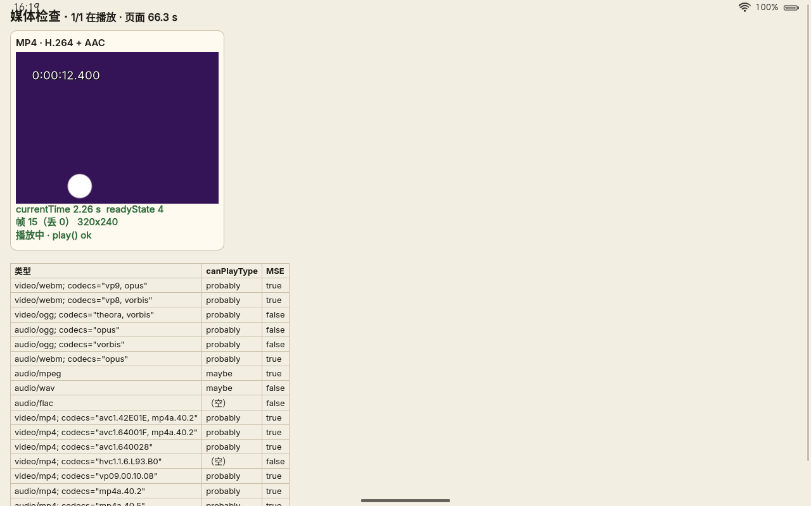
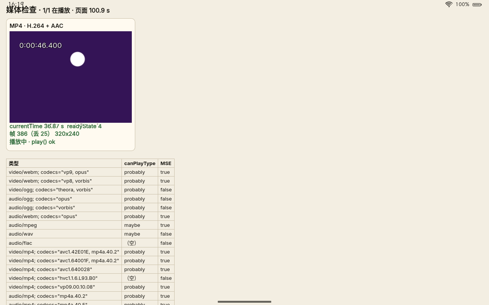
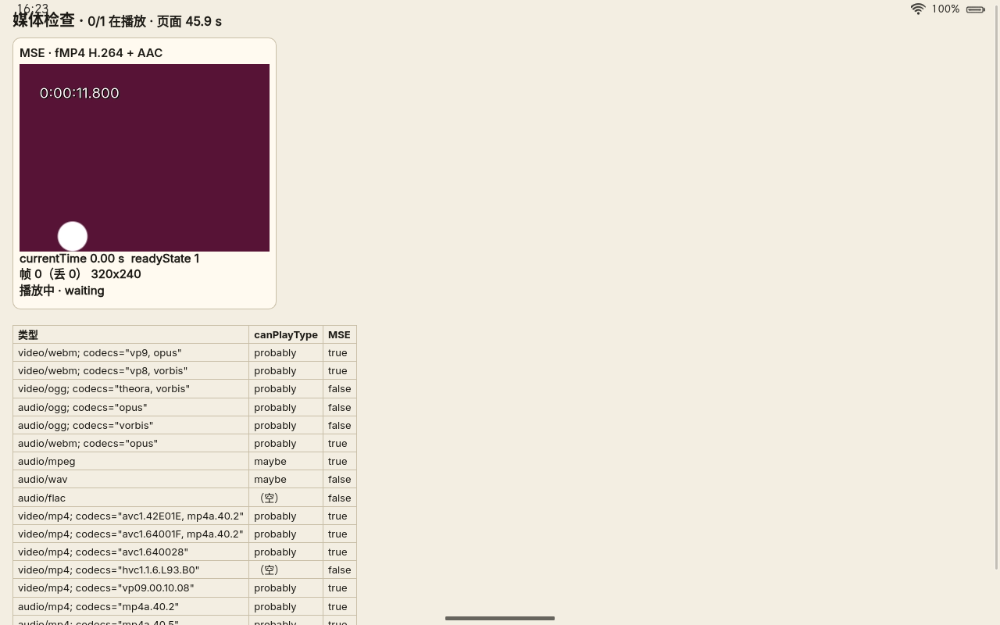
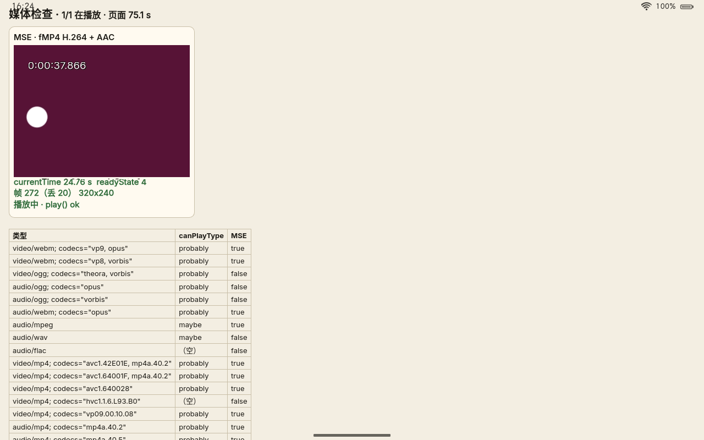
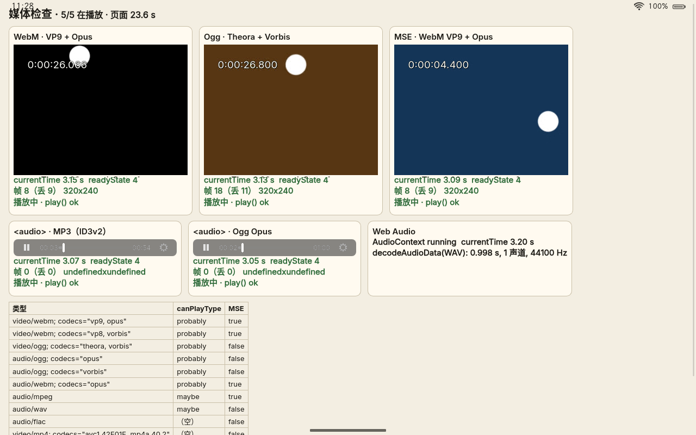
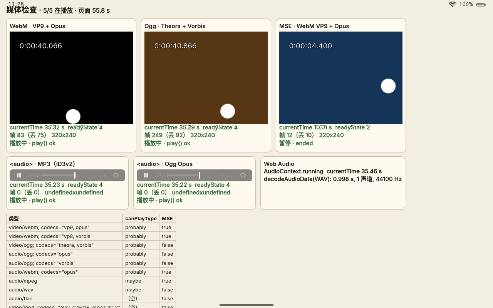

# 媒体格式（v1）

网页里的 `<video>`、`<audio>`、MSE（Media Source Extensions）与 Web Audio 都由 WPE WebKit 交给 GStreamer 播放。镜像里的 GStreamer 由三部分组成：

| 包 | 来源 | 内容 |
|---|---|---|
| `gstreamer` | Alpine | 核心与 coreelements（queue、fakesink、typefind 等） |
| `gst-plugins-base` | Alpine（wpewebkit 依赖它的库） | playbin、decodebin、音频转换/重采样、alsasink、GL 上传与颜色转换；**Ogg、Vorbis、Opus、Theora** |
| `gst-plugins-loong` | 自编（`system/packages/gst-plugins-loong`） | gst-plugins-good 与 -bad 里 WebKit 播放要用的最小子集，见下文 |
| `gst-libav-loong` + `ffmpeg-loong` | 自编（`system/packages/ffmpeg-loong`，一个 APKBUILD 出两个包） | **H.264、AAC 软解**（`avdec_h264`、`avdec_aac`）：只编这两个解码器的 FFmpeg，库在私有目录 `/usr/lib/ffmpeg-loong`，见下文“MP4：H.264 与 AAC 软解” |

Alpine 的 `gst-plugins-good` 不装：它把所有插件打在一个包里，连带 X11、PulseAudio、libraw1394、cairo、gdk-pixbuf、lame、shout、wavpack 等。`gst-plugins-loong` 与它（以及 `gst-plugins-bad`）互斥，插件文件同名同路径；`gst-libav-loong` 同样与 Alpine 的 `gst-libav` 互斥。

体积：`gst-plugins-loong` 连同新增的 libvpx、libmpg123，只读根 +3.0 MiB（真机配置 101.0 → 104.0 MiB）；`gst-libav-loong` + `ffmpeg-loong` 再 +0.86 MiB（文件 1.8 MiB），见[体积预算](体积预算.md#音视频)。

## 支持哪些格式

| 容器 | 视频 | 音频 | QEMU 与所有机型（软件） | nabu（V4L2 硬解，待上机） |
|---|---|---|---|---|
| WebM / Matroska | VP8、VP9 | Opus、Vorbis | ✅（VP8/VP9 用 libvpx） | VP9 走 Venus（若驱动支持），优先于软解 |
| Ogg | Theora | Vorbis、Opus | ✅ | — |
| MP4 / MOV | H.264、VP9 | AAC（LC、HE-AAC v1/v2）、MP3 | ✅（H.264、AAC 用 ffmpeg-loong） | H.264 走 Venus，优先于软解；AAC 软解 |
| MP4 / MOV | HEVC | | ❌（不编 HEVC 软解，见下文） | ✅ 走 Venus（v4l2h265dec + h265parse） |
| M4A、ADTS（.aac） | — | AAC | ✅ | ✅ |
| MP3 | — | MP3 | ✅（mpg123；带 ID3v2/APE 标签的也行） | ✅ |
| WAV | — | PCM | ✅ | ✅ |
| 网络电台（Shoutcast/Icecast） | — | MP3、Ogg | ✅（icydemux） | ✅ |
| MSE | WebM（VP8/VP9 + Opus/Vorbis）；fMP4（H.264、VP9 + AAC） | | ✅ | H.264 经 Venus |

另外：Web Audio 的 `decodeAudioData` 支持的格式同上表的音频（包括 AAC/M4A）；`playbackRate` 倍速播放时保持音调（scaletempo）。不支持：HEVC 软解、AV1、FLAC（有 flacparse，没有解码器）、AC-3/E-AC-3、xHE-AAC（USAC）、HLS/DASH（WebKit 默认关闭，网站会改用 MSE）。

`canPlayType` / `MediaSource.isTypeSupported` 在 QEMU 镜像里的实际结果见下文“QEMU 验证”。

## MP4：H.264 与 AAC 软解

网页上最常见的是 MP4（H.264 + AAC，MSE 里是分片的 fMP4）。qtdemux 能解封装，缺的是解码器。软件解码的几种选择：

- **H.264**：`openh264`（1.5 MiB；Cisco 付的专利费只覆盖 Cisco 自己发布的二进制，自己编译的不在内）、`gst-libav` + FFmpeg。
- **AAC**：`fdkaac`（Fraunhofer 的许可证不是 OSI 认可的自由软件许可，Debian 放在 non-free）、`faad`（GPL-2.0，网页进程里加载 GPL 插件）、`avdec_aac`（FFmpeg，LGPL）。
- Alpine 的 `ffmpeg-libavcodec` 有 19 MiB，还连带 x264、x265、dav1d、libvpx 等一串库，`gst-libav` 还要 libavformat、libavfilter。

所以做了一个只含 `h264`、`aac` 两个解码器的 FFmpeg（`ffmpeg-loong`，与 Alpine 同版本 8.1.3）和对它编译的 gst-libav 1.28.3（`gst-libav-loong`），同一个 APKBUILD：`system/packages/ffmpeg-loong/`。

### FFmpeg 的配置

```sh
./configure --prefix=/usr --libdir=/usr/lib/ffmpeg-loong --shlibdir=/usr/lib/ffmpeg-loong \
    --incdir=/usr/lib/ffmpeg-loong/include --pkgconfigdir=/usr/lib/ffmpeg-loong/pkgconfig \
    --enable-shared --disable-static \
    --disable-everything --disable-autodetect --enable-pthreads \
    --disable-programs --disable-doc \
    --disable-avdevice --disable-avformat --disable-avfilter --disable-swscale --disable-swresample \
    --disable-network --disable-iconv --disable-debug --disable-stripping \
    --enable-small --enable-lto \
    --enable-decoder=h264,aac
```

- 只有两个解码器，没有编码器、封装/解封装（GStreamer 的 qtdemux、matroskademux 做）、parser（gst-libav 不用 `av_parser`，分帧由 `h264parse`、`aacparse` 做）、bitstream filter、滤镜、设备、网络、hwaccel、命令行程序。`aac` 解码器包括 HE-AAC（SBR）与 HE-AAC v2（PS）。
- `--disable-autodetect`：不自动链接 zlib、iconv、libdrm、vaapi、vulkan、xcb 等；它也关掉了线程库，所以 `--enable-pthreads` 要明确写上（H.264 的帧级/片级多线程解码）。库只依赖 musl。
- 汇编开着：x86_64 的 SSE2/SSSE3/AVX2 等（要 nasm，运行时检测 CPU），aarch64 的 NEON。关掉汇编解码要慢几倍。
- 结果：x86_64 上 `libavcodec` 1.04 MiB + `libavutil` 0.62 MiB，aarch64 上 0.88 + 0.56 MiB（经 qemu-user 构建约 13 分钟，在 aarch64 chroot 里解码检查片段正常）；configure 的结论是 “License: LGPL version 2.1 or later”（APKBUILD 里核对 `config.h`，开了 GPL 组件就构建失败）。

各选项在 x86_64 上量的（strip 后的库，含 libavformat/libavfilter 的行是 gst-libav 原样时要的）：

| 配置 | 库合计 | 说明 |
|---|---|---|
| `-O2`，h264 + hevc + aac 及 parser，带 avformat/avfilter | 3.66 MiB | 起点 |
| 加 `--enable-small`（`-Os`，去掉长名等字符串） | 2.82 MiB | −0.84 MiB（压缩后 −0.38）；1080p30 H.264 High（6 Mbit/s，600 帧）单线程解码 3.51 → 3.57 s，**只慢 1.6%**（热点在汇编里） |
| 不编 HEVC | 2.04 MiB | HEVC 软解要 0.78 MiB（压缩后 0.22） |
| 加 `--enable-lto` | 1.91 MiB | −6%（Alpine 的 ffmpeg 也开 LTO） |
| **不要 libavformat、libavfilter（给 gst-libav 打补丁）** | **1.66 MiB** | 两个只剩框架的库 0.25 MiB；插件本身也从 0.33 MiB 降到 0.19 MiB（未 strip） |

**为什么不编 HEVC 软解**：多 0.78 MiB；nabu 的 HEVC 走 Venus 硬解，`v4l2h265dec` 照样让 WebKit 报告支持。没有硬解的机器上，报告支持 HEVC 反而有害：B 站这类按 `MediaSource.isTypeSupported` 在 AVC/HEVC/AV1 之间挑编码的网站会选上 HEVC，而 HEVC 软解比 H.264 吃力得多。要加只需在 `--enable-decoder` 里加上 `hevc`。

### gst-libav 与库的位置

- **私有目录 `/usr/lib/ffmpeg-loong`**：库的 soname 与 Alpine 的 `ffmpeg-libs` 相同（`libavcodec.so.62`、`libavutil.so.60`），放在 `/usr/lib` 会和 Alpine 的包冲突，别的 Alpine 包依赖 `so:libavcodec.so.62` 时也会被这个只有两个解码器的版本“满足”。放在私有目录、APKBUILD 设 `sonameprefix="ffmpeg-loong:"`，提供的是 `so:ffmpeg-loong:libavcodec.so.62`，两边互不干扰；插件 `libgstlibav.so` 带 `RUNPATH=/usr/lib/ffmpeg-loong`。WebKit 网页进程的沙箱绑定了整个 `/usr/lib`，插件在沙箱里照样找得到库。同一进程里只能有一份 `libavcodec.so.62`（musl 按 soname 去重），所以 `gst-libav-loong` 与 Alpine 的 `gst-libav` 互斥。
- **gst-libav 在同一个 APKBUILD 里编**：不需要单独的 `-dev` 包装进共用的开发 chroot；插件的依赖直接解析到本包。子包 `gst-libav-loong` 的版本号因此跟 FFmpeg（8.1.3），gst-libav 本身的版本在 APKBUILD 的 `_gstver`。
- **补丁 `gst-libav-decoders-only.patch`**：gst-libav 原样要链接 libavformat、libavfilter（给 `avdemux_*`、`avmux_*`、`avdeinterlace`、`avvidcmp` 用），而这些元素在这个 FFmpeg 上要么什么也不注册、要么用不上。补丁只编解码器部分（`avdec_*`），不再链接这两个库；另外 `--enable-small` 让 `AVCodec.long_name` 为空，元素的长名改用短名。插件里只有两个元素：`avdec_h264`、`avdec_aac`。
- **优先级**：`avdec_h264`、`avdec_aac` 的 rank 是 PRIMARY（256），nabu 上的 `v4l2h264dec` 是 PRIMARY+1，所以有 Venus 时 H.264 自动走硬解，`avdec_h264` 是后备。WebKit 的 `GStreamerRegistryScanner` 看到能解 `video/x-h264`（且有 `h264parse`）就把 MP4 容器与 `avc1.*` 报告为支持，看到能解 `audio/mpeg, mpegversion=4` 就报告 `mp4a.40.2/5/29`、`audio/mp4`、`audio/aac`。顺带的：MP4 容器原来只在有 H.264 解码器时才登记，现在 MP4 里的 VP9（`vp09.*`）也报告支持了。

### 专利与许可证

> 下面是工程上的整理，**不是法律意见**；正式发行前要请律师确认。

- **许可证**：`ffmpeg-loong` 按 LGPL-2.1-or-later 编译（没有 `--enable-gpl`、`--enable-version3`、`--enable-nonfree`，不链接任何外部库），gst-libav 是 LGPL-2.1-or-later，两者都是动态库，用户可以替换。分发镜像时要附上许可证全文，并提供对应的源代码（FFmpeg 与 gst-libav 的原始源码包、补丁、APKBUILD 即构建方法）或书面提供源码的承诺。目前镜像里不带许可证文本（mkimage 删掉 `/usr/share/doc`，Alpine 包的许可证在没装的 `-doc` 子包里）——整个镜像的许可证与源码提供方式是发行前要统一做的事，不只这两个包。
- **专利**：著作权许可（LGPL）不包含专利许可。H.264（AVC）、AAC（含 HE-AAC 的 SBR、PS）、HEVC 都有专利池：H.264 与 AAC 主要由 Via LA 管理（原 MPEG LA 的 AVC 池已并入 Via LA），HEVC 分散在 Access Advance、Via LA 和若干单独的专利权人手里，是最乱的一个。专利按国家/地区有效：早期的 AVC、AAC-LC 专利已大量到期，但仍有一部分（以及 HE-AAC 的较晚专利）在一些国家有效到 2020 年代末。专利池的许可通常向“最终产品”（整机或软件产品）的发行方收取，按台数计费、每年有一定的免费台数，具体条款以专利池现行文件为准。
- **对 Loong OS 的发行意味着**：
  - 开发镜像（自己编、自己用）按现在的做法包含 `gst-libav-loong`。
  - 公开发行镜像前要做选择：(1) 向专利池取得 H.264 与 AAC 的许可（看出货量是否在免费额度内）；或 (2) 发行镜像不带 `gst-libav-loong`（从 mkimage 的 `WITH_WPE` 软件包里去掉这一项即可，其余音视频照常；MP4 只在有硬解的机器上播放视频，AAC 放不了），把它作为用户自行安装的附加包，放在单独的仓库里（类似 Fedora 把这类编解码器放在第三方仓库的做法）；或 (3) 只在专利已到期或不适用的地区发行。
  - 不能用 Cisco 的 OpenH264 规避：Cisco 付的专利费只覆盖 Cisco 自己发布、由用户下载安装的二进制，AAC 也不在内。
  - **硬件解码不等于没有专利问题**：高通芯片里的 Venus 解码器的专利许可通常由整机厂商随设备取得；刷入第三方系统后，这层许可是否仍然覆盖，没有确定的结论。
  - 选择不报告某种编码（例如没有硬解时不报告 HEVC）是体积与体验上的决定，不是专利上的。

## gst-plugins-loong 里有什么

来自 gst-plugins-good 1.28（与 Alpine 的 gstreamer 同版本，`--auto-features=disabled`，只开下面这些）：

| 插件 | 元素 | 为什么要 |
|---|---|---|
| autodetect | autoaudiosink | WebKit 的音频输出（媒体元素与 Web Audio）。**缺了它任何 `<video>`/`<audio>` 都让网页进程崩溃**（`RELEASE_ASSERT`） |
| interleave | deinterleave | Web Audio 的 `decodeAudioData` 与 `createMediaElementSource`（缺了同样崩溃） |
| audiofx | scaletempo | WebKit 默认把它设为 playbin 的音频滤镜：倍速播放保持音调（1.0 倍时直通） |
| isomp4 | qtdemux | MP4/MOV/M4A、MSE 的 MP4 |
| matroska | matroskademux | WebM/MKV、MSE 的 WebM |
| audioparsers | aacparse、mpegaudioparse、flacparse… | MP3 文件；MSE 的 AAC/MP3 分帧 |
| wavparse | wavparse | WAV |
| id3demux、apetag | id3demux、apedemux | 带标签的 MP3 先被识别成 `application/x-id3` |
| icydemux | icydemux | WebKit 请求媒体时总带 `Icy-MetaData: 1`，网络电台会在流里插元数据 |
| vpx | vp8dec、vp9dec | VP8/VP9 软解（libvpx） |
| mpg123 | mpg123audiodec | MP3 软解（libmpg123；MP3 专利已过期） |
| v4l2 | v4l2h264dec、v4l2h265dec、v4l2vp9dec… | V4L2 有状态编解码器（Venus），加载插件时探测 `/dev/video*`，有什么注册什么；不用 libv4l2、libgudev |

来自 gst-plugins-bad 1.28（只编这两个插件和它们用的 `libgstcodecparsers`，其余十几个库不编译）：

| 插件 | 元素 | 为什么要 |
|---|---|---|
| videoparsers | h264parse、h265parse、vp9parse… | `v4l2h264dec`/`v4l2h265dec` 只收 byte-stream，MP4 里是 avc/hvc1，要 parser 转换（没有它 WebKit 也不报告 H.264 可播放）；MSE 用 vp9parse 补全编码参数 |
| opus | opusparse | MSE 下 WebKit 要求 Opus 有解析器，否则不报告 `audio/webm; codecs=opus` |

不要的：`deinterlace`（playbin 默认不去隔行）、视频输出 sink（WebKit 用自己的 GL sink）。编码器与封装器（vp8enc/vp9enc、qtmux）用不到，只是 vpx、isomp4 插件里顺带编进去了，没有单独去掉。

## 音频输出

`autoaudiosink` 按优先级试可用的音频 sink，镜像里只有 gst-plugins-base 的 `alsasink`（ALSA 的 `default` 设备）：

- **没有声卡**（QEMU 默认没有声音设备，内核模块白名单里也没有声卡驱动）：`alsasink` 打不开，`autoaudiosink` 发一条警告（WebKit 只记日志）并退回 `fakesink`，照常按系统时钟播放，`currentTime` 正常前进。
- **nabu**：镜像里有 alsa-lib、`alsa-ucm-conf` 和 nabu 的 UCM 文件（`system/devices/xiaomi-nabu/rootfs/usr/share/alsa/ucm2/`），WebKit 的沙箱会绑定 `/dev/snd`，loong 用户在 `audio` 组。UCM 的 `HiFi` 用例（把 MultiMedia1 接到扬声器的 TDM 通路、设功放音量）由机型目录里的 `loong-audio`（OpenRC 服务 + udev 规则，用 `alsaucm`）在开机和声卡出现时启用；ALSA 的 `default` 经 dmix 混音（`/usr/share/alsa/cards/sm8150.conf`），多个网页进程可以同时出声。不用声音服务；以后的方向是 PipeWire + WirePlumber。在 QEMU 里用一块 HDA 声卡做过替身检查（同一份 dmix 配置只改驱动名）：AAC 实际出声并录到了，两个沙箱里的网页进程同时打开了 `default`（共用一个 dmix）。细节与上机检查步骤见 [nabu 适配说明](devices/xiaomi-nabu.md#音频扬声器)，尚未在真机上验证。

## 硬件解码（nabu，待上机验证）

- Venus 是 V4L2 **有状态**（stateful）解码器，对应 gst-plugins-good 的 v4l2 插件（`v4l2h264dec` 等，rank 为 PRIMARY+1，自动优先于软解）。gst-plugins-bad 的 `v4l2codecs`（无状态，Hantro/rkvdec/Cedrus 用）不需要。
- 插件在 GStreamer 扫描插件时探测 `/dev/video*`；注册表缓存在 `~/.cache/gstreamer-1.0/`，设备变化时自动重扫。WebKit 的沙箱会绑定 `/dev/video*`、`/dev/v4l`、`/dev/media*`（“摄像头之外，视频解码也要 v4l2”）。
- 零拷贝：v4l2 解码器输出 DMA-BUF，WebKit 的 GL 视频 sink（`USE_GSTREAMER_GL`）经 `glupload` 导入为 EGLImage，不经 CPU 拷贝。
- 要确认：pmOS 的 sm8150 内核里 venus 驱动是否支持 SM8150、Venus 固件能否加载（在 `qcom/sm8150/xiaomi/nabu/`，已在 `FIRMWARE` 白名单里）、实际注册了哪些解码器（`GST_DEBUG=v4l2*:4`）、H.264/HEVC/VP9 的分辨率上限、DMA-BUF 导入 freedreno 是否成功。

## QEMU 验证

检查页 `webrt/tests/media/index.html` 放 WebM（VP9 + Opus）、Ogg（Theora + Vorbis）、MSE（WebM VP9 + Opus，整段 append）、MP4（H.264 High + AAC-LC）、MSE fMP4（H.264 High + AAC-LC，初始化段与全部分片一次 append）、三个 `<audio>`（MP3 带 ID3v2、Ogg Opus、M4A）和 Web Audio（`decodeAudioData` 解一段 WAV 与一段 AAC、振荡器经 `AudioContext` 输出），每 2 秒在控制台输出一行状态；地址参数 `?only=` 选其中几项。片段由 `mkclips.sh` 用开发 chroot 里完整的 GStreamer 生成（320×240@15 的测试图带时间码，60 秒；H.264 用 gst-plugins-ugly 的 `x264enc`，AAC 用 `fdkaacenc`），`qemu-check.sh` 把它们连同 busybox-extras 的 httpd 作为第二块磁盘传进虚拟机，页面经 `http://127.0.0.1:8080/` 打开，点按一下页面后连续截图：

```sh
tools/dev-chroot.sh run sh webrt/tests/media/mkclips.sh build/media-test
tools/dev-chroot.sh run env WITH_WPE=1 system/mkimage/mkimage.sh qemu-x86_64   # QEMU 默认 MESA_FLAVOR=distro
tools/dev-chroot.sh run flock /var/lock/loong-qemu sh webrt/tests/media/qemu-check.sh \
    build/image/qemu-x86_64/loong-qemu-x86_64.img build/media-test build/out/media-qemu
# 只放 MP4：在 run 后面加 env QUERY='?only=mp4'（同理 msemp4、m4a；dev-chroot.sh 不传递环境变量）
```

### MP4（H.264 + AAC，ffmpeg-loong）

结果（QEMU x86_64，TCG，llvmpipe，WebKit 沙箱开启，`MESA_FLAVOR=distro`，镜像带 gst-plugins-loong + gst-libav-loong，没有声卡；宿主机上同时有别的构建在跑）：

| | 播放中（一） | 播放中（二） |
|---|---|---|
| MP4 · H.264 + AAC（`?only=mp4`） |  |  |
| MSE · fMP4（`?only=msemp4`） |  |  |

- **都能播放到结尾，网页进程没有崩溃**。画面里的时间码：MP4 从 0:00:12.400 走到 0:00:46.400，MSE fMP4 从 0:00:11.800 走到 0:00:37.866。TCG 下网页的重绘远远落后：状态文字比视频层还慢（截图里视频是 46.4 s 时状态文字还停在 36.87 s），以控制台记录为准。
- 控制台记下的 `currentTime`（秒）与已显示帧数：

  | 页面时间 | MP4（`?only=mp4`） | 页面时间 | MSE fMP4（`?only=msemp4`） |
  |---|---|---|---|
  | 70.2 | 6.22（57 帧） | 60.3 | 9.96（80 帧） |
  | 82.6 | 18.63（182） | 72.4 | 22.05（240） |
  | 92.7 | 28.72（310） | 82.5 | 32.15（369） |
  | 103.0 | 38.98（413） | 94.8 | 40.13（434），`ended` |
  | 125.7 | 60.05（696），`ended` | | |

  `currentTime` 与页面时间同步前进（每 10 s 前进 10 s 左右）。三项一起放（`?only=mp4,msemp4,m4a`）时也都到了结尾：MP4 60.05 s（423 帧）、MSE 40.13 s（306 帧）、M4A 6.87 → 17.72 → 30.81 → 45.65 → 57.99 → 60.05 s，只是 TCG 下两路 H.264 加上 llvmpipe 合成跟不上，网页画面直到播完才重绘（单放一路时落后十几到几十秒，见上面的截图）。
- `decodeAudioData`：AAC（M4A，1 s 单声道 48 kHz）解出 1.045 s、1 声道（按 `AudioContext` 的采样率重采样到 44100 Hz）；WAV 同前。
- 另外在开发 chroot 里用同一个包（解到临时目录，`GST_PLUGIN_PATH` 指过去）直接解码核对：MP4 解出 900 帧视频、60.05 s 立体声音频，fMP4 解出 599 帧（编码 600 帧）、40.04 s，M4A 60.05 s；解出的正弦波幅度（RMS 4626）与编码时的音量 0.2 相符（一次性的检查，脚本没有提交）。
- 解封装与分帧：`qtdemux` → `h264parse` → `avdec_h264`，`qtdemux` → `aacparse` → `avdec_aac`；MSE 下 WebKit 自己的 AppendPipeline 用 `qtdemux` 解出分片里的样本。

### 加 MP4 之前（gst-plugins-loong 本身）

结果（QEMU x86_64，TCG，llvmpipe，WebKit 沙箱开启，镜像只有 gst-plugins-base + gst-plugins-loong，没有声卡）：

| 前后两张截图 | |
|---|---|
|  |  |

- **网页进程不再崩溃**，五路媒体和 Web Audio 同时播放到结尾。截图里视频画面的时间码从 0:00:26.1 走到 0:00:40.1（WebM）、0:00:26.8 到 0:00:40.9（Ogg）；TCG 下网页文字的重绘比视频层慢，状态文字落后几秒到二十几秒，以控制台记录为准。
- 点按后三次截图时控制台记下的 `currentTime`（秒）：

  | 页面时间 | WebM VP9+Opus（帧数） | Ogg Theora+Vorbis（帧数） | MP3 | Ogg Opus | AudioContext |
  |---|---|---|---|---|---|
  | 50.4 | 29.92（74） | 29.90（218） | 29.82 | 29.81 | running 29.84 |
  | 58.5 | 38.10（95） | 38.08（277） | 38.02 | 38.01 | running 37.83 |
  | 66.9 | 46.50（112） | 46.48（340） | 46.42 | 46.42 | running 46.26 |

  `currentTime` 与页面时间同步前进（页面时间过去 8.1、8.4 s，`currentTime` 前进 8.2、8.4 s）。MSE 片段（10 秒）播放到 10.01 s 后 `ended`。`decodeAudioData`：0.998 s、1 声道、44100 Hz。帧数低是 TCG 软件模拟（三路视频 + llvmpipe 合成），不代表真机。
- 没有声卡时：`alsasink` 打不开 `default`，`autoaudiosink` 退回 `fakesink`，WebKit 只记一条警告（`Could not open audio device for playback`），播放与 `currentTime` 正常。
### canPlayType 与 MSE

`canPlayType` / `MediaSource.isTypeSupported`（QEMU 镜像，带 gst-libav-loong；“之前”一列是只有 gst-plugins-loong 时）：

| 类型 | canPlayType | MSE | 之前 |
|---|---|---|---|
| `video/webm; codecs="vp9, opus"`、`"vp8, vorbis"`、`audio/webm; codecs="opus"` | probably | true | 相同 |
| `video/ogg; codecs="theora, vorbis"`、`audio/ogg; codecs="opus"`、`"vorbis"` | probably | false（MSE 不支持 Ogg） | 相同 |
| `audio/mpeg` | maybe | true | 相同 |
| `audio/wav` | maybe | false | 相同 |
| `video/mp4; codecs="avc1.42E01E, mp4a.40.2"`、`"avc1.64001F, mp4a.40.2"`、`"avc1.640028"` | **probably** | **true** | （空）/ false |
| `audio/mp4; codecs="mp4a.40.2"`、`"mp4a.40.5"`（HE-AAC） | **probably** | **true** | （空）/ false |
| `audio/aac` | **maybe** | **true** | （空）/ false |
| `video/mp4; codecs="vp09.00.10.08"`（MP4 里的 VP9） | **probably** | **true** | （空）/ false |
| `video/mp4; codecs="hvc1.1.6.L93.B0"`、`"av01.0.05M.08"`、`audio/flac` | （空） | false | 相同 |

MP4 里的 VP9 是顺带的：WebKit 只在有 H.264 解码器时才登记 MP4 容器。nabu 上有 Venus 时，HEVC 的 MP4 应变成 probably（`v4l2h265dec` + `h265parse`），要上机确认。

验证中发现的、与插件无关的三点（都是 WebKit 的既有行为，检查页已按此调整）：

- **有声音的媒体要有用户手势**：WPE 默认的自动播放策略是 `WEBKIT_AUTOPLAY_ALLOW_WITHOUT_SOUND`，页面加载时直接 `play()` 会被拒绝（`NotAllowedError`），静音的可以自动播放；`AudioContext` 也要在手势里 `resume()`。触摸屏上 `pointerdown` 不算手势，`click` 算。系统应用或已安装的 PWA 要不要放开（`webkit_website_policies_new_with_policies` 设 `WEBKIT_AUTOPLAY_ALLOW`），由 webrt 决定。
- **`file://` 页面里的本地媒体**：GStreamer 在 Web 进程里直接读文件（`filesrc`），而 bubblewrap 沙箱里只有 `/usr` 等系统目录，看不到 `/home`，播放报“Resource not found”。`/usr/share/loong/web` 下的系统应用不受影响；以后要放用户自己的音乐、视频，loong-webapp 需要 `webkit_web_context_add_path_to_sandbox()` 或者经自定义 URI scheme 读文件。网页上的媒体（HTTP/HTTPS）由 WebKit 的 `webkitwebsrc` 经网络进程读取，没有这个问题。
- **`file://` 页面不能用 MSE**：null 源的 `blob:` 地址被拒绝（`Not allowed to load local resource`）。
